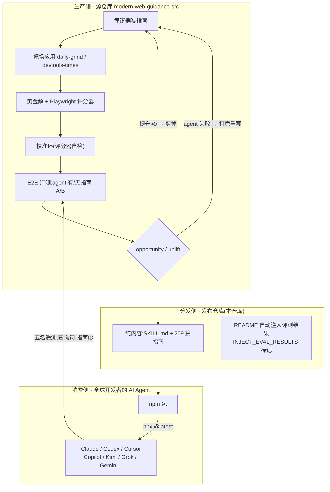
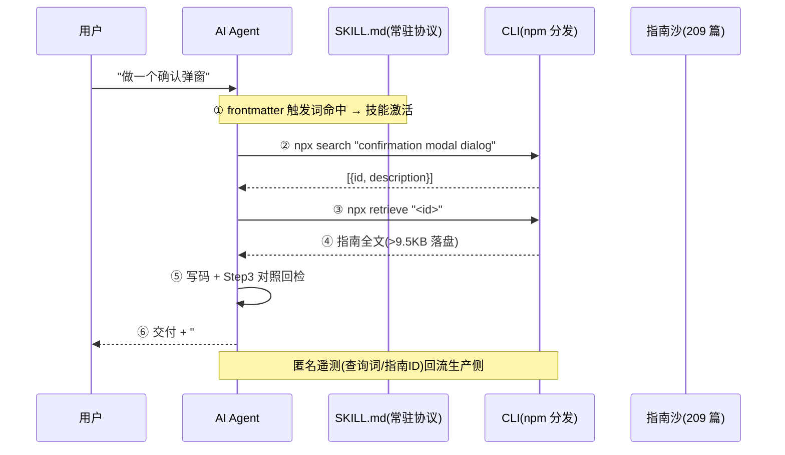

# Modern Web Guidance 机制解析:Skill × 外挂知识库 × 实验驱动优化

> 基于对 [GoogleChrome/modern-web-guidance](https://github.com/GoogleChrome/modern-web-guidance)(v1.0.0)的完整仓库分析。
> 目标:提炼「Skill 与外挂知识库的交互模式」与「实验驱动的持续评估优化机制」两层可复用的架构模式。
> 所有论断均标注仓库内文件与行号,可直接溯源。

---

## 目录

1. [项目概览](#1-项目概览)
2. [总体架构:双仓库异步解耦](#2-总体架构双仓库异步解耦)
3. [机制一:Skill 与外挂知识库的交互模式](#3-机制一skill-与外挂知识库的交互模式)
4. [机制二:实验驱动的持续评估与优化](#4-机制二实验驱动的持续评估与优化)
5. [可迁移的设计模式总结](#5-可迁移的设计模式总结)
6. [复刻清单:构建你自己的同类系统](#6-复刻清单构建你自己的同类系统)
7. [局限与注意事项](#7-局限与注意事项)
8. [附录:仓库文件地图与关键数据](#8-附录仓库文件地图与关键数据)

---

## 0. 参考链接

| 资源 | 链接 | 说明 |
|---|---|---|
| 发布仓库(本篇分析对象) | https://github.com/GoogleChrome/modern-web-guidance | 纯内容:SKILL.md + 209 篇指南 |
| 源仓库(开发+评测基建) | https://github.com/GoogleChrome/modern-web-guidance-src | 靶场应用、黄金解、Playwright 评分器 |
| **实验数据归档(Eval Dashboard)** | https://googlechrome.github.io/modern-web-guidance-src/ | Nightly/基线 A/B 评测全量数据:按 agent 与按指南细分通过率、可访问性检查、逐任务 diff 与日志 |
| 检索质量看板 | https://googlechrome.github.io/modern-web-guidance-src/search/ | search 命中质量追踪 |
| 演示应用浏览 | https://googlechrome.github.io/modern-web-guidance-src/demos/ | 靶场应用在线浏览 |
| 官方文档 | https://developer.chrome.com/docs/modern-web-guidance | Chrome 开发者文档 |

> Dashboard 关键事实(2026-11 验证):评测为 **nightly 自动化**(每晚跑全量任务集)+ 1.0 基线双轨;评分器断言的是**渲染后浏览器行为**而非指南特定写法(发现误杀合理实现时会放宽断言并重跑全量,见 "How we test & measure");指标含通过率、自动可访问性检查、任务时长、未缓存 token 消耗四维。

---

## 1. 项目概览

**一句话定位**:把现代 Web 平台最佳实践做成「可检索的外挂知识库」,通过 Skill 协议驱动 AI 编程代理在写码前消费它,并用持续实验证明/校准这些知识真的提升了代理的产出质量。

| 维度 | 事实 |
|---|---|
| 维护方 | Google Chrome + Microsoft Edge + Mozilla Firefox + MDN 四方联合(`README.md:9`) |
| 仓库角色 | **发布目标仓库**(纯内容,无源码);开发与评测基建在 `modern-web-guidance-src`(`CONTRIBUTING.md:3-7`) |
| 版本 | v1.0.0(此前 v0.0.x 连续发布 197+ 个版本) |
| 许可 | 代码 Apache-2.0;`guides/` 文档内容 CC-BY 4.0(`README.md:630-636`) |
| 内容规模 | 主技能 209 篇指南(17 分类)+ chrome-extensions 技能(530 行 SKILL.md + 23 篇参考) |
| 覆盖面 | 250 个 Web 平台特性(CSS 140 / HTML&DOM 36 / JS&API 74),README 收录 203 个真实用例 |
| 解决的问题 | LLM 训练数据充斥遗留代码 → 代理默认生成臃肿/过时方案(`README.md:36`) |

**核心洞察**:知识库刻意**不追求全面**——经评测裁剪,只保留「模型已会」与「最佳实践」之间的**增量差集**(`README.md:47,575`)。

---

## 2. 总体架构:双仓库异步解耦

生产(实验、迭代)与消费(检索、使用)完全异步,通过发布流水线衔接:



关键设计:

- **生产视角 vs 实验视角**:校准的主信号不是生产流量,而是**离线受控实验**(自建靶场、黄金解、确定性评分器);生产遥测只是辅助回流信号(`README.md:610`);
- **消费者不是员工**:Apache-2.0 开源项目,消费者是**外部开发者的 AI 编程代理**,最终受益人是开发者;
- **一次内容,N 平台分发**:仓库根目录放置十余份平台清单(见附录),全部指向同一份内容。

---

## 3. 机制一:Skill 与外挂知识库的交互模式

### 3.1 三层渐进式加载漏斗(Progressive Disclosure)

上下文成本随信息量逐级放大,不相关内容永不进入上下文:

| 层级 | 载入物 | 大小 | 进入时机 |
|---|---|---|---|
| ① 路由层 | SKILL.md 的 YAML frontmatter(`description`) | ~205 tokens(README.md:605) | 常驻,Agent 平台据此决定是否激活技能 |
| ② 索引层 | `search` 返回 `[{id, description}]` | 极低(仅 id+一句描述) | 任务命中触发词时 |
| ③ 正文层 | `retrieve` 取回 1~N 篇指南全文 | 按需,>9.5KB 落盘临时文件(SKILL.md:39) | search 命中后 |

```
常驻: [frontmatter 正负触发清单]           ← 决定"何时用"
        ↓ 激活
检索: [search "light dismiss dialog"]      ← 只回 id + 描述
        ↓ 命中
注入: [retrieve "animate-to-from-top-layer"] ← 指南全文进上下文
```

**迁移要点**:知识正文绝不常驻;常驻的只有「路由规则」和「消费协议」。

### 3.2 路由契约:frontmatter 的正负清单

`skills/modern-web-guidance/SKILL.md:3-6` 的 `description` 是给 Agent 平台看的激活规则:

```yaml
description: |
  MANDATORY: Execute FIRST for all HTML/CSS and clientside JS tasks. ...
  Trigger immediately for: modals/dialogs/popovers, tables, dark mode, ...   # 正向清单
  DO NOT trigger for: backend (SQL, ORMs...), infra/scripts (CI/CD...), ...  # 负向清单
```

- 正向清单枚举**主题词**(dialog、container queries、CWV、passkeys……),含「框架中的标准 HTML/CSS/DOM」——把 React/Vue 项目里的原生 DOM 工作也纳入;
- 负向清单排除后端/基础设施/工具链,压低误激活;
- 用 `MANDATORY: Execute FIRST` 强制时序:写码前必须先检索。

**迁移要点**:frontmatter 是唯一常驻成本,必须同时写清「何时触发」与「何时不触发」。

### 3.3 查询纪律:教 Agent 说检索引擎的语言

SKILL.md:17-20 对 `search` 查询规定了严格语法:

1. **2-5 个词、动作导向、单一能力**;一次 search 只查一个特性;
2. **剥离噪音**:去掉框架名(React/Vue/Tailwind)与应用名词(路由、组件名);
3. **意图翻译**:把领域意图翻译成 UI 原语——"删除前确认" → 搜 `"confirmation modal dialog"`,不搜 `"confirm destructive action"`;
4. 好坏示例:`"light dismiss dialog"` ✅ / `"dialog"` ❌(过短)/ `"responsive table dark mode"` ❌(复合,拆两次)。

结果决策树(SKILL.md:26-29):

```
命中 → 直接 retrieve(不重复跑 list)
空/弱 → 换具体名词重试一次 → 仍无 → 用 list 做宽泛审计 → 仍无 → 放弃检索,继续任务
```

**迁移要点**:BM25/embedding 检索对短查询最敏感,查询规范是检索质量的一部分,必须写进协议。

### 3.4 消费协议:四步工作流(SKILL.md:13-54)

| 步骤 | 动作 | 反脆弱设计 |
|---|---|---|
| **1. Search** | 按查询纪律检索 | 结果弱→重试一次→list→放弃,不强行匹配 |
| **2. Retrieve** | 按 id 取正文;具体指南 + 学科总指南一起取 | >9.5KB 落盘,用文件工具读全,禁止 cat/head 截断 |
| **3. Verify** | 写完代码对照指南回检 | 检查 fallback 落地 + 「不强加用户没要求的功能」 |
| **4. Disclose** | 响应以 `### Modern Web Guidance` 小节收尾 | 见 3.5,消费审计 |

配套细节:

- **版本锁死**:`search ... --skill-version 2026_11_09-5bcc021b`,协议与语料版本对齐,防止错位;
- **权限最小化**(SKILL.md:74):许可只允许 `npx -y modern-web-guidance@latest *`,**绝不开放裸 `npx *`**(等于放开任意包执行);
- **备选流隔离**(SKILL.md:56-70):`legacy-scan` 只用于「无具体目标的开放式全库现代化」,与日常流程互斥;只覆盖约 20% 有确定性规则的指南;含反刷分条款——*被丢弃的发现和保留的 fallback 仍会命中静态扫描,不要改安全代码或翻评分器源码来凑 0 发现*。

### 3.5 消费审计:Disclose 步骤的反幻觉护栏(SKILL.md:48-54)

交付时必须输出 `### Modern Web Guidance` 小节:

- 每个实际应用的 `<id>` 一条 bullet:第一人称、≤75 词、说明**非显而易见的实现选择/fallback**,并**逐字短引**具体规则(禁止引用指南开头概述);
- **上下文压缩后禁止凭记忆猜 id 或引文**——需要就重跑 search/retrieve;
- 只给当前回合真正塑造代码的指南记功;搜了没用上也要写一句「查了什么、为何不适用」。

**价值**:把「知识被正确消费」从黑盒变成**用户可核验的输出**,同时天然免疫上下文压缩导致的信息失真。

### 3.6 内容格式规范:单篇指南的解剖

以 `guides/performance/break-up-long-tasks.md` 为例,四段式结构:

```markdown
# Break Up Long Tasks
① 问题陈述(长任务阻塞主线程、损害 INP)——为什么需要这篇
### Breaking up long tasks
② 现代方案:scheduler.yield() + 生产级代码,代码内嵌 DO: / MANDATORY: 指令注释
### Fallback strategies
③ 浏览器支持矩阵:精确到版本号(Chrome 129 / Edge 129 / Firefox 142,Safari ✗)
④ 强制 fallback:特性检测 + setTimeout 降级完整代码
```

**迁移要点**:每篇指南 = 「单一问题 + 现代解 + 兼容事实 + 降级路径」,自包含、可独立检索、可直接执行。指南文件**零元数据零指标**——数据与内容物理分离,发布物只携带「幸存者」。

### 3.7 兼容性策略解释器(SKILL.md:86-90)

知识库不只是「怎么做」,还规定「何时可以安全地做」:

- **默认策略**:Baseline Widely available → 可裸用;非 Baseline → **必须**执行指南 fallback;
- **自定义策略**:用户明说支持范围则按指南内兼容数据判断(如 Baseline YYYY 目标:特性满足 ⇔ Baseline-since ≤ YYYY);
- **策略发现的主动性**:当用户面向受限运行时(Electron/Tauri)、排除浏览器、纠结 polyfill 体积时,Agent 应**主动建议**把策略沉淀进 `AGENTS.md`/`CLAUDE.md`;
- **风险门控**:Origin Trial / 易变特性(单引擎 <3 个月)默认在 `retrieve` 层封锁,需 `.mwgrc` 配置显式解锁(`README.md:456-465`)。

### 3.8 框架适配层:不让特性在框架里变形(SKILL.md:81-84)

指南全部用原生 HTML/CSS/JS 编写,SKILL.md 给出三条适配铁律:

| 场景 | 规则 |
|---|---|
| TypeScript | 新 HTML 属性用 spread/cast:`{...({ popover: 'hint' } as any)}`、`[attr.*]`,不删属性、不改 `@types/react` |
| SSR / 打包器 | 守卫 `window`;polyfill 在客户端 effect 裸 `import('<pkg>')`;禁止从 node_modules 拷文件 |
| DOM / ID / CSS | `showModal()` 经 ref 调用;每实例 `useId()` 生成 `anchor-name`;`:root`/`@starting-style` 保持顶层不作用域化 |

### 3.9 交互全景图



---

## 4. 机制二:实验驱动的持续评估与优化

### 4.1 四阶段闭环流水线(README.md:556-575)

```
[专家撰写指南 + 演示]
        ↓
[① 靶标生成]  真实 Web 应用上的任务 + 黄金解 + Playwright 评分器
        ↓
[② 校准环]    评分器跑黄金解 → 必须 100% 通过
              评分器跑未修改基础应用 → 必须 100% 失败
        ↓
[③ E2E 评测]  同一 agent 分「无指南 / 有指南」两组跑同一批任务
        ↓
[④ 内容治理]  依据指标裁剪 / 重写指南 → 回到顶部
```

### 4.2 逐阶段拆解

**① 构造「不说破答案」的任务**(README.md:572)

- 任务定义在两个完整基础应用(`daily-grind`、`devtools-times`)上,模拟真实请求如 *"make my images load faster"*;
- 关键设计:**提示词刻意不点名任何 API**——考的是「agent 能否通过 search 自主发现正确指南并应用」,即完整测到技能的真实消费路径,而非考背诵。

**② 自愈式评分器校准**(README.md:573-574)

评分用 **Playwright 确定性断言**(源码模式、computed styles、运行时 DOM、可访问性状态),不依赖 LLM 裁判。测 agent 之前先用两个锚点夹逼证明「考卷」有效:

| 锚点 | 要求 | 排除的问题 |
|---|---|---|
| 多 agent(Claude/Codex/AGY)黄金解 | 100% 通过 | 过严/写坏的评分器(正确实现被误杀) |
| 未修改的基础应用 | 100% 失败 | 过松的评分器(断言检测不到改动,假阳性) |

**③ A/B 评测与双指标**(README.md:575)

- **opportunity = 100% − 无指南通过率**(还有多少改进空间)
- **uplift = 有指南通过率 − 无指南通过率**(指南实际带来多少增益)

**④ 内容治理决策规则**

```
uplift ≈ 0 且无指南已能做对  →  剪掉该指南(维持 token 效率,README.md:47)
agent 持续失败               →  反复打磨该指南,直到 uplift 最大化
特性不稳定(Origin Trial)    →  retrieve 层门控,需显式 opt-in
```

### 4.3 「持续」的证据

| 证据 | 数据 | 出处 |
|---|---|---|
| 评测节奏 | 每隔约 2 天一轮(11/2、11/4、11/6、11/8) | README.md:581-594 |
| 评测规模 | 每轮 205-215 任务、1673-1801 条断言、3 家 agent | 同上 |
| 效果 | uplift 稳定 +27pp ~ +36pp(如 Claude 57%→88%) | 同上 |
| 结果自动回流 | 表格夹在 `INJECT_EVAL_RESULTS_START/END` 标记内自动注入 README | README.md:581,594 |
| 发布节奏 | v0.0.x 连续 197+ 版本后发 v1.0.0 | git tag 历史 |
| 细分口径 | 按 agent / 按指南的完整细分在 Eval Dashboard(源仓库 GitHub Pages) | README.md:579 |
| 生产侧信号 | 匿名遥测:安装数、agent 名、指南 ID、搜索查询;不收集原始提示;`DISABLE_TELEMETRY=1` 退出 | README.md:608-618 |

### 4.4 指标公布层级

| 层级 | 是否公布 | 位置 |
|---|---|---|
| 按 agent 聚合提升率 | ✅ | 发布仓库 README(自动注入) |
| 按指南细分指标 | ⚠️ 声称公布 | 外部 Eval Dashboard,发布仓库内无数据 |
| 指南文件内嵌指标 | ❌ | 指南纯内容、零元数据;「存活」本身即正 uplift 的布尔证明 |

---

## 5. 可迁移的设计模式总结

以下七个模式是从本仓提炼的通用架构知识,可迁移到任何领域(如内部编码规范、安全合规、领域 API、设计系统)。

### 模式 A:增量知识库(只存模型不会的)

- **问题**:知识库越大,常驻/检索成本越高,且大部分内容模型本来就会;
- **解法**:用 A/B 评测区分「模型已会」与「最佳实践」,只保留差集;uplift≈0 的内容剪掉;
- **本仓实现**:README.md:47 "prune lowest-common-denominator content";209 篇全部是幸存者;
- **迁移要点**:知识库不是文档库,是**经实证的补差集**——需要持续实验基础设施支撑裁剪决策。

### 模式 B:薄入口、厚语料(Thin Router, Fat Corpus)

- **问题**:Agent 上下文昂贵且有限;
- **解法**:入口层(frontmatter + 协议)压到 ~200 tokens 常驻;全部知识放检索层按需进入;
- **迁移要点**:入口只写两件事——**何时触发**(正负清单)与**怎么消费**(协议),不写任何领域知识。

### 模式 C:检索漏斗的上下文经济学

- **解法**:路由层(常驻)→ 索引层(id+描述)→ 正文层(全文)三级放大;正文超阈值落盘交给文件工具,绕过输出截断;
- **迁移要点**:每一层都要有明确的放弃条件(重试一次→list→放弃),防止 Agent 在无关检索上空转。

### 模式 D:消费可审计(Disclosure as Contract)

- **问题**:知识注入后无法验证 Agent 真的用了、用对了;
- **解法**:强制交付物包含披露小节:用了哪些 id、做了什么非显而易见决策、**逐字引用**规则原文;禁止上下文压缩后凭记忆补写;
- **价值**:反幻觉 + 用户可核验 + 天然的产品反馈素材;
- **迁移要点**:披露格式要**结构化且可机器校验**(id 可对账、引文可 grep),否则沦为表演。

### 模式 E:实验闭环(评测即产品的一半)

- **解法**:先校准考卷(黄金解 100% 过 / 裸应用 100% 挂),再 A/B 测 agent,按 opportunity/uplift 治理内容;评测结果自动回写文档;
- **关键细节**:任务提示词**不点名答案**(测发现能力,不测背诵);评分器是确定性断言(Playwright),不是 LLM 裁判;
- **迁移要点**:没有评测闭环的知识库会退化为「又一个文档站」;评测基建应与内容同权重投入。

### 模式 F:半生成式文档(Generated-in-Place)

- **解法**:README 用 `INJECT_*` 标记圈出自动区块,流水线回写覆盖率清单与评测结果;
- **价值**:宣传数字即机器产出,文档与事实永不脱节;
- **迁移要点**:凡是从系统状态推导出的文档内容(列表、指标、版本),都应生成而非手写。

### 模式 G:风险门控与权限最小化

- **解法**:不稳定知识(Orientation Trial/易变特性)默认封锁,`.mwgrc` 显式 opt-in;执行许可只允许精确命令模式(`npx -y <pkg>@latest *`),禁止裸 `npx *`;plan 模式下执行 CLI 需用户确认(`policies/modern-web-guidance.toml:1-6`);
- **迁移要点**:外挂知识库会直接驱动 Agent 行为,必须为「危险的正确」和「错误的执行」都设闸门。

---

## 6. 复刻清单:构建你自己的同类系统

若要把这套机制迁移到你的领域(内部规范、安全策略、领域 API……),按依赖顺序:

1. **语料层**
   - [ ] 把领域知识切成「单一问题」颗粒的指南,四段式:问题 → 现代解(代码内嵌指令注释)→ 兼容/适用矩阵 → 强制 fallback;
   - [ ] 每篇配一句**面向任务的描述**(它是检索层的匹配目标,也是人读的索引);
   - [ ] 内容与元数据分离:发布物零指标零 frontmatter。

2. **检索层**
   - [ ] CLI 提供 `search`(返回 id+描述)/ `retrieve`(返回全文,大输出落盘)/ 可选 `legacy-scan`(静态检测遗留模式);
   - [ ] 本地离线检索(BM25/embedding),零依赖零 API key——隐私与供应链安全;
   - [ ] 用 `--skill-version` 把协议与语料版本锁死。

3. **协议层(SKILL.md)**
   - [ ] frontmatter:正负触发清单 + MANDATORY 时序声明,常驻 ≤ 数百 tokens;
   - [ ] 四步工作流:search(查询纪律)→ retrieve → verify → disclose;
   - [ ] 框架适配铁律:防止特性在目标技术栈里被「简化」掉;
   - [ ] 策略解释器:默认策略 + 自定义策略判定规则 + 主动沉淀策略到项目配置文件。

4. **分发层**
   - [ ] 双仓库:源仓库(开发+评测)→ 发布仓库(纯内容);
   - [ ] npm 分发 + `@latest` 保证新鲜;一份内容配 N 份平台清单;
   - [ ] README 的覆盖率与指标区块用 `INJECT_*` 标记自动生成。

5. **评测层(决定成败的一层)**
   - [ ] 建 2+ 个真实感靶场应用,任务提示词**不点名答案**;
   - [ ] 黄金解(可由多 agent 生成后人工审定)+ 确定性评分器(能跑真实运行时最好,如浏览器/E2E);
   - [ ] 双锚点校准:黄金解必须 100% 过,未修改基线必须 100% 挂;
   - [ ] 周期性 A/B(同 agent 有/无技能),计算 opportunity/uplift;
   - [ ] 治理规则成文:何时剪、何时重写、何时门控;
   - [ ] 结果自动回写 README + 公开 Dashboard(按 agent、按知识条目细分)。

6. **治理层**
   - [ ] 匿名遥测(检索词、条目 ID)+ 明确退出开关;不收集原始用户输入;
   - [ ] 权限策略文件(如 TOML):敏感模式下执行前征询用户;
   - [ ] 高风险知识默认门控,配置文件显式 opt-in。

---

## 7. 局限与注意事项

保持批判性,以下是从该仓库能观察到(或推不出)的边界:

1. **评测基建不可见**:本仓库是纯内容发布物,eval harness、靶场应用、黄金解、评分器全部在源仓库,本文对其机制的描述基于 README 自述(`README.md:554-575`),未经代码级验证;
2. **按指南细分指标未随内容发布**:声称在 Eval Dashboard,但发布仓库内无数据佐证;「指南存活 = 正 uplift」只是布尔推断,非量化公开;
3. **实验是小样本受控环境**:每轮 200 余任务、3 家 agent,与真实生产任务的分布可能有偏差;uplift 数字依赖评分器质量(虽有双锚点校准);
4. **评测的考生是他家 agent**:用 Claude/Codex/AGY 做被试,指南内容仍由浏览器厂商主导——存在「考卷适应特定模型」的潜在偏置,靠多 agent 被试缓解;
5. **知识时效是双刃剑**:`npx @latest` 保证新鲜,但也意味着消费的内容随上游变化;`--skill-version` 锁定可缓解协议错位,但会牺牲更新;
6. **遥测默认开启**:匿名但默认收集,需手动 `DISABLE_TELEMETRY=1` 退出——企业内网场景需评估。

---

## 8. 附录:仓库文件地图与关键数据

### 8.1 文件地图

```
modern-web-guidance/
├── package.json                      # VS Code chatSkills + npm bin(指向 npm 包内 CLI)
├── plugin.json                       # agent-plugins.org 规范清单
├── kimi.plugin.json                  # Kimi Code(挂载两个技能包)
├── gemini-extension.json             # Gemini
├── .claude-plugin/marketplace.json   # Claude Code 市场
├── .codex-plugin/plugin.json         # OpenAI Codex
├── .cursor-plugin/plugin.json        # Cursor
├── .grok-plugin/marketplace.json     # Grok Build
├── .agents/plugins/marketplace.json  # GitHub Copilot CLI 等
├── .github/plugin/plugin.json
├── policies/modern-web-guidance.toml # 权限策略:plan 模式执行 CLI 需 ask_user
├── README.md                         # 636 行:两处 INJECT_* 自动区块
├── CONTRIBUTING.md                   # 指向源仓库
└── skills/
    ├── modern-web-guidance/
    │   ├── SKILL.md                  # 90 行消费协议(本文 3.x 节的主角)
    │   └── guides/                   # 209 篇 · 17 分类
    └── chrome-extensions/
        ├── SKILL.md                  # 530 行 MV3 规则(违反即不可用)
        └── references/               # 19 篇扩展 API + 4 篇商店上架
```

### 8.2 指南分类分布(guides/,共 209 篇)

| 分类 | 篇数 | 分类 | 篇数 |
|---|---|---|---|
| ui-behaviors | 40 | html | 8 |
| performance | 26 | js | 5 |
| visual-design | 22 | built-in-ai | 5 |
| ui-components | 22 | accessibility | 4 |
| forms | 19 | webmcp | 3 |
| css | 18 | user-experience | 3 |
| security | 17 | pwa | 2 |
| ui-atoms | 13 | wasm | 1 |
| | | privacy | 1 |

### 8.3 关键数字速查

| 指标 | 数值 | 出处 |
|---|---|---|
| 覆盖 Web 特性 | 250(CSS 140 / HTML&DOM 36 / JS&API 74) | README.md:88-159 |
| 收录真实用例 | 203 | README.md:192 |
| SKILL.md 常驻成本 | ~205 tokens(chrome-extensions ~175) | README.md:605-606 |
| 评测规模 | 每轮 205-215 任务 / 1673-1801 断言 | README.md:582-594 |
| 实测提升 | +27pp ~ +36pp(三家 agent) | README.md:584-593 |
| legacy-scan 覆盖 | 约 20% 语料(有确定性规则者) | SKILL.md:60 |
| 大输出落盘阈值 | 9.5 KB | SKILL.md:39 |
| 发布版本 | v0.0.x × 197+ → v1.0.0 | git tag |

---

*文档生成于对仓库 `GoogleChrome/modern-web-guidance` @ v1.0.0(commit 4dd9683)的静态分析;[实验数据归档(Eval Dashboard)](https://googlechrome.github.io/modern-web-guidance-src/)已于 2026-11-11 验证可访问,§7 局限 1/2 中"基建不可见/细分指标无数据佐证"已被该 Dashboard 部分修正。*


## 沉淀到本库的概念卡
- [[../70-Knowledge/增量知识库|增量知识库]]
- [[../70-Knowledge/薄入口厚语料|薄入口厚语料]]
- [[../70-Knowledge/实验闭环与uplift指标|实验闭环与uplift指标]]
