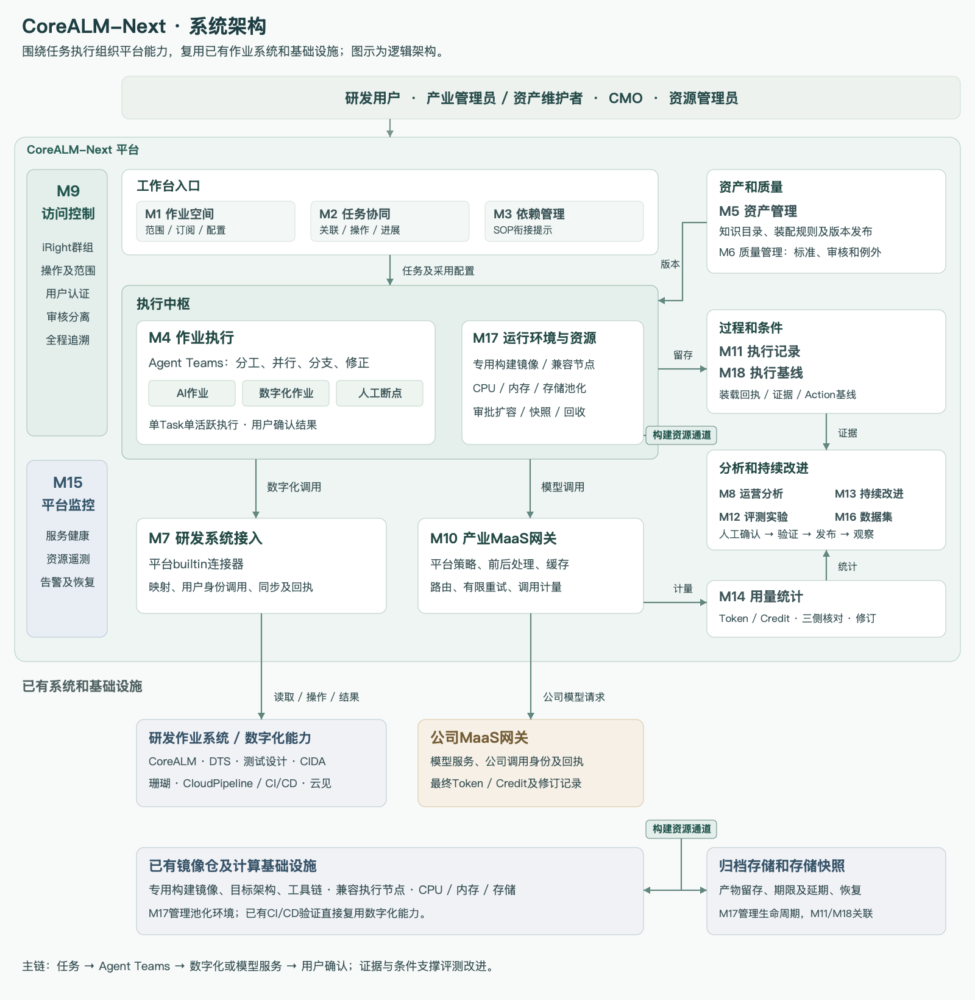
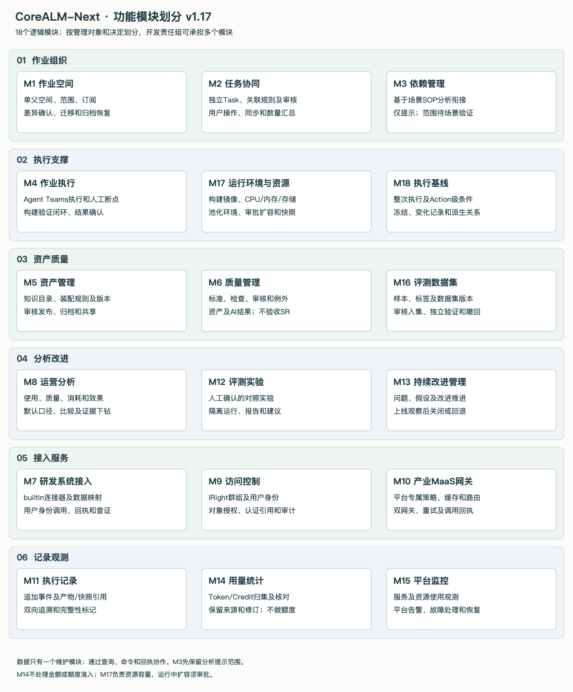
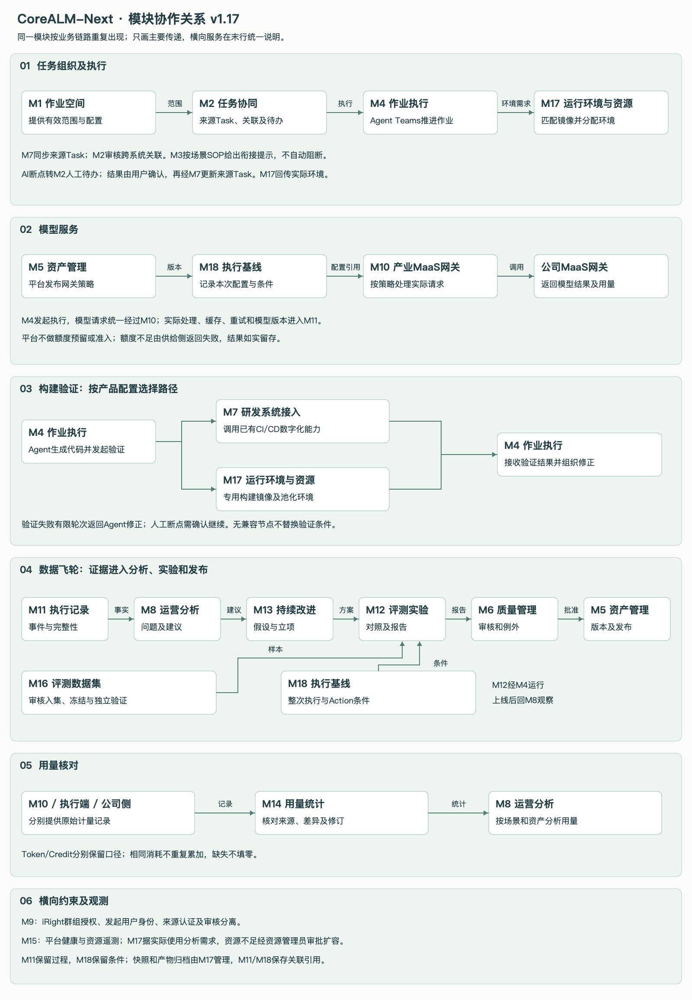
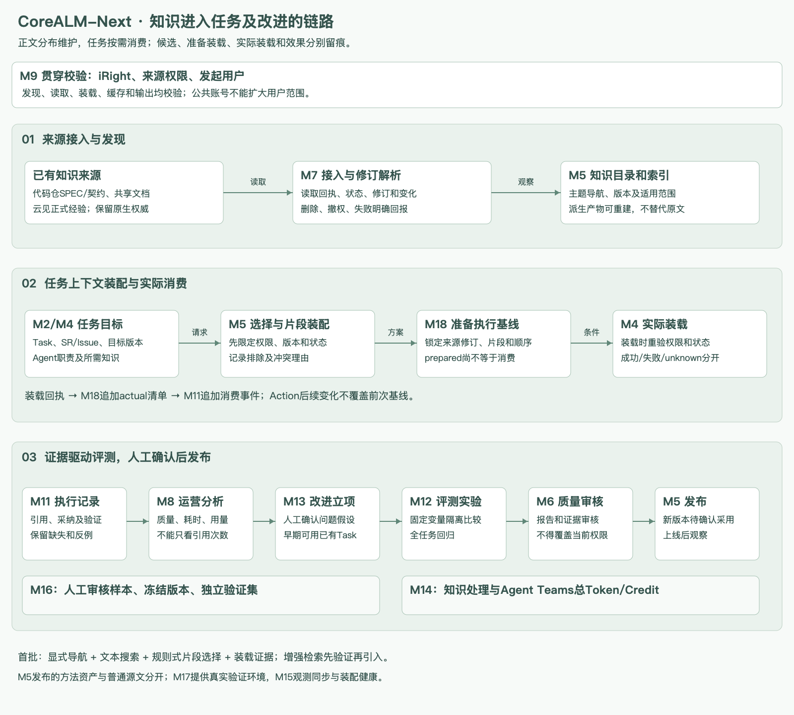

# CoreALM-Next 系统设计方案 v1.17

2026-11-11 · 平台功能设计基线

## 01 产品定位

CoreALM-Next是产业装备部面向研发场景的作业平台。它连接现有作业系统、Agent Teams、公司MaaS和平台池化资源，提供任务协同、资产复用、执行记录、用量分析及持续改进能力。

本设计只讨论平台建设及其功能边界，不按产业用户的团队结构拆分模块。18个逻辑模块作为后续开发分工的基础，一个开发责任组可以承担多个模块；产业用户、CMO和资源管理员表示平台能力的使用或管理角色，不等同于开发责任组。

### 建设范围

- 作业空间组织跨产品、跨服务的工作范围，产品、服务和版本引用已有系统。
- 独立Task在所属系统管理，工作台按SR编号等属性关联并汇总进展，不另建SR交付验收。
- Agent Teams承担主要AI执行，平台接续数字化作业和人工断点，提供过程可视化及结果确认。
- 平台提供builtin作业系统接入、双网关适配、构建验证、池化资源、产物归档和存储快照。
- 使用后分析基于执行事实和Action基线，经人工确认、评测、审核发布和上线观察持续改进。

### 统计和控制的界限

公司装备部提供MaaS及公司计量网关，产业侧提供调用前后处理、缓存和适配。双方共同承担费用是业务背景；本版平台不进入金额、价格、费用分摊及支付，只统计和核对Token/Credit，不管理预算、额度预留或用量准入。

模型请求正常下发，额度不足由供给侧返回失败，平台记录并展示；网络安全、运行保护性限流和用户授权仍须执行。计算资源容量属于M17管理范围，运行中扩容须资源管理员审批，不能与Token/Credit统计混为一谈。

### 事实来源

来源系统持有产品、服务、版本、SR、Issue和Task等业务事实；已有镜像仓持有构建镜像；iRight持有群组及权限范围；公司侧持有其计量记录。平台维护关联、配置、执行、分析和审核记录，所有对外动作保留来源回执。静态原型、设计和源码分析均不代表外部系统已完成接入。

## 02 模块架构

模块按管理对象、维护状态和作出决定划分，不按页面、部署服务或用户团队划分。同一事实只有一个写入模块，其他模块通过接口和回执使用；关联紧密不等于应共享可变状态。

中间是执行主链，右侧是资产、证据和改进闭环，左侧为授权和监控。两处“构建资源通道”标签表示M17与底层构建资源的同一连接。

### 模块清单

| 模块 | 名称 | 管理对象 | 主要能力 |
| --- | --- | --- | --- |
| M1 | 作业空间 | 空间、来源范围、订阅及配置修订 | 创建空间；维护单父级关系；配置继承；预览和确认差异；迁移、归档及申请恢复 |
| M2 | 任务协同 | 来源Task索引、关联规则、关联结果、审核记录、待办及进展汇总 | 任务登记；跨系统关联；人工修正和审核；以用户身份操作任务；同步状态；汇总SR进展 |
| M3 | 依赖管理（待场景验证） | SOP衔接分析、缺项和流程偏差 | 依据确认的场景SOP及实际Task，识别衔接关系、缺少输入或步骤，给出分析提示 |
| M4 | 作业执行 | 执行尝试、受控Action、AI断点、人工介入及结果确认衔接 | 以Agent Teams推进任务；接续数字化和人工步骤；有限重试；构建验证闭环；跟踪执行结果 |
| M5 | 资产管理 | 知识目录、上下文选择方案、装配策略、资产版本及派生组合 | 知识登记和发现；片段装配规则；版本、审核发布、派生和归档 |
| M6 | 质量管理 | 版本化质量标准、检查结果、审核、整改及例外批准 | 按场景和资产类型定义标准；自动检查；人工审核；必选及提示项；整改复查；例外放行 |
| M7 | 研发系统接入 | builtin连接器、知识源观察、字段映射、同步和读取/操作回执 | 接入作业系统、代码仓、文档平台和云见；用户身份同步、修订解析和查证 |
| M8 | 运营分析 | 指标口径、分析版本、比较范围、异常线索及改进效果 | 使用、质量效率、消耗用量和改进效果分析；多维筛选、比较及下钻 |
| M9 | 访问控制 | iRight群组映射、授权校验、身份绑定、认证引用及审计 | 接入CMO统一权限范围；校验操作及对象范围；审核分离；用户身份全程追溯 |
| M10 | 产业MaaS网关 | 网关请求、处理和缓存结果、上游尝试、模型回执及策略绑定 | 前后处理、缓存、模型路由、限流、请求级重试和切换、公司调用映射 |
| M11 | 执行记录 | 原始事件、知识消费、步骤观察、证据引用及完整性 | 追加保存实际过程和消费回执；双向追溯；缺失和截断标记 |
| M12 | 评测实验 | 实验方案、确认记录、运行批次及评测报告 | 控制变量比较质量、耗时和消耗；固定样本和标准；限定投入及停止条件 |
| M13 | 持续改进管理 | 改进候选、立项、假设、推进记录及观察结论 | 组织问题发现、评测验证、审核发布和上线观察；支持回退或继续改进 |
| M14 | 用量统计 | 多来源Token/Credit明细、计量口径、核对差异及修订 | 归集执行端、产业网关和公司侧记录；去重统计；差异核对；迟到和修订追溯 |
| M15 | 平台监控 | 平台遥测、健康信号、告警及故障记录 | 观测服务、接口、延迟、积压及资源；配置告警；确认处理和恢复 |
| M16 | 评测数据集 | 候选样本、标签、审核、冻结版本、用途划分及撤回 | 从记录、案例或外部导入样本；脱敏标注；人工入集；独立验证集；撤回影响追踪 |
| M17 | 运行环境与资源 | 运行端、能力配置、构建镜像引用、资源池、环境、分配、扩容、快照及归档保留 | 平台配置运行能力；需求分析和兼容匹配；池化环境；审批扩容；回收；快照恢复 |
| M18 | 执行基线 | ContextManifest、整次执行/Action基线、准备及实际装载确认 | 冻结知识和执行条件；记录实际装载和局部变化；可还原性说明 |

### 各模块职责

#### M1 作业空间

组织空间内的范围和配置，变化先看差异再采用。

**主要流程：**来源范围及父配置 → 差异预览 → 确认发布 → 空间配置生效

| 接收什么 | 交付什么 |
| --- | --- |
| 来源产品/服务/版本、父配置、订阅选择 | 有效空间配置、范围修订、归档及恢复记录 |

**主要协作：**M2、M5、M7、M9。

**关键约束：**父配置更新不自动覆盖子空间；迁移和恢复保留空间身份。

##### 已确认规则和完整边界

**管理边界：**不维护来源产品事实、任务状态或资产内容。空间关系不自动授予权限。

产品、服务、版本从已有系统关联。一个空间可关联多个来源对象，同一来源对象可用于多个空间，支持跨产品、跨服务作业。空间关系可由CMO管理，平台提供能力，不按用户团队划分功能模块。

空间采用单父级树形结构。支持继承、覆盖和忽略配置；父配置变化只提示差异，子空间管理者确认后采用，可逐项处理并保留本地覆盖。跨空间资产复用通过订阅完成。

允许迁移到其他父空间，迁移前预览差异；保留空间身份、自有配置、任务关联和历史，禁止形成环。迁移不自动改变资产归属、访问权限或在途执行。

只设“使用中”和“已归档”，不设置停用。存在使用中子空间时，须先迁出或归档；存在排队、运行、暂停、等待人工或取消未确认等未终结执行时，阻止归档。普通未完成且无活跃执行的任务不阻止归档。

归档前提示未完成任务清单，归档后保留关联和历史，禁止从该空间发起新执行及发布配置。恢复须特殊申请并审批，保留原身份；归档期间父配置变化仍按差异确认。

##### 知识工程职责

空间可选择知识来源和订阅范围，父配置更新仍以差异确认采用；知识订阅不授予来源读取或装载权限。

#### M2 任务协同

让独立Task保持可追溯，并按业务属性组织协同。

**主要流程：**来源Task → 规则及人工修正 → 审核关联 → 同步和进展汇总

| 接收什么 | 交付什么 |
| --- | --- |
| 来源Task、SR/Issue属性、关联建议及用户操作 | 已审核关联、待办、来源回执、数量进展 |

**主要协作：**M1、M3、M4、M7、M9。

**关键约束：**规则和单条修正都须审核；SR只汇总进展，不增加验收。

##### 已确认规则和完整边界

**管理边界：**各系统Task保持独立。聚合不合并生命周期，不判定SR交付或另建验收。

包含任务登记、任务关联、协同处理三个子功能。工作台允许创建任务，但必须同步至目标作业系统并取得原生身份；不形成脱离来源系统的独立任务。

关联沿用已有默认规则，按SR编号等业务属性聚合不同系统的独立Task，规则按场景配置。允许人工配置并分析关联性，提供匹配样例、覆盖和冲突建议；候选建议不自动生效。

关联规则新增或修改、人工补充或排除单条关联，均需人工审核。发布前预览影响，由审核者确认生效及历史重算范围，保留版本。已批准的人工修正优先于规则计算，后续重算不覆盖。

SR作为最小可验证交付单元，一个交付Task只归属一个SR。问题处理通过Issue管理；例行巡检和维护也须在已有系统有任务跟踪，不强制所有Task挂SR。多SR匹配标记冲突；共享产物通过引用或依赖使用，不增加Task的SR归属。

允许在工作台指派、交接、关闭任务，以发起用户认证调用来源系统，由来源系统最终校验并确认。原系统不支持时提供跳转，支持事件同步、轮询补充及手动刷新；展示原生状态、最近同步时间和异常。

统一进展为未开始、进行中、已完成、已取消；保留原生状态，未知状态待映射，阻塞和同步健康独立标记。SR按独立Task数量汇总，不设权重，不用Task全部关闭推断SR已交付。SR正式状态沿用来源系统。

##### 知识工程职责

增加TaskKnowledgeBinding：将来源Task、SR/Issue、批准变更和知识修订关联，区分baseline/target/reference。仓内tasks.md只作实施清单或投影，不形成第二套正式任务状态。

#### M3 依赖管理（待场景验证）

以少数场景SOP为依据，发现任务衔接中的缺项。

**主要流程：**已确认SOP → 步骤与Task映射 → 衔接分析 → 缺项及偏差提示

| 接收什么 | 交付什么 |
| --- | --- |
| SOP采用版本、裁剪结果、Task输入输出 | 有依据的衔接提示、缺项及偏差 |

**主要协作：**M2、M5、M7。

**关键约束：**先做分析提示；完整边界待典型SOP验证。

##### 已确认规则和完整边界

**管理边界：**不建设通用依赖调度引擎，不自动阻断、补建任务或推进业务验收。

IPD提供总体研发阶段及约束，首期梳理少数跨作业领域、跨作业系统的场景SOP。各系统按同一SOP拆分任务，标记步骤，平台才有可靠关联依据。

SOP模板归M5，具体SR或Issue采用的版本、裁剪结果及步骤Task映射归M2。允许产业用户裁剪可选步骤，必选步骤不可删除，确认后使用。

执行开始后可说明原因、重新确认并修订流程，保留修订及既有任务历史。Agent Teams内部步骤不要求与场景SOP一一对应。

M3仅依据确认流程分析衔接、缺项和偏差，不把同属一个SR视为执行依赖。本模块具体规则及完整范围待典型SOP验证后收敛。

#### M4 作业执行

以Agent Teams推进任务，接续验证和人工断点。

**主要流程：**启动Agent Teams → 执行及构建验证 → 按需人工接续 → 用户确认结果

| 接收什么 | 交付什么 |
| --- | --- |
| Task、发起用户、采用配置、基线、环境能力 | 执行状态、结果和产物、人工待办、Task更新请求 |

**主要协作：**M2、M7、M10、M11、M17、M18。

**关键约束：**默认一个Task只有一个活跃执行；失败修正及重试都有上限。

##### 已确认规则和完整边界

**管理边界：**不维护来源Task最终状态、资源容量、基线快照、原始证据或质量标准。

统一呈现AI、数字化作业和人工步骤，一个Task可包含多个步骤。Agent Teams负责内部协作、并行和分支；平台接续AI断点，展示交付过程，不要求再配置一套等价的内部编排流程。

AI无法继续时保留现场，通过M2转人工待办，由用户确认继续。允许主动补充信息、纠正方向或暂停调整，分别展示接收与生效结果；不支持原地恢复时明确发起关联的新尝试。

仅对明确可重试的临时故障有限重试，保留每次结果及消耗。业务判断失败、重复失败或副作用不明时转人工。M10只恢复单次模型请求，M4负责作业级恢复，避免重试无界叠加。

同一Task默认只允许一个活跃执行，排队、运行、暂停、等待人工均占用；Agent Teams内部并行不受影响。执行结束后待用户确认；接受结果后由M2/M7以用户身份更新来源Task，以来源回执确认完成。

不接受结果时用户补充修改要求，发起下一次执行，保留前次记录、产物和消耗。支持代码生成→构建验证→失败反馈→Agent修正→再次验证，限定轮次，超限或需判断时转人工。

##### 知识工程职责

按Task、Action、阶段和Agent职责请求M5选择方案，重验权限后实际装载并报告回执。准备、成功装载、失败及unknown分开；知识冲突形成既有人工断点。Teams成员共享目标和来源索引，按职责最小装载，交接保留证据，不共享超出用户权限的正文。

#### M5 资产管理

把可复用方法维护成有证据、有版本的正式资产。

**主要流程：**草稿及派生 → 试用或评测 → 独立审核 → 不可变发布

| 接收什么 | 交付什么 |
| --- | --- |
| 资产内容、上游版本、评测证据及共享配置 | 正式版本、组合锁定、派生差异、归档恢复记录 |

**主要协作：**M1、M6、M12、M17、M18。

**关键约束：**支持单版本和整体归档；网关策略仅由平台维护。

##### 已确认规则和完整边界

**管理边界：**不保存单次执行基线，不运行评测，不批准自身质量；空间采用选择归M1。

统一管理Agent配置、Skill、Workflow、场景SOP、上下文模板、可复用策略及构建验证配置，按类型定义内容结构。资产由产业用户维护；网关策略是平台专属资产，不向产业管理员开放修改。

草稿与已发布版本分开，发布版本不可修改。草稿可在授权范围试用，正式发布必须提交对应版本的试用或评测证据，由不同于提交人的审核者批准。质量标准和结论归M6。

支持派生定制，保留上游版本及差异。上游更新提示差异，维护者决定是否合入；合入形成新草稿并重新审核，不自动覆盖定制。支持资产包锁定组成版本并独立评测、审核和发布。

统一使用“归档”，支持单版本和整体归档。归档后禁止新订阅、派生及新执行采用；保留历史，在途执行默认继续原版本。组成版本归档时资产包禁止新采用并提示修订，不自动归档整个包。

归档恢复须特殊申请审批。整体恢复不自动恢复此前单独归档的版本；资产包重新校验组成状态。支持仅本人、指定空间和产业内共享范围，由M9校验；空间管理权不自动包含资产维护权。

##### 知识工程职责

知识工程子能力包括KnowledgeEntry目录、来源修订引用、可重建索引、ContextSelectionPlan及装配策略版本。普通知识沿用源正文和原生修订，正式Skill/SOP/策略才走AssetRelease。M5选择候选和必要片段，不把计划视为实际消费，也不持有执行基线。

#### M6 质量管理

按场景提供质量依据，区分检查事实和审核决定。

**主要流程：**选定标准版本 → 自动检查 → 人工审核 → 通过、整改或例外

| 接收什么 | 交付什么 |
| --- | --- |
| 质量标准、资产或作业结果、检查及评测证据 | 检查结果、审核结论、整改记录、例外批准 |

**主要协作：**M4、M5、M9、M12。

**关键约束：**资产、标准发布和例外审核须与提交人分离；SR验收仍在原系统。

##### 已确认规则和完整边界

**管理边界：**聚焦资产和AI作业结果，不承担SR正式验收，不替代用户完成Task确认。

采用自动检查和人工审核，模型评价仅作辅助。分别保存客观检查结果、模型建议和人工结论，不设统一质量分数。

检查项分必须满足和提示改进；必选项未通过或缺证据时阻止发布或作业结果确认。允许申请例外，记录理由、风险、范围、有效期及审批，保留原未通过结果，不改写为通过。

标准新增修改需人工审核发布，不可直接修改已发布版本。新标准默认用于后续检查；历史复查单独发起并保留新旧结果。支持退回整改、重检和再审，保留每轮问题及证据。

资产发布、标准发布及例外审批人与提交人必须不同，M9执行约束。普通作业结果允许用户自行确认，但仍需满足必选检查或具有有效例外。

##### 知识工程职责

知识质量检查覆盖版本适用、来源冲突、必要约束、提示注入和验证证据；原始规格、代码实现及部署状态分别判断。知识纠错经源评审或既有资产发布，例外不能覆盖当前来源授权。

#### M7 研发系统接入

把已有作业系统接成平台builtin能力。

**主要流程：**接收请求 → 用户身份调用 → 来源处理 → 同步及回执查证

| 接收什么 | 交付什么 |
| --- | --- |
| 来源系统接口、用户认证引用、映射配置及操作请求 | 可用builtin能力、来源数据、同步状态及操作回执 |

**主要协作：**M2、M4、M9、M17。

**关键约束：**每个系统接入建设单独列任务；每次接口调用不另造独立Task。

##### 已确认规则和完整边界

**管理边界：**不维护跨系统Task关联规则，不负责运行状态或镜像、资源调度，不扩大来源权限。

作业系统对接作为平台builtin能力提供，不要求产业用户自行开发。平台登记系统类型和能力，产业管理员启用配置，空间选择订阅范围。当前每个系统按统一入口接入，不增加多部署入口管理。

平台或CMO提供字段及状态映射推荐配置，产业管理员按实际调整并预览确认。默认配置更新提示差异，不覆盖定制。M7解释单系统字段，M2负责跨系统关联规则及审核。

以用户身份调用，认证托管及授权归M9，来源最终确认。同步失败保留最近成功数据、显示时效及异常，支持自动重试和人工补同步；写操作结果未知先查证，不盲目重提。

复用已有CI/CD、测试、镜像仓及数字化原子能力；M7承接协议，M4跟踪执行，M17消费构建镜像信息。云见持有正式经验，平台通过授权引用及发布回执接入。

“接入一个作业系统”的建设本身须作为开发任务登记，逐系统明确接入范围、权限、字段映射、同步、操作回执、联调及验收。它是平台建设任务，不将每次接口调用额外创建为独立业务Task。

##### 知识工程职责

增加代码仓、既有文档平台和云见的知识读取及变化接入，返回稳定来源身份、精确修订、原生状态及读取回执。更新、删除、撤权和同步中断须传播到M5及相关缓存；不得把统一索引变成新的正文权威。

#### M8 运营分析

让使用、质量、消耗和改进效果能比较、能下钻。

**主要流程：**读取业务事实 → 按口径计算 → 比较及证据下钻 → 提出改进建议

| 接收什么 | 交付什么 |
| --- | --- |
| 执行、质量、资产采用、M14统计及指标配置 | 版本化分析、异常线索、比较结果及改进建议 |

**主要协作：**M6、M11、M13、M14。

**关键约束：**缺失和未归因单列；建议经人工确认后进入改进流程。

##### 已确认规则和完整边界

**管理边界：**读取事实及M14统计，不另建计量账，不修改质量、执行状态或自动优化策略。

覆盖任务和执行量、资产使用；质量检查、返工、人工介入、失败重试、耗时；Token/Credit、缓存和模型分布；优化前后质量、耗时及消耗。

按产品、服务、空间、SR/Issue、场景、资产版本和模型筛选、比较，下钻Task、执行及证据。缺失和未归因单列，引用M14用量口径。

平台或CMO提供默认指标，产业管理员可配置；保留口径版本，展示计算、范围、窗口及截至时间。分析只给异常、原因和改进建议，人工确认后进入M13，不自动更改在用资产和策略。

##### 知识工程职责

增加知识检索/装载覆盖、错误版本和冲突归因、人工补充、任务质量及全团队耗时/用量比较。关联引用次数不直接代表收益；建议由人工确认进入改进，不自动改知识。

#### M9 访问控制

沿用iRight权限范围，把每次操作追溯到发起用户。

**主要流程：**识别发起用户 → 读取授权范围 → 校验操作及对象 → 认证使用和审计

| 接收什么 | 交付什么 |
| --- | --- |
| iRight群组、来源身份、目标对象及操作 | 授权结果、受控认证引用、审核分离检查及审计 |

**主要协作：**M2、M4、M7、M10。

**关键约束：**公共账号也要保留真实用户；自动步骤、重试和续跑重验权限。

##### 已确认规则和完整边界

**管理边界：**不自建群组成员体系，不扩大来源系统权限，不管理用量额度准入。

CMO通过iRight群组统一维护权限范围并使用已有看护机制。平台接入群组及授权映射，按操作类型和对象范围校验，不由产业管理员另建平行人员授权体系。

所有执行关联发起用户；即使底层以公共账号触发，也须保留实际用户，不得利用公共账号扩大其权限。后续自动步骤、重试、续跑沿用原发起人并重新校验当前权限。

权限不足或认证失效时停止后续未授权操作，保留现场和追溯链。来源系统最终校验其权限；认证信息安全托管，证据与基线只保留受控引用，不记录明文。

##### 知识工程职责

知识发现、读取、装载、缓存、交接和输出均校验发起用户及来源权限；公共账号和索引维护作业保留用户主体。经批准的作业指令、知识参考及操作授权分开，知识正文不能扩大权限。

#### M10 产业MaaS网关

按平台策略适配公司MaaS，留下真实调用依据。

**主要流程：**受理模型请求 → 处理及缓存判定 → 未命中调用MaaS → 返回结果和回执

| 接收什么 | 交付什么 |
| --- | --- |
| 用户及执行标识、模型请求、平台发布策略 | 处理结果、缓存记录、上游尝试及用量回执 |

**主要协作：**M4、M5、M9、M11、M14。

**关键约束：**缓存命中直接返回并留痕；平台不做Token/Credit额度准入。

##### 已确认规则和完整边界

**管理边界：**不调度Task，不做额度预留和准入，不维护用量统计或自动改变质量要求。

纳管模型调用必须经过产业网关再访问公司MaaS网关，不开放绕过路径。所有网关策略由平台配置、审核及发布，不向产业管理员开放修改。M5保存策略版本，M10执行并记录实际采用版本。

缓存命中、重试、模型切换分别记录原因、结果和实际消耗，关联原请求及公司回执。按平台设定的次数、场景和消耗上限恢复请求，无法继续明确失败，不静默降低质量要求。

跨用户或空间缓存复用须检查权限和内容适用性。平台不替用户判断额度是否够用，正常下发请求，额度不足由供给侧返回失败；M10如实记录。运行保护性限流不等同预算或Credit额度准入。

##### 知识工程职责

知识装配、检索或摘要如需模型调用，同样经过产业网关并产生回执；M10不承接Task上下文选择和跨来源知识治理，不增加Token/Credit额度准入。

#### M11 执行记录

保留实际发生的过程，让证据可追溯、缺失可识别。

**主要流程：**采集生产者事件 → 追加保存 → 标记完整性 → 双向追溯

| 接收什么 | 交付什么 |
| --- | --- |
| 步骤、调用、人工干预、产物和快照引用 | 事件轨迹、证据索引、步骤投影及完整性报告 |

**主要协作：**M4、M8、M16、M17、M18。

**关键约束：**修正不覆盖历史；观察到的步骤不冒充事前受控步骤。

##### 已确认规则和完整边界

**管理边界：**不维护执行控制状态，不冻结条件，不推测不可观察的过程或回填隐藏信息。

统一记录步骤、工具和模型调用、人工干预、外部作业回执、产物及验证结果，关联Task、执行尝试、步骤和基线。只记录可观察事实，不要求模型隐藏思维链。

修正追加记录及原因，不覆盖历史。敏感内容删除和权限撤回按规则处理并留痕。从步骤可追溯输入、资产、调用、产物和决定，也可反查某资产或证据被哪些执行使用。

显示输出截断、缺回执、日志不可得等完整性及原因。受控Action和Agent内部观察步骤明确区分，事后解析步骤保留分析版本，不反写执行状态。产物及存储快照保存受控引用，生命周期归M17。

##### 知识工程职责

增加retrieved/selected/loaded/cited/adopted/validated等知识消费事件，关联agent/session、来源修订和ContextManifest；装载须有回执，无回执标unknown。检索、装载、采纳和验证分别记录，不用任务成功补造知识有效性。

#### M12 评测实验

固定比较条件，验证一个改动是否改善质量和消耗。

**主要流程：**人工确认方案 → 隔离对照运行 → 测量及比较 → 形成报告

| 接收什么 | 交付什么 |
| --- | --- |
| 候选版本、数据集、标准、基线和实验边界 | 实验结果、波动及限制、评测报告和建议 |

**主要协作：**M4、M6、M13、M16、M18。

**关键约束：**默认隔离评测；生产灰度另批，报告不自动替换在用版本。

##### 已确认规则和完整边界

**管理边界：**经M4运行，M16提供样本，M18提供条件，M6审核，不自动发布或替换版本。

实验方案须人工确认，明确比较版本、主变量、样本、标准、重复次数、消耗上限和停止条件。不能固定的条件明确记录，不把观察当确定收益。

默认隔离评测，不修改生产数据或触发真实交付。生产灰度另行审批并限定范围。区分历史复核、局部回放、隔离重执行和生产灰度，明确可复现及证据边界。

结束后生成报告和建议，经M6审核、M5发布及后续采用流程，不自动更新在用版本。Action局部优化需检查完整任务结果、返工及总消耗。

##### 知识工程职责

知识评测按单次主要变量分步比较：先版本/状态过滤，再片段装配，再一种增强检索或压缩；固定任务、模型、代码、环境及标准，记录波动、人工补充、失败及团队总消耗。

#### M13 持续改进管理

把分析线索推进为可验证、可观察的改进事项。

**主要流程：**问题候选 → 人工立项 → 组织验证及发布 → 观察后关闭

| 接收什么 | 交付什么 |
| --- | --- |
| 人工或系统候选、证据、改进目标及假设 | 改进事项、关联方案和版本、观察结论及回退请求 |

**主要协作：**M5、M6、M8、M12。

**关键约束：**发布成功不等于改进成功；内容和实际变更仍归对应模块。

##### 已确认规则和完整边界

**管理边界：**不维护资产内容、指标引擎、实验样本及实验结果，待办由M2呈现。

人工可创建，系统可提出候选，人工确认立项。记录问题证据、假设、负责人、目标和推进过程。覆盖资产、平台网关策略及跨系统SOP优化。

各类改动由相应模块维护及批准；网关策略保持平台专属。上线后须经效果观察才能关闭，不因发布成功认定优化成功；退化或未达标时发起回退或继续改进，实际变更由对应模块执行。

##### 知识工程职责

知识反馈先形成候选，人工立项后组织样本、回归、源修订或资产发布及上线观察。单次成功和模型总结不能直接升格共享规则，不自动训练。

#### M14 用量统计

保留三侧原始计量，形成可核对的Token/Credit统计。

**主要流程：**归集三侧记录 → 口径识别及去重 → 核对差异 → 修订统计

| 接收什么 | 交付什么 |
| --- | --- |
| 执行端、产业网关、公司侧的原始计量及修订 | 用量明细、核对结果、未归因项及统计版本 |

**主要协作：**M8、M10、M11。

**关键约束：**同一消耗不重复累加；不做金额、预算预留或调用拦截。

##### 已确认规则和完整边界

**管理边界：**不涉及金额、价格、支付、预算预留、额度准入或调用拦截；M8做跨域分析。

Token与Credit分别保存来源原始口径，不自行换算。分别展示执行端、产业网关和公司记录，说明覆盖范围及差异，不将同一用量重复累加。

累计与增量分开处理，重试和缓存保留真实记录。缺失、迟到、修订保留原记录及依据，更新统计结果，不按零处理。无法精确关联Action时保留已知粒度，不平均摊分。

额度不足不由本模块决定，正常调用由供给侧返回结果。公司和产业各承担一半费用属于背景约定，不转化为本平台金额、费用分摊或预算管理功能。

##### 知识工程职责

知识检索中的模型重排、摘要、Teams协调及失败重试有实际用量时一并统计。三侧相同消耗仍去重，未知明示；不以最终Prompt输入量代替全链路消耗。

#### M15 平台监控

看护平台健康，并为资源需求分析提供实际观测。

**主要流程：**采集服务及资源 → 按规则告警 → 确认和处理 → 恢复留痕

| 接收什么 | 交付什么 |
| --- | --- |
| 健康指标、链路异常、积压、CPU/内存/存储遥测 | 告警、故障记录、恢复状态和资源观测数据 |

**主要协作：**M4、M7、M10、M17。

**关键约束：**监控只报告事实；运行中扩容仍由资源管理员审批。

##### 已确认规则和完整边界

**管理边界：**不代替业务执行证据、研发质量判断或用量统计。

监控指标、告警阈值和通知规则由平台统一配置，保留告警确认、处理和恢复记录。采集CPU、内存、存储使用和峰值，向M17提供资源需求分析依据。

M15保存观测事实，M17决定分配及资源生命周期；不足需提示用户并经资源管理员审批扩容，不由监控告警直接扩容。

##### 知识工程职责

看护知识源同步游标、索引更新时效、装配失败及撤权传播状态，向对应模块提供故障观测，不裁决知识事实正确性。

#### M16 评测数据集

把授权案例加工成可复核、可重复使用的评测样本。

**主要流程：**选取候选样本 → 脱敏及标注 → 人工审核入集 → 冻结数据集版本

| 接收什么 | 交付什么 |
| --- | --- |
| 执行证据、人工案例、导入样本及授权 | 样本与标签修订、数据集版本、撤回影响记录 |

**主要协作：**M6、M11、M12、M13。

**关键约束：**调优集和独立验证集分开；撤回追踪到数据集及报告。

##### 已确认规则和完整边界

**管理边界：**原始证据归M11，实验运行归M12，不另建业务事实源。

正式入集须人工审核，保留来源、加工和审核记录。正式数据集版本不可直接修改，样本或标签变化形成新版本，历史实验保留原引用。

区分调试优化集和独立验证集，限制验证样本用于日常调优。样本错误、敏感或撤权时允许撤回，标记受影响的数据集和报告，按留存及权限处理实际内容并保留原因。

##### 知识工程职责

知识样本包含常规、边界、旧版本、权限、冲突和无答案题，审核冻结并隔离调优/验证用途。读取授权不自动等于样本共享或训练授权，撤回关联数据集和报告。

#### M17 运行环境与资源

为需要真实环境的任务匹配构建镜像和池化资源。

**主要流程：**镜像及资源需求 → 兼容匹配并分配 → 运行观测及审批调整 → 归档、快照和回收

| 接收什么 | 交付什么 |
| --- | --- |
| 构建验证配置、节点能力、资源容量及实际使用 | 运行环境、分配及扩容回执、归档产物和存储快照 |

**主要协作：**M4、M5、M7、M11、M15、M18。

**关键约束：**初次配置内自动分配；运行中不足先提示，再经资源管理员审批扩容。

##### 已确认规则和完整边界

**管理边界：**不自建镜像仓，不编排跨产品联调环境，不替代既有CI/CD或维护Task状态。

资源接入、配置和开放范围由平台管理，用户选择已开放能力。登记工具、环境及暂停/恢复/取消等控制能力及限制，M4据实际能力提供操作，不将配置当作已执行成功。

接入已有镜像仓，镜像主要用于代码构建验证，如ARM目标架构及专用工具链。平台默认配置，有权限的产品维护者可补产品专用路径、镜像及资源要求；配置经M5版本审核发布。M17匹配兼容节点，无资源明确提示，不自行替换验证条件。

有的产品经已有CI/CD数字化能力验证，有的通过平台池化CPU、内存和存储创建真实环境执行。M4选择配置路径，M7对接外部能力，M17只承载需要平台环境的部分。跨产品多镜像联调编排复用既有数字化原子能力。

结合预设配置、镜像和工具链要求、历史实际使用及当前执行情况分析资源。首次在预设范围自动分配；运行中不足提示用户，须资源管理员审批扩容，再执行调整，不能自动扩容。涉及重启或现场影响还需用户确认，M18记录规格变化。

任务结束默认释放计算资源，产物归档，必要数据保存存储快照。手动及按平台配置在执行前、重要步骤后、释放前自动快照。释放须确认必要归档和快照成功，失败明确待处理；快照不等于进程或内存检查点。

平台配置产物及快照保留期限、清理前提示和自动清理，支持延期申请；有效评测或调查引用需先处理保留要求。整套环境保留须申请并设期限。快照恢复默认新环境、新执行尝试，保留来源关联，不覆盖旧环境或历史。

##### 知识工程职责

知识驱动的代码改动仍通过既有CI/CD或专用池化环境验证，实际镜像、工具链、架构和快照引用交M18；不能用文档声称兼容代替真实构建验证。

#### M18 执行基线

冻结每次执行实际采用的条件，支持追溯和对照。

**主要流程：**收集已知条件 → 冻结执行基线 → 确认实际装载 → 追加Action及条件变化

| 接收什么 | 交付什么 |
| --- | --- |
| 输入、代码、上下文、资产、模型、镜像及资源条件 | 整次执行基线、Action差异、派生关系及可还原性 |

**主要协作：**M4、M5、M11、M12、M17。

**关键约束：**未知条件明确标记；事后重建不冒充执行前冻结。

##### 已确认规则和完整边界

**管理边界：**不维护可复用定义、执行控制状态或原始过程；不假定未知条件已冻结。

记录实际输入、代码、上下文、资产版本、模型配置、构建镜像和环境及资源规格。整次执行保存共同条件，Action继承后记录局部输入及差异，采用引用避免复制整套内容。

执行前冻结已知条件，装载后确认实际采用内容，运行变化追加新基线或增量并关联前次，不覆盖历史。受控步骤可事前冻结，观察步骤只有可靠前置证据才具备事前基线；事后重建明确标识。

按维度标记完整、部分可知、未知或不可还原，记录原因。动态输入、人工补充、资源调整及快照恢复保留关联；存储快照恢复不承诺原进程续跑或结果必然相同。

##### 知识工程职责

增加ContextManifest，区分prepared拟装载与经回执确认的actual内容，固定来源修订、片段范围、顺序、转换版本和摘要。Action继承共同条件并追加变化；跨仓同时锁定已确认代码/契约组合，无装载证据和不可留存正文明确标记。

### 关键交界

| 交界 | 责任分配 |
| --- | --- |
| M1 / M5 | M1保存空间采用及订阅选择；M5维护资产内容、版本和兼容解析。 |
| M2 / M7 | M2管理跨系统Task关联规则；M7管理单系统字段映射、同步和操作回执。 |
| M2 / M3 | 按SR等属性聚合归M2；按场景SOP分析步骤衔接归M3，不从聚合关系推导依赖。 |
| M4 / M17 | M4推进执行并提出环境需求；M17分配资源、准备环境并负责回收。 |
| M4 / M11 / M18 | 分别维护执行状态、已发生事实和执行条件，以ID关联，不各建一套执行状态。 |
| M6 / M12 / M16 | 分别管理标准及审核、实验运行及报告、样本及数据集版本。 |
| M8 / M13 | M8提出分析及建议；人工确认后M13推进改进及观察，不自动发布。 |
| M10 / M14 / M8 | M10产生调用回执，M14统一用量统计和核对，M8分析使用及优化效果。 |
| M15 / M17 | M15观测资源使用；M17分析需求和管理容量，扩容经资源管理员审批。 |
| M5 / M17 / M18 | M5维护构建验证配置版本；M17准备实际环境；M18保存本次采用条件。 |
| M7 / builtin建设任务 | 连接器是平台内置能力；每个作业系统的接入建设独立列任务，详见第8章。 |

## 03 领域模型

### 3.1 来源任务及聚合

来源Task以“来源系统＋原生类型＋原生ID”识别，保留原生状态和修订。工作台索引不替代原生任务。工作台创建的任务必须关联目标系统身份后进入正式协同和执行；来源尚未确认时仅显示待同步请求。

SR是最小可验证交付单元，一个交付Task只归属一个SR。Issue、巡检和维护任务使用各自管理依据，不能都塞入“未归属SR”分类。跨产品或跨服务SR可包含多个来源Task，但不合并其生命周期。共享构建结果和证据通过引用复用，Task在汇总中只计数一次。

| 对象 | 含义 | 维护模块 |
| --- | --- | --- |
| SourceObjectRef | 产品、服务、版本、SR、Issue、Task等来源引用及修订 | M7同步，来源系统为事实权威 |
| Space / ScopeRevision | 单父空间、来源范围和有效配置修订 | M1 |
| TaskRecord / TaskAssociation | 独立Task索引、业务属性及关联关系 | M2 |
| AssociationRule / ManualOverride | 版本化匹配规则、人工补充或排除、审核依据 | M2 |
| SOPAdoption / StepTaskBinding | 具体SR/Issue采用的SOP版本、裁剪修订及步骤对应Task | M2；模板由M5维护 |
| ExecutionAttempt / ActionInstance | 一次执行及受控步骤，关联原生运行与会话 | M4 |
| ObservedStep / ProvenanceEvent | Agent内部可观察步骤、原始事件及解析版本 | M11 |
| AssetRelease / AssetBundle | 不可变资产版本、组成锁定及派生关系 | M5 |
| ExecutionBaseline / ActionBaseline | 整次条件、局部输入差异和派生关系 | M18 |
| BuildVerificationProfile | CI/CD或池化环境路径、镜像、架构、工具链和资源需求 | M5发布；M17执行环境配置 |
| Environment / ResourceAllocation | 实际环境、资源规格、占用、扩容和回收 | M17 |
| StorageSnapshot / ArchivedArtifact | 存储快照和归档保留策略；执行记录保存引用 | M17管理生命周期；M11/M18关联 |
| UsageObservation / UsageRevision | 多来源Token/Credit、计量语义、核对及修订 | M14 |
| QualityPolicy / Assessment / Exception | 标准版本、检查及审核结果、例外范围与期限 | M6 |
| DatasetVersion / Experiment / ImprovementCase | 审核数据集、对照实验和改进推进 | M16 / M12 / M13 |

### 3.2 状态分别表达

| 维度 | 取值或说明 |
| --- | --- |
| Task统一进展 | 未开始、进行中、已完成、已取消；保留来源原生值，未知值待映射。 |
| 阻塞及同步 | 阻塞原因、同步时效和异常独立展示，不伪造Task状态。 |
| 执行过程 | 排队、运行、暂停、等待人工、运行结束及结果待确认等；不替代来源Task完成。 |
| 空间生命周期 | 使用中、已归档；特殊申请批准后恢复，不设置停用。 |
| 资产生命周期 | 草稿、审核、发布、归档；单版本和整体归档分别管理。 |
| 质量结果 | 自动检查、人工结论和例外批准分别保存；原未通过不因例外改为通过。 |
| 证据完整性 | 完整、部分可知、缺失或不可获取，记录原因，不以零补空缺。 |

### 3.3 身份和关联

Task、执行尝试、供应商会话、Action、工具调用、网关请求及公司调用分别标识，不强制一一对应。一次网关请求缓存命中时可以没有公司调用，重试或切换可以产生多个上游调用。原生工具call_id带执行或会话作用域。费用功能不在本版，消耗只归到证据支持的粒度。

任务页面、给Agent的任务契约和仓库State.md可引用同一Task、执行及基线修订。State.md是现场投影，不成为第二个状态权威；specs继续由仓库或专业系统维护，平台保存授权引用。

### 3.4 研发现状作为场景依据

需求处理以人工为主；设计可有AI和数字化辅助；开发分析、实现及脚本开发已有CLI或Multica实践。自测仍需人工，测试分析可用专业平台和CLI，构建复用CloudPipeline，测试执行复用珊瑚，CIDA已有用例属性但需治理。已有执行能力不代表任务关联、身份和结果证据已打通。

07b脚本调试仍需要脚本、包含目标新特性的开发交付版本以及装载该版本的个人验证环境，工厂部署不是其硬前置。以下保留既有研发作业示意，作为SOP选取依据，不表示本版M3已实现通用依赖或自动阻断。

### 3.5 知识及上下文对象

知识按原生来源分布维护，平台统一发现并按Task/Action消费。普通文档沿用源修订，正式方法资产走M5发布。现行基线、进行中变更、历史档案分开；规格约定、代码实现和部署状态分别保存。跨仓锁定经确认的代码/契约版本集合，不各取最新。

| 对象 | 管理模块 | 关键语义 |
| --- | --- | --- |
| KnowledgeEntry / RevisionRef | M5；原生观察由M7提供 | 来源、类型、适用范围、主题及精确修订；源正文不复制为独立权威 |
| TaskKnowledgeBinding | M2 | SR/Issue/Task、变更及知识引用，区分baseline/target/reference |
| ContextSelectionPlan | M5 | 候选、已选片段、策略版本、排除理由和冲突，尚不等于实际装载 |
| ContextManifest | M18 | prepared和经回执确认的actual分开；顺序、片段、来源及转换版本，Action局部继承 |
| ContextConsumptionEvent | M11 | 检索、选择、装载、引用、采纳和验证分别观察，未知不补造 |
| KnowledgeFinding | M6 | 版本冲突、知识缺陷及审核证据，正文修改沿用源评审 |

## 04 运行机制

### 4.1 空间配置和归档

空间关联产品、服务和版本，可跨产品；树形父子关系只组织配置，不等同业务依赖。父空间变更生成差异，子空间确认后采用，资产内容与空间选择分别处理。迁移预览继承变化，不自动修改资产归属、身份授权或活跃执行。

归档检查使用中子空间及全部未终结执行。子空间须先迁出或归档；活跃执行须结束或确认取消。无活跃执行的普通未完成Task仅提示，不阻止归档。归档后保留历史，特殊申请批准后恢复。

### 4.2 任务登记、关联和同步

用户选择目标作业系统创建Task，M7用用户身份提交，取得原生身份后M2纳管。既有Task直接按来源引用登记。规则基于业务属性建立关联，不建立一个任务跨系统复制状态的模型。

平台沿用默认规则并支持人工配置，关联建议给出依据、样例和冲突。规则及单条人工修正均审核后生效。新版本上线前预览范围，历史重算由审核者明确；保留原版本和人工覆盖。规则默认只影响工作台关联，修改来源字段是另一次显式授权操作。

指派、交接、关闭请求由M7提交，来源成功才更新正式状态；不支持则跳转。工作台持续获取变化，显示最近同步时间及异常。SR按统一四类进展统计独立Task数量，不加权，已取消单列，不据此判定交付或验收。

### 4.3 SOP驱动的衔接分析

选取少数典型跨领域SOP，模板由M5发布。具体SR/Issue选择版本后可裁剪可选步骤，必选步骤保留，确认后指导各系统任务拆分。实际开始后允许说明原因并重新确认修订，不覆盖既有任务历史。

M3分析步骤对应Task、必要输入和偏差，仅给提示，不自动阻断或创建任务。是否需要更强依赖能力在典型场景验证后决定，不提前固化通用流程引擎。

### 4.4 Agent Teams执行和人工断点

M4发起Agent Teams执行，使用版本化资产和冻结条件，单Task默认一个活跃执行。内部可并行和分支，数字化作业经M7接续。AI断点保留现场并生成M2人工待办，用户处理并确认后继续。

用户可补充信息或调整方向，分别记录提交、接收、应用及结果。暂停、恢复、取消按M17声明的实际执行端能力提供；不支持恢复时明确创建关联新尝试，不将接受请求等同远端成功。取消不自动撤销已发生副作用。

临时故障有限重试，业务失败或副作用不明转人工。执行结束先展示结果待用户确认；不接受则补充修改要求再执行，接受后以用户身份更新来源Task。必选质量检查未过且无有效例外时，不能完成结果确认。

### 4.5 代码构建验证

任务采用平台默认或经审核的产品专用配置，锁定路径、镜像、工具链、目标架构和资源要求。两条路径按产品及实际需要选用：

| 路径 | 分工和结果 |
| --- | --- |
| 已有CI/CD数字化能力 | M4提出验证，M7调用并获取结果、产物及回执，不重复创建环境。 |
| 平台池化资源 | M17从已有镜像仓选择专用构建镜像，匹配兼容节点并创建实际环境；M4运行验证。 |

验证失败返回Agent修正后再验证，限定轮次；超过次数或需业务判断转人工。构建成功不自动表示Task完成。ARM等目标要求必须明确区分目标架构、工具链和执行节点能力，无匹配资源不能擅自改成其他验证条件。跨产品联调装配由已有数字化原子能力承接，不在这里新增多产品部署编排。

### 4.6 资源分析、扩容和回收

M17综合预设配置、构建镜像、历史运行及当前CPU/内存/存储使用分析需求，首次在配置范围内自动分配。运行中不足提示用户，由资源管理员审批扩容后调整；需重启或可能损坏现场时还需用户确认。M15提供遥测，M18追加实际规格变化，不能由监控告警直接自动扩容。

任务结束按策略完成产物归档及必要存储快照，再释放计算资源；归档或快照失败显示待处理，不宣称已安全回收。整套环境需保留时申请并设期限。平台配置保留期限、清理前提示和自动清理，用户可申请延期；有效评测或调查引用先处理保留要求。

支持手动快照，并按平台配置在执行前、重要步骤后、释放前自动创建。恢复默认新环境、新执行尝试，保留原环境及执行关联。可以先恢复环境检查，启动新尝试仍须满足单Task单活跃执行。存储快照不等同内存、进程或供应商会话检查点。

### 4.7 资产发布、派生和归档

知识正文沿用代码仓、共享平台或云见原生修订及评审，M5登记目录和引用；普通源文不强制包装为AssetRelease。可复用Skill/SOP/装配策略继续按正式资产发布，现行、目标变更和历史材料不能混用。

草稿在授权范围试用，正式发布提交具体内容版本的试用/评测证据，由不同于提交人的审核者批准后形成不可变版本。派生保留上游差异，更新需维护者决定合入再审；空间采用更新仍须差异确认。

组合包锁定组成版本并独立验证。版本或整体归档禁止新订阅、派生和新采用，已有执行默认继续原版本；组成归档使包禁止新采用并提示维护者更新。恢复经特殊申请，整体恢复不带回此前单独归档版本。

### 4.8 质量检查和例外

按场景和资产类型配置版本化标准，自动检查加人工审核，模型只提供辅助。必选项未过或无证据不得确认，提示项由审核者判断。例外申请记录风险、范围及有效期，独立审批且保留原结果。

标准修改审核后发布，默认只影响后续检查；复查单独保留结果。整改、重检和再审逐轮留痕。质量范围是资产发布和AI作业结果，不增加SR交付判定或正式验收流程。

### 4.9 产业网关和用量统计

纳管模型流量统一经产业网关访问公司网关。平台独占策略配置权，执行前后处理、授权缓存、路由和有限恢复，分别记录缓存命中、重试、切换及上游回执。缓存不能突破用户权限。

M14分别接收执行端、产业网关和公司记录，按计量语义去重核对。Token/Credit不自行互换，同一消耗不重复累加，累计上报不当新增量。缺失不填零，迟到和修订保留依据；无法对齐显示未归因或差异。请求不做额度预审，供给侧额度不足如实失败。

### 4.10 知识装配、执行证据和基线

任务先明确来源Task、目标版本、知识角色和Agent职责；M5按当前权限、版本及状态选择必要片段，M18准备基线，M4实际装载并返回回执。基线确认和消费事件分别追加；不可见的CLI上下文不声称已完整记录。源冲突或关键知识缺失沿用M4人工断点，不让模型悄悄选择事实版本。

执行前由M18冻结已知条件，装载后确认实际代码、资产和环境。Action继承整次执行条件并保存本地差异；动态输入、人工介入、资源变化追加关联记录，不改历史。只能事后观察的Agent步骤保留采集边界，不伪称逐步事前可控。

M11追加发生事实，提供步骤、日志、工具输出、资产消费和人工决定的一体查询；区分配置引用、实际装载、调用及采纳，执行成功不能补造资产采纳证据。缺回执、截断和不可获取明确标记，证据大载荷使用受控引用，不采集凭证明文或隐藏思维链。

### 4.11 评测和持续改进

知识样本覆盖常规、旧版本、权限、冲突和无答案场景，人工审核后区分调优和独立验证。反馈依次判断来源、检索、装配、理解、环境和实现，不将失败直接归因知识过期；一次成功不自动成为共享规则。

M8从使用、质量效率、消耗和效果中给出问题建议，人工立项进入M13。M16经审核入集、冻结版本并隔离验证集。M12人工确认实验条件、样本、标准、重复次数及消耗边界后，经M4隔离运行。

评测报告提交M6审核，批准版本由M5发布，采用仍遵守权限及配置确认；生产灰度另行审批。上线后M8观察，M13达成观察目标才关闭，退化可回退或继续改进。分析、实验、发布和生产收益分别记录，失败及未采纳样本保留，不自动训练或自我替换。

### 4.12 身份和运行约束

CMO通过iRight群组管理授权范围，平台检查操作和对象范围。所有执行、后续自动步骤、重试和续跑关联发起用户，并校验当前权限；公共账号只是底层执行身份，不能抹除用户或扩大其权限。来源系统最终校验操作，未授权时停止后续动作并保留现场。

## 05 模块协作契约

本章约定系统设计层面的输入、输出和责任，不提前绑定数据库、服务数量或具体框架。模块可以先在同一应用内实现，仍需保持对象所有权和接口边界。

### 5.1 主要协作链路

| 链路 | 请求及结果 | 约束 |
| --- | --- | --- |
| M1 → M2 | 有效空间范围及配置版本 → Task投影 | 空间订阅不复制Task，也不授予来源权限。 |
| M7 → M2 | 来源对象、原始字段、映射状态及同步修订 | M7不计算跨系统关联，M2不维护来源事实。 |
| M5 → M2 → M3 | SOP版本 → 场景采用/裁剪及Task映射 → 衔接分析 | M3仅提示，规则待典型场景验证。 |
| M2 → M4 | Task、用户、目标、输入和采用配置 → 执行尝试 | 同Task默认单活跃执行，来源身份及当前权限明确。 |
| M4 → M17 | 构建镜像、架构及资源需求 → 环境与分配回执 | 首次自动分配不超配置；运行扩容经资源管理员批准。 |
| M4 → M7 | 已有CI/CD等原子能力请求 → 操作/运行回执 | 调用不是新增独立Task，结果未知先查证。 |
| M4 → M2 → M7 | 结果及用户确认 → 来源Task更新回执 | 用户确认及来源成功前不宣称Task已完成。 |
| M5 → M18；M17 → M18 | 定义版本；实际镜像/环境/资源 → 执行基线 | 预期与实际区分，变化追加，条件未知明确记录。 |
| 各生产者 → M11 | 事件、产物、快照引用及结果 → 记录完整性 | 事件去重，保留原始来源，敏感信息最小化。 |
| M10 / 执行端 / 公司 → M14 → M8 | 原始计量 → 核对及统计 → 运营分析 | 来源不同不重复累加，不做额度或金额决定。 |
| M13 → M12 → M4 | 改进假设 → 已确认实验 → 隔离执行 | 样本M16、标准M6、条件M18均锁定版本。 |
| M12 → M6 → M5 → M8/M13 | 报告 → 审核 → 发布 → 采用后观察 | 发布不等于优化有效，不自动替换在用版本。 |

### 5.2 操作、事件和查证

改变配置、关联、审批或执行的操作，携带目标、预期修订、用户及幂等标识。状态变化及待投递事件需要一致留存，重试不重复生成任务或外部副作用。外部系统不支持幂等时，受理超时先查证，无法确认则展示待核实。

事件包含来源、事件标识、发生时间、接收时间、关联对象及版本。投影可重建，原始事实不被页面写入覆盖。任务状态以来源回执为准，M4执行状态只有一个权威，不能因适配Multica再建平行调度器。

### 5.3 Multica复用边界

复用任务、讨论、Agent/Teams、TaskService、daemon、provider适配、消息事件和用量聚合模式。工作台补充空间订阅、跨系统属性关联及审核、SOP采用分析、资产发布、领域授权、基线、质量和评测，以及资源环境管理。

原生Issue关闭不代表SR验收，原生运行成功不代表用户接受结果。Agent内部流式工具事件可用作观察，不当然具备执行前控制。保持现有前端core/views/ui分工，模块数量不等于微服务数量。具体技术适配在责任组设计阶段确定。

### 5.4 产物、快照和证据

M17负责产物归档及快照的保留、恢复和清理；M11负责执行证据索引及追溯，M18保存条件引用，M16加工授权评测样本。原始产物和加工样本分开保存。

清理前检查有效保留要求；来源撤回、样本撤回和内容不可获取应标记相关数据集、报告及基线可用性。保留历史关联不等于继续授予内容访问权，也不承诺完整复现已不可用环境。

### 5.5 知识选择和装载契约

M7 ResolveKnowledgeSource返回精确修订和读取回执；M5 DiscoverKnowledge/PlanTaskContext限定权限、版本及语义后选择；M18 PrepareContextBaseline记录拟用条件；M4 LoadTaskContext按能力装载；M18 ConfirmContextLoad追加实际清单；M11 AppendKnowledgeObservation留存事件。接口名为建议内部契约，不要求外部系统照搬。

Task/Action、agent_role、发起用户、策略和目标版本必须关联。prepared不算消费；loaded有回执，无回执unknown。来源变化不静默替换内容，撤权限制后续装载；发现阶段不得泄漏无权正文。知识参考不能改变操作授权，公共账号仍保留用户。详细字段、异常及能力等级见知识工程实施方案。

## 06 外部能力接入

### 6.1 作业系统作为builtin能力

平台内置各作业系统连接器和受支持能力；当前按统一入口接入，以产品、服务和项目范围筛选，不额外管理多部署入口。接入建设本身作为平台开发任务安排，不能仅写成外部前提，任务清单见第8章。

| 作业系统 | 接入内容 | 基本验收 |
| --- | --- | --- |
| CoreALM | 产品、版本、需求/SR及原生Task，关联属性、修订和状态 | 读取范围及增量；Task创建与支持的操作；原生身份、用户权限和回执。 |
| DTS | Issue、缺陷、关联Task、现场附件及修复版本 | 问题作业不强挂SR；用户操作和状态回执；附件授权；缺陷定位链路。 |
| 全量测试设计 | 测试分析、设计任务和专业产物 | 任务及产物查询；关联属性和修订；支持动作；与脚本Task的可追溯关系。 |
| CIDA | 用例、属性及相关任务 | 用例原生身份；SR/版本等字段；用例不冒充脚本；映射和属性更新查证。 |
| 珊瑚 | 测试执行数字化原子能力及执行结果 | 下发、查询及控制能力；策略及环境要求；结果、日志和用例证据。 |
| CloudPipeline / CI/CD | 流水线构建验证、产物和状态 | 发起/查证；镜像和代码引用；失败结果返回Agent；重复请求防重。 |

### 6.2 接入配置和认证

平台维护接口适配及能力登记，平台或CMO提供推荐字段、状态映射，产业管理员配置实际映射，空间选择范围。推荐更新以差异提示，不覆盖已有配置。认证引用由M9管理，调用关联发起用户，公共账号也保留用户追溯。

每个系统确认稳定对象ID、修订或观察时间、查询和增量方式、可执行操作、用户授权、错误及回执。暂不支持的写操作仅跳转原系统；同步异常显示最后成功数据并支持补同步。不同系统字段无需完全同构，由映射解释。

### 6.3 镜像仓和构建验证

复用已有镜像仓，不新建仓库。接入产品专用构建镜像的唯一标识、工具链、目标架构、启动条件和资源需求；可变标签须解析实际镜像引用。平台通过M17匹配运行节点，镜像选择不等于节点兼容。

CI/CD已覆盖的验证优先复用数字化原子能力；需真实专用环境时用平台池化资源。池化环境不取代现有跨产品联调部署能力。CPU架构、虚拟化或交叉编译等实际可用条件由资源能力声明及兼容验证确定。

### 6.4 iRight和公司MaaS

CMO通过iRight群组管理范围并看护，M9对接当前身份、群组及授权映射。接口时效、撤权传播和来源认证以实际能力验收，不能另建一套平行权限范围。

M10接入公司MaaS模型及网关，确认请求ID、模型版本、流式终态、最终用量、缓存计量、限流和异常语义。M14接入公司Token/Credit记录及修订；仅提供汇总时明确核对级别，不承诺逐次调用对齐。无需金额和账单价格接口。

### 6.5 经验和通知

云见持有正式经验及其版本，M5管理平台侧候选和引用，M7执行发布/查询并保留回执。AgentSpace、Extension或市场出口按能力适配，均遵守不可变发布和采用权限，不作为已打通事实。

WeLink等通知渠道可承载待办提醒和受控跳转，平台校验用户及操作，展示实际结果；通道故障不阻断任务状态同步。新增通知通道不创建独立协同事实源。

WeLink定位分两期扩展。首期为通知通道：待办提醒、断点通知及受控跳转，操作回工作台完成。第二期升级为分级受控交互通道（依托WeLink CLI及员工助手扩展能力）：低风险操作（确认继续、补充信息、暂停）允许在WeLink内原地回复，等同工作台人工接续动作，走同一接收、校验、生效链；高风险操作（关闭任务、接受交付结果）仍跳转工作台二次确认。每条交互经M9校验发起用户（WeLink账号与iRight身份绑定，仅被@或有权限用户可操作），操作指令仅来自结构化按钮，不解析自由文本为指令；回复内容作为人工补充信息进入执行现场，交互事件及回执记入M11。WeLink消息不形成独立任务状态，来源系统仍为权威；通道故障退回工作台待办路径，不阻断执行。第二期范围修订经设计评审后生效。

### 6.6 知识源接入

在M7 builtin能力中增加代码仓、已有共享文档和云见读取及变化接入。统一索引不改变正文权威；明确精确修订读取、状态/权限/删除观察、同步游标和失败语义。不支持历史修订或无法留存时公开可还原性局限。

CMO权限范围继续依托iRight，来源系统最终校验。首批用显式路径及文本检索；是否建设向量、图谱、OpenSpec或Spec Kit适配，待实际瓶颈和试点证据后决定。各源接入作为平台建设任务登记。

## 07 平台管理和审批

### 7.1 管理角色

| 角色 | 平台支持的职责 |
| --- | --- |
| 平台管理者 | builtin能力、镜像及资源开放、网关策略、监控告警和归档保留默认配置。 |
| CMO | 产品空间关系管理、iRight群组权限范围及既有看护；提供关联、映射和指标推荐规则。 |
| 产业管理员 | 按授权配置空间、系统启用、字段映射及指标；不能修改网关策略或独立扩大权限。 |
| 产业资产维护者 | 维护、试用和派生资产，提交发布或恢复申请。 |
| 有权限的产品维护者 | 在平台开放范围补充产品构建验证配置，提交版本审核。 |
| 资源管理员 | 审核运行中CPU、内存、存储扩容并确认资源调整。 |
| 审核者 | 按范围审核关联、资产、质量标准、例外、实验、归档恢复及其他申请。 |
| 发起用户 | 对任务及后续自动执行保持身份追溯，处理断点和确认结果。 |

这些是可授权的平台角色，不要求产业按表重组团队，也不作为开发责任组划分依据。权限范围统一依托iRight，来源系统仍最终校验。

### 7.2 审批边界

| 事项 | 生效条件 |
| --- | --- |
| 关联规则及单条修正 | 人工审核，确认范围；历史重算另列范围并保留人工覆盖。 |
| 资产/标准发布及例外 | 提交和审批分离；发布证据匹配具体内容版本。 |
| 普通作业结果 | 允许用户自行确认；必选质量检查或有效例外仍适用。 |
| 评测运行及生产灰度 | 方案先人工确认；生产灰度另批并限范围。 |
| 空间或资产恢复 | 特殊申请，经有权限人员批准。 |
| 运行中扩容 | 资源管理员审批；涉及重启或现场影响再征得用户确认。 |
| 配置推荐更新 | 提示差异，由具有配置权限的管理者采纳，不自动覆盖。 |

### 7.3 责任组交付约束

每个模块指定开发维护责任，交付内容含对象边界、接口、异常恢复、权限及验收场景。相关模块可以由同一责任组承担，但仍不能直接维护彼此事实。共享待办由M2呈现，审核状态、资源申请和实验过程由各领域模块维护。

建设任务应登记在现有作业系统，保留原生身份和模块归属。本文清单是待登记工作项，不表示已经向外部系统创建任务。

## 08 建设任务和验收

### 8.1 建设顺序

1. 锁定来源字段、权限和典型场景，梳理首批SOP、builtin接入任务及构建验证配置。
2. 接通来源Task、关联审核、Agent执行、双网关和用户结果确认，建立真实记录与基线。
3. 完成CI/CD和池化环境两条构建验证路径，资源扩容审批、归档快照及恢复。
4. 完成质量、用量核对、运营分析和评测改进闭环，再按验证结果扩展场景及执行端。

本版不固定各责任组或交付日期，M3完整规则待场景验证。各模块按边界拆任务后分配责任组，不按用户团队倒推模块。

### 8.2 builtin作业系统接入建设任务

“接入一个作业系统”本身是平台建设任务，不能只列为外部依赖，也不把每次调用等同新增Task。以下编号为设计清单编号，需登记到现有作业系统并取得原生身份，当前未宣称已创建。

| 建设任务 | builtin能力 | 验收范围 |
| --- | --- | --- |
| BUILTIN-01 | CoreALM | 读取范围及增量；Task创建与支持的操作；原生身份、用户权限和回执。 |
| BUILTIN-02 | DTS | 问题作业不强挂SR；用户操作和状态回执；附件授权；缺陷定位链路。 |
| BUILTIN-03 | 全量测试设计 | 任务及产物查询；关联属性和修订；支持动作；与脚本Task的可追溯关系。 |
| BUILTIN-04 | CIDA | 用例原生身份；SR/版本等字段；用例不冒充脚本；映射和属性更新查证。 |
| BUILTIN-05 | 珊瑚 | 下发、查询及控制能力；策略及环境要求；结果、日志和用例证据。 |
| BUILTIN-06 | CloudPipeline / CI/CD | 发起/查证；镜像和代码引用；失败结果返回Agent；重复请求防重。 |

每项由M7接入建设负责，M2配合关联及操作，M9配合身份，涉及执行和环境时由M4/M17配合。接口盘点、字段和默认映射、认证、读取及变化同步、支持的写操作、回执查证、异常降级、联调及验收均应有明确子项。不支持的能力登记缺口及替代入口，不虚构全量接口。

镜像仓、iRight、公司MaaS和云见属于支撑接入建设项，分别由M17/M7、M9、M10/M14、M7/M5牵头，仍纳入平台建设任务管理。完整可分配清单另见《builtin接入建设任务清单》。

### 8.3 模块边界验收

| 验收场景 | 涉及模块 | 验收要求 |
| --- | --- | --- |
| 空间与范围 | M1/M2/M9 | 单父继承差异确认、迁移、跨产品引用；未终结执行阻止归档，普通未完成Task不阻止；特殊恢复。 |
| 跨系统Task关联 | M2/M7 | 工作台创建须来源身份；按属性关联独立Task；规则和单条修正审核；预览重算不覆盖人工修正。 |
| 进展汇总 | M2 | 四类进展、原生状态和同步时效；按Task数量去重、不加权；不创建SR交付结论。 |
| SOP分析 | M3/M2/M5 | 必选不可裁剪；场景可修订并保留历史；只提示衔接缺项，不自动阻断。 |
| Agent断点及确认 | M4/M2/M7 | 单活跃执行、人工继续、主动干预、有限重试；用户确认后来源回执完成，拒绝后新尝试。 |
| 两条构建验证路径 | M4/M7/M17 | 真实CI/CD验证；另以专用ARM等构建环境验证，失败返回Agent修正，轮次超限转人工。 |
| 资源环境 | M17/M15/M18 | 首次配置内分配；不兼容不替换；不足提示并审批扩容；规格变化留痕。 |
| 产物及快照 | M17/M11/M18 | 归档快照后释放；手动及自动快照；期限、延期和引用保护；恢复新环境及尝试。 |
| 资产与质量 | M5/M6/M9 | 不可变发布、证据、审核分离、派生及组合；归档与依赖阻止新采用、特殊恢复。 |
| 网关和用量 | M10/M14/M8 | 平台独占策略；双网关；缓存/重试明细；三源去重和修订；额度不足由供给失败，不做本地准入。 |
| 用户授权 | M9/M7/M4 | iRight群组及对象校验；公共账号仍追溯发起人，后续步骤重验当前权限。 |
| 记录及基线 | M11/M18 | 双向追溯、追加修正和完整性；整次及Action基线，观察步骤不伪称事前冻结。 |
| 评测及改进 | M8/M12/M13/M16/M6 | 审核入集、独立验证；方案确认和隔离实验；报告不自动发布；上线观察再关闭。 |
| 平台监控 | M15 | 平台配置阈值、通知和故障处理恢复记录，不以采样监控替代业务证据。 |

### 8.4 跨模块贯穿验收

选择一个SR关联多个系统Task，按确认SOP拆分并显示数量进展；其中一个Task由Agent Teams生成代码，先后验证CI/CD或池化环境路径。演练人工断点、失败修正、资源不足审批、用户结果确认及来源同步，再完成产物归档、快照和资源回收。

对同次执行核对模型请求、三侧用量、基线和证据，含重复事件、迟到回执及输出缺失。将失败及人工修正样本经审核入集，只改变一个变量做隔离评测，经过审核发布及实际采用观察。任何演示数据均不替代真实身份、接口和容量验证。

### 8.5 知识工程建设任务

KE-01至KE-09为来源语义、授权、任务绑定、规则装配、基线、实际装载、事件和质量底线；KE-10至KE-12完善增量同步、数据集/评测及分析；KE-13/14为改进管理及增强检索。各任务关联既有模块责任组，保留原有优先级。建设清单待登记到现有作业系统，不表示已创建外部Task。

首批选一个真实服务修改和一个旧版本Issue修复，代码仓和必要文档来源按用户授权接入。基线和消费事件与执行同时交付，不能在上线后补造。M8看板不是开始M12对照的前置，样本、质量和用量可先用可追溯记录联调。

### 8.6 知识工程验收

验收应覆盖：当前/草稿/历史混入、旧版本定位、无权及中途撤权、装载前来源变化、规格冲突、无回执、重复乱序、压缩丢失否定条件、提示注入、Teams交接、知识修改随真实构建验证，以及反馈审核发布。未启用能力标未交付，不以mock接口通过替代实际验收。

分步比较版本过滤、片段装配及一种增强策略，固定任务/代码/模型/环境/标准并记录不可控条件。检查完整任务质量和团队总Token/Credit，包含摘要、重排、协调和失败重试。越权为阻断项，其余门槛由试点按初始基线预先确定，不承诺固定节省比例。

## 09 设计依据和待确认项

### 9.1 本版设计基线

v1.17在已确认的18模块边界上纳入知识工程，M5增加知识目录和装配规则，M4提供实际装载，M18/M11分别固定条件及记录消费；原v1.16保留存档。M2内置任务关联；M3暂定SOP衔接分析；M14由费用管理收敛为用量统计；M17扩充运行环境、构建镜像、池化资源及快照。空间、资产统一使用归档，网关策略仅平台可配，权限范围统一依托iRight。

已将原正文中的SR独立验收、预算及额度预留、用户自行配置网关、运行中自动扩容、按用户团队拆模块等冲突表述移除或改写。业务背景、拟建能力、待核实接口和真实实现分别说明，不将对话确认当作已开发完成。

### 9.2 待后续设计确认

- 知识试点真实仓库、来源版本/权限能力、内容确认人、装载回执覆盖及保留范围；非安全类效果门槛按首批基线预先确定。

- 首批场景SOP、步骤字段及各系统任务拆分约定；M3分析规则和完整范围仍待验证。
- 各系统真实接口、支持动作、用户身份及回执；默认关联/映射规则及异常样例。
- iRight对接时效、群组到平台操作和对象范围映射、公共账号用户追溯的实际实现能力。
- 公司网关ID和Token/Credit明细口径、累计/增量语义、修订及可核对粒度。
- 执行器可控及可观察范围、构建镜像/节点兼容性、快照可恢复范围和存储能力。
- 质量标准、典型样本、观察窗口、归档保留期限及审批权限的具体参数。
- WeLink分级受控交互（6.5二期）的低风险操作清单划定、员工助手回调稳定性及误触数据，经设计评审后生效。

### 9.3 来源材料

本版纳入《研发作业知识管理参考方案》的来源和生命周期原则，以及本轮技术/应用评估，形成独立专题实施方案、KE任务及KA验收合同。参考方案不自动替代平台授权和执行规则。

保留原有研发现状澄清、工作台方案、执行链路、资产生命周期、资源专题及治理资料作为背景。v1.15历史设计已存档，本版正文是当前范围；历史设计中的扩大目标不再默认进入本版承诺。

Multica源码分析基于提交c681f71791e3e785f1742743acdaf03c1e8c1d2d，主要参考TaskService、daemon、provider接口、任务事件、累计用量及worktree实现。源码分析支持复用判断，不等于安全审计、真实CLI联调或公司系统验证。

白皮书已有阅读结论为本方案提供Agent OS/Token Ops协同、上下文反馈及运营关联的背景。本平台采用Action基线、使用后分析和人工控制的改进闭环，不把厂商规划当作已验证收益；本版不因白皮书含费用视角而增加金额功能。原PDF位于项目“材料报告/2026AI原生基础设施白皮书.pdf”，未嵌入分享文档。

### 9.4 文档和原型边界

原型页面只演示交互，本次更新的是系统设计、模块边界说明和相关图示，没有同步实现业务功能。历史原型的预算、SR验收或自动控制展示，不代表本版范围。原型与本版不一致时，以本版明确的功能和权限边界作为后续开发依据。

- [v1.16设计存档](/Users/acoin/Documents/Codex/ai-native/corealm-next/结果输出/downloads/archive/CoreALM-Next-v1.16-知识工程整合前.html)
- [知识工程实施方案](../03%20知识工程/AI原生研发作业知识工程实施方案.md)
- [知识工程建设任务清单](CoreALM-Next知识工程建设任务清单.md)
- [v1.15设计存档](/Users/acoin/Documents/Codex/ai-native/corealm-next/结果输出/downloads/archive/CoreALM-Next-v1.15-系统设计方案.html)
- [v1.17模块边界说明](CoreALM-Next功能模块划分.md)
- [v1.17接入建设任务清单](CoreALM-Next%20builtin接入建设任务清单.md)
- [Multica设计复核记录](/Users/acoin/Documents/Codex/ai-native/corealm-next/结果输出/downloads/CoreALM-Next-v1.15-基于Multica源码的设计复核.md)

历史复核中关于费用账本、额度预留和通用依赖的建议，仅作历史讨论，不覆盖本轮确认后的范围。
