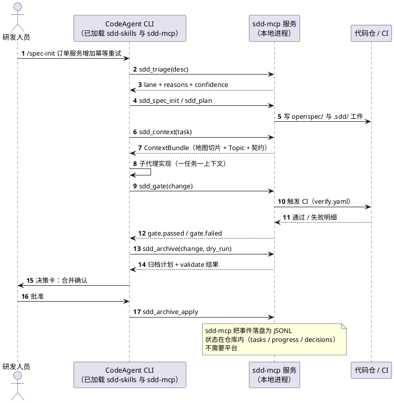
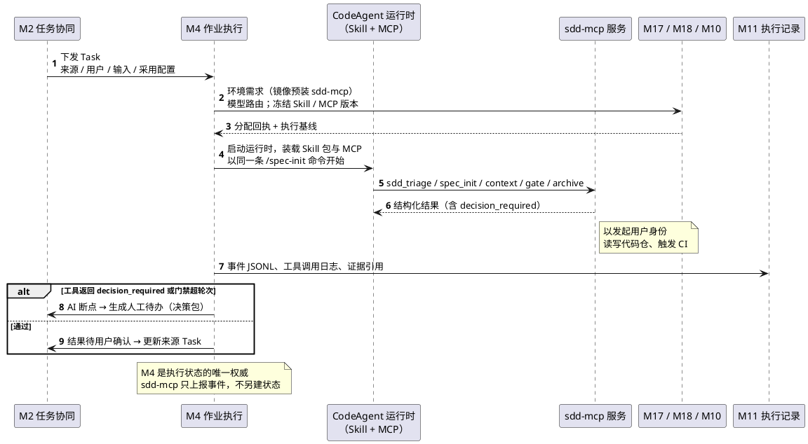
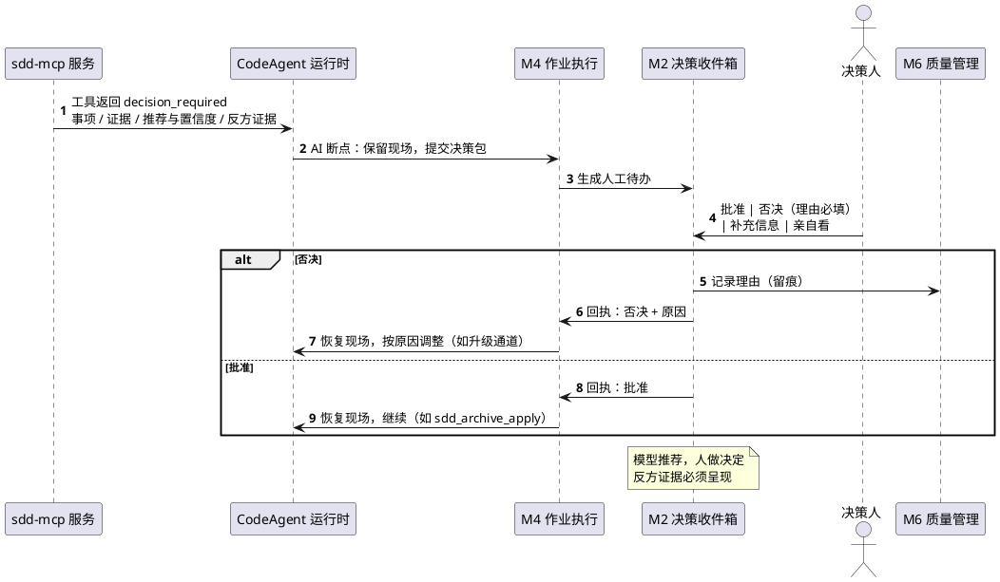
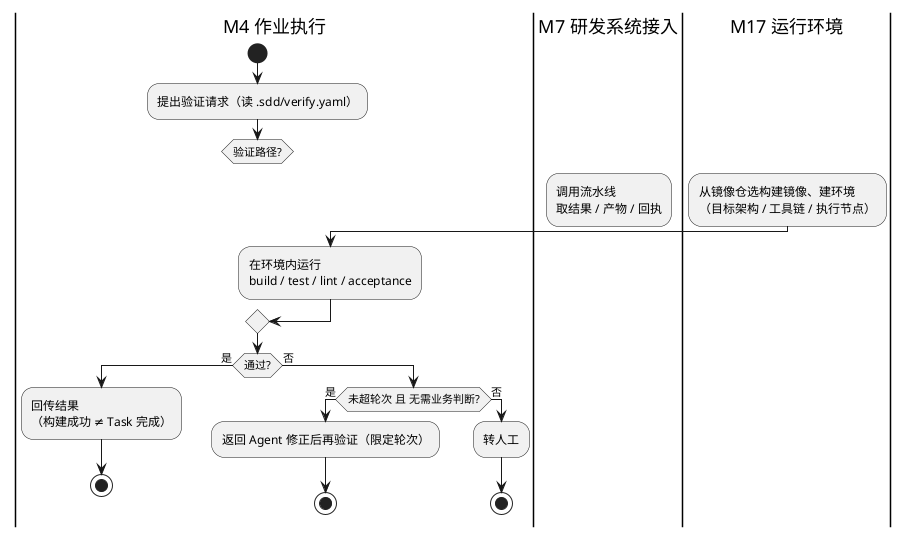
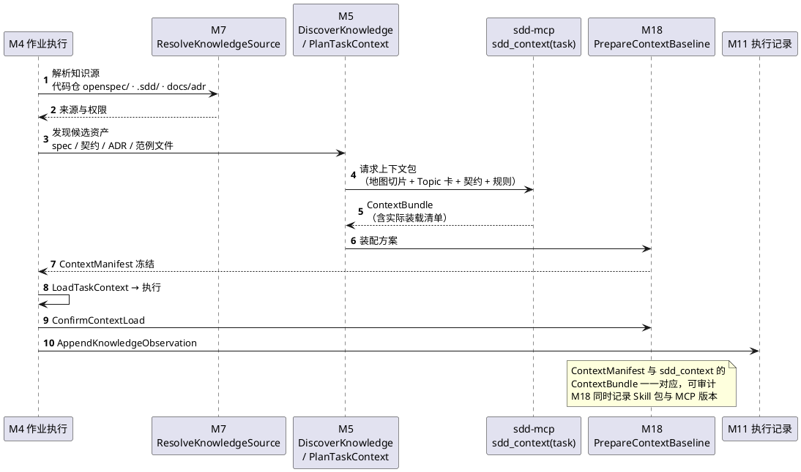

# SDD 工具链与 CoreALM-Next 的结合方案 v1.0

> 目标读者：CoreALM-Next 平台设计 owner、SDD 工具链负责人、平台各模块责任组
> 交付形式：Markdown（本文件）+ 可视化静态页 [[SDD工具链与CoreALM-Next结合方案.html]]（方案 B），图示 PlantUML；独立工具链方案见 [[SDD工具链系统化方案.md]]（方案 A）
> 状态：草案待评审。标【待确认】的条目集中在 §10
> 同步：2026-11-24 按 HTML 页面同步生成；plantuml 块与 `sdd-plan-html/puml/` 图源一致

已确认的定位：SDD 工具链是**独立工具链**，不依赖 CoreALM-Next 建设和演进。它的交付形态是**一组斜杠命令、一组 Skill 加一组 MCP 服务**，由 CodeAgent 运行时加载；研发人员在 CodeAgent CLI 里用 `/spec-init <变更描述>` 这样的命令触发，不另做独立的 SDD CLI。后续会引导大家优先走 CoreALM-Next，本地用 CodeAgent CLI 单独跑 SDD 作为试点入口和长期兜底。CoreALM-Next 在平台模式下负责准备运行环境、固定版本、发起执行、承接人工决策和记录事实，不新增第 19 个模块。

## 1. 定位与边界

分工：工具链负责把一个变更从描述做到合并，入口是 CodeAgent CLI 里的斜杠命令；平台负责谁发起、在什么环境跑、以谁的身份跑、留下什么记录、由谁决策。两者通过斜杠命令与 Skill 包、MCP 工具面和一套标准事件连起来。长远以 CoreALM-Next 为主要入口，本地 CodeAgent CLI 单独跑是试点入口和长期兜底。

图 1 · 总体关系（HTML 呈现）：发起侧（M2 任务协同 + 决策收件箱、M4 作业执行）→ 接入边界（M5 登记 + M17 预装 + M18 冻结；接入面三样东西：MCP 工具面（协议 v1）、JSONL 标准事件、决策包 schema）→ Agent 运行时加载 Skill 与 MCP → 记录侧（M11 执行记录，M8 运营分析、M14 用量统计、M6 质量结果登记）；研发人员也可以在自己的 CodeAgent CLI 里用同一条斜杠命令、同一套 Skill 与 MCP 直接跑（独立模式）。SDD 工具链独立演进：斜杠命令 + Skill 包 + MCP 服务 + 仓库内工件 + CI，对平台零依赖，C1 分级 → C2–C4 上下文 → C5–C6 规范 → C7 执行 → C8–C10 验证 → C11–C13 沉淀。

六条边界原则：

1. **独立工具链，入口是斜杠命令**。斜杠命令、Skill 包、MCP 服务、仓库内工件和 CI 五部分，装进任何支持自定义命令、Skill 和 MCP 的 CodeAgent 就能用 `/spec-init …` 跑通全部流程，不需要平台。命令名和目录按运行时适配（如 `.claude/commands/`、`.codex/prompts/`），命令正文指向同一个 Skill。
2. **平台是运行环境的提供方和记录方**。平台不是运行前提；它提供发起入口、环境、身份、决策与记录。工具链对平台的全部依赖为零。
3. **Skill 讲流程，MCP 做判定**。Skill 是 prompt 层：流程、模板、检查清单，告诉 agent 怎么走、何时调用哪个工具。MCP 是确定性层：分级规则、哈希、解析、追溯、归档脚本、事件落盘。"过不过"只来自 MCP 工具或 CI 的返回值，Skill 里不写判定逻辑。
4. **同一事实单一写入方**。独立模式：事实在仓库与 sdd-mcp 落盘的事件里；平台模式：执行状态归 M4、已发生事实归 M11、执行条件归 M18、质量判定归 M6、决策待办归 M2。以 ID 关联，不双写。
5. **接入面保持小而稳定**。MCP 工具面、标准事件（JSONL）、决策包 schema 三样，全部带版本号。平台只依赖这三样，不读工具链内部文件；版本由 M5 资产发布和 M18 基线固定。
6. **人工点统一走决策收件箱**。范围确认、合并确认、门禁失败裁决三个决策点，MCP 工具统一以 `decision_required` 返回。平台模式下由 M4 转成 M2 的决策包；独立模式下 agent 在对话里用同样的 schema 呈现决策卡。

## 2. 两种运行模式

同一条斜杠命令、同一套 Skill 和 MCP，两种装载方式。独立模式由研发人员在自己的 CodeAgent CLI 里敲命令；平台模式由 M4 启动 Agent 运行时并按基线装载后，以同一条命令开始。两种模式产出的事件完全相同。

| | 独立模式 | 平台模式 |
|---|---|---|
| 入口 | CodeAgent CLI 斜杠命令：`/spec-init <变更描述>`（IDE 插件或终端里敲） | M2 任务协同 → M4 作业执行启动 Agent 运行时 → 以同一条命令开始 |
| 命令来源 | 仓库内命令目录（`.claude/commands/`、`.codex/prompts/` 等，按运行时），随代码拉取 | M5 登记的命令与 Skill 包，按 M18 基线固定版本装载 |
| Skill 来源 | 仓库内 `.agents/skills/sdd-*`，随代码一起拉取；或用户级安装 | M5 登记的 `sdd-skills` 资产，按 M18 基线固定的版本装载 |
| MCP 来源 | `.mcp.json` 指向本机 `sdd-mcp`（uvx / npm 启动本地进程） | M17 的 Agent 镜像预装 `sdd-mcp`；M18 记录版本与工具清单 hash |
| 执行状态 | 仓库内 `openspec/changes/<id>/` 的 tasks 勾选与 `progress.md` | M4（唯一权威），以 change_id 关联仓库状态 |
| 已发生事实 | sdd-mcp 落盘的 JSONL 事件 + 运行时工具调用日志 | M11 执行记录订阅同一事件流 |
| 执行条件 | 本地运行时 / CI runner | M18 冻结 ContextManifest 与执行基线；M17 准备环境 |
| 模型 | 开发者自配 | M10 产业 MaaS 网关路由；版本记入基线 |
| 人工决策 | agent 在对话里呈现决策卡，人直接回复批准或否决 | M2 决策收件箱；否决理由必填，M6 留痕 |
| 质量判定 | CI 按 verify.yaml 跑门禁，`sdd_gate_result` 读结果 | 同样在 CI 执行；M6 登记为检查结果，必选项未过不得确认 |
| 适用 | 试点期、P0–P1、个人与小团队；长期作为平台故障时的兜底 | P2 起逐步成为主要入口；需要审计、度量、审批的组织化场景 |



图 2 · 独立模式：研发人员在 CodeAgent CLI 里敲 `/spec-init <变更描述>`，命令加载对应 Skill，agent 按 Skill 的流程调用 sdd-mcp 的工具，sdd-mcp 与代码仓、CI 交互并把事件落盘；人工确认在对话里以决策卡呈现。



图 3 · 平台模式：M2 发起 → M4 持有执行状态 → M17/M18/M10 准备环境、冻结命令、Skill 与 MCP 版本、路由模型 → M4 启动 Agent 运行时并装载，以同一条 `/spec-init` 命令开始 → agent 调用 sdd-mcp → 事件与工具调用日志进 M11；工具返回 decision_required 时变成 M2 决策包。

图 4 · 平台 Task 详情里的 SDD 面板（示意，HTML 呈现）：Task #T-2087 订单服务幂等重试，标准通道运行中（C7 实现中，change_id CHG-0142）；面板含范围与覆盖（波及能力 order-service × 3 · pay-callback × 1；spec 覆盖 order-service ✓ · pay-callback delta 已起草；追溯 12 条需求 → 9 条挂测试 · 3 条待补）、门禁结果（C8 lint + 复杂度 ✓ · C9 合规检查 2 项待看 · C10 CI build + test ✓）、事件时间线（10:02 change.triaged → 标准通道；10:03 change.approved · 李工，置信度 0.86；10:05 task.started · T-1 幂等键，上下文 6.2k；10:21 gate.failed · C9：REQ-004 异常场景未覆盖 → 回修 1/3；10:26 task.started · 回修切片 T-1b）与决策操作（查看决策包 / 批准合并 / 打开变更目录）。

## 3. 事实归属

系统设计方案 §5.2 规定：M4、M11、M18 分别维护执行状态、已发生事实和执行条件，以 ID 关联，不各建状态。sdd-mcp 在平台模式下遵守这条规则，只上报事件，不另存权威状态。

图 5 · 事实归属（HTML 呈现）：独立模式权威在仓库与本地（执行状态 = change 目录内 tasks 勾选与 progress.md；已发生事实 = sdd-mcp 落盘的 JSONL 事件文件；执行条件 = 本地 CodeAgent 运行时 / CI runner、开发者自配模型；质量判定 = CI 门禁结果经 `sdd_gate_result` 读取；决策待办 = 对话里的决策卡，同一 schema）。平台模式权威在平台模块（执行状态 = M4 唯一权威；已发生事实 = M11；执行条件 = M18 执行基线（含 Skill / MCP 版本）+ M17 环境 + M10 模型路由；质量判定 = M6；决策待办 = M2 决策收件箱）。两种模式用同一套事件，区别只在**权威写入方**；以 change_id 关联，不双写。

| 事实 | 独立模式权威 | 平台模式权威 | 同步方式 |
|---|---|---|---|
| 执行状态（进行到哪） | change 目录内 tasks / progress | M4 | sdd-mcp 每步发 `task.started / completed`，M4 以 change_id 关联 |
| 已发生事实（发生了什么） | JSONL 事件文件 | M11 | 同一事件流，M4 收集后交 M11；与运行时工具调用日志按 event_id 去重 |
| 执行条件（用什么跑的） | 本地运行时 / CI runner | M18（ContextManifest、Skill / MCP 版本、模型与配置基线）+ M17（环境） | `sdd_context` 返回实际装载清单；`sdd_info` 返回 Skill / MCP 版本 |
| 质量判定（过没过） | CI 门禁结果 | M6 | `gate.passed / failed`、`compliance.reported` 事件登记为检查结果 |
| 决策待办（等人什么） | 对话中的决策卡 | M2 | 工具返回 `decision_required` 并携带决策包 schema → M4 断点 → M2 决策收件箱 |
| 工件版本（spec / trace / ADR） | Git 提交 | M5 登记（资产目录与引用） | 归档后 `archive.validated` 带 commit SHA |

## 4. Skill 与 MCP 契约

研发人员看到的只是几条斜杠命令；命令背后是 Skill 包和 MCP 服务。接入边界是三样东西：MCP 工具面、事件面、决策包，全部带版本号。命令与 Skill 包本身也带版本，由 M5 登记为资产。平台只依赖这几样，不读工具链内部文件。

### 4.0 入口层：斜杠命令

每个 Skill 对应一条命令，放在 CodeAgent 的自定义命令目录里，命令正文就是该 Skill 的 `SKILL.md`（或指向它）。`/spec-init` 是主入口：一条命令完成分级、提案和 spec 起草，然后按通道自动串起后续步骤，在三个决策点停下来等人。其余命令可以单独重跑某一步（例如门禁失败后只重跑 `/sdd-verify`）。

```text
/spec-init <变更描述>   主入口：sdd-triage → sdd-proposal → sdd-spec-init → … → sdd-archive
/sdd-triage            只做分级，看判据
/sdd-scenarios         只补三栏场景与需求 ID
/sdd-implement         按 tasks 切片实现（一任务一上下文）
/sdd-verify            触发门禁、读结果、按轮次自愈
/sdd-compliance        发起独立合规检查
/sdd-archive           归档 dry-run 与 ADR
/sdd-drift             漂移检查与 steering 回写
```

命令名沿用现有习惯（待确认项 12）；不同 CodeAgent 的命令目录不同，用一份安装说明覆盖，命令正文与 Skill 内容不重复维护。

### 4.1 Skill 层：流程与模板（sdd-skills v1）

每个 Skill 是一个 `SKILL.md` 加参考资料和可选脚本，按 Agent Skills 开放标准编写，可被任何支持该标准的 CodeAgent 加载。Skill 负责让 agent 按顺序调用工具，并把结果解释给人。

| 命令 | Skill | 职责 | 组件 | 产出 |
|---|---|---|---|---|
| `/sdd-triage` | `sdd-triage` | 读判据表，调用 `sdd_triage`，解释原因，判断是否要升级通道 | C1 | 通道 + 判据 → 决策卡 |
| `/spec-init` | `sdd-proposal` | 一页 proposal 模板，三条通道各自的工件要求 | C1 C5 | proposal.md |
| `/spec-init` | `sdd-spec-init` | 增量起草流程，指纹缓存用法，覆盖报告怎么读 | C2 | spec delta + 覆盖报告 |
| `/sdd-scenarios` | `sdd-scenarios` | 三栏场景模板、必答清单、需求 ID 规则 | C5 | REQ + scenarios |
| `/sdd-implement` | `sdd-implement` | 一任务一上下文、切片规则、状态外置 | C7 | tasks 切片 + progress |
| `/sdd-verify` | `sdd-verify` | 何时触发门禁、怎么读失败、自愈轮次上限 | C10 | 回修或转人 |
| `/sdd-compliance` | `sdd-compliance` | 独立合规检查的检查单与证据格式，在隔离子代理中运行 | C9 | 合规报告 |
| `/sdd-archive` | `sdd-archive` | 归档流程、ADR 门槛、dry-run 确认 | C11 | 归档 diff + ADR |
| `/sdd-drift` | `sdd-drift` | 漂移检查三档、steering 回写规则 | C12 | steering / ADR 更新 |

规则：Skill 里不写判定逻辑。"过不过"只能来自 MCP 工具或 CI 的返回值。

### 4.2 MCP 工具面（协议 v1）

由 `sdd-mcp` 服务提供，本地进程或平台镜像内运行。每个工具返回统一带 `status`：`ok`、`decision_required`（携带 4.4 的决策包）、`gate_failed`。

```text
sdd_info()                         → {skills_version, mcp_version, tools_hash}
sdd_triage(change_desc)             → {lane, reasons[], confidence}
sdd_spec_init(change_id, caps[])    → {drafts[], coverage_report}
sdd_impact(since)                   → {capabilities, files, repos, contracts}
sdd_context(task_id)                → {context_bundle, context_manifest}
sdd_plan(change_id)                 → {tasks[]}
sdd_check_trace(change_id)          → {orphan_reqs[], untested[], unmapped[]}
sdd_gate(change_id, scope)          → 触发 CI 按 verify.yaml 跑 build/test/lint → {run_id}
sdd_gate_result(run_id)             → {checks[], failing[], duration_ms}   # 只读 CI 结果
sdd_compliance(change_id)           → 发起独立合规检查 → {report_id} / 结果
sdd_archive(change_id, dry_run=true)→ {plan{moves[], capability_map[]}, validate{errors[]}}
sdd_archive_apply(change_id)        → 需已批准 kind=merge 的决策
sdd_events(change_id, since?)       → 事件 JSONL
```

只读资源：`sdd://specs/{capability}`、`sdd://map/{topic}`、`sdd://standards`。门禁不在 MCP 进程里判定：MCP 只触发 CI 并读回结果，CI 侧的 `sdd-core` 与 MCP 共用同一套检查实现。

### 4.3 事件面（JSONL，schema v1）

每行一个事件：`{schema, event_id, change_id, ts, actor, type, data}`，由 `sdd-mcp` 落盘到 `.sdd/events/<change_id>.jsonl`。平台订阅的关键类型：

```text
change.triaged      {lane, reasons[], confidence}
change.approved     {decision_id, approver, overrides[]}
task.started        {task_id, slice, context_manifest_id,
                     skills_version, mcp_version, model}
gate.failed/passed  {checks[], failing[], duration_ms}
compliance.reported {results[{req, verdict, evidence[]}], round}
archive.validated   {capability_id, diff_ref, adr_required}
heal.exhausted      {rounds, last_error}   # → 转决策收件箱
```

约束：事件只追加不改写；`actor` 永远是发起用户；CodeAgent 运行时的工具调用日志是第二来源，M11 按 `event_id` 去重。

### 4.4 决策包 schema

```json
{
  "decision_id": "...",
  "kind": "scope|merge|gate-failure",
  "change_id": "...",
  "subject": "一页提案摘要",
  "evidence": [{"ref": "file:line|url", "note": "..."}],
  "recommendation": {"action": "approve", "confidence": 0.86},
  "counter_evidence": ["..."],
  "options": ["approve", "reject", "ask-info", "inspect"],
  "expires_at": "..."
}
```

由工具返回的 `decision_required` 携带。约束：推荐可解释、可追责；反方证据必须呈现；否决与复核留痕；做推荐的是模型，做决定的是人。



图 6 · 决策往返：sdd-mcp 的工具返回 decision_required → agent 向 M4 提交断点并保留现场 → M2 生成决策包 → 批准或否决（理由必填）→ M6 留痕 → M4 恢复现场，agent 继续。

### 4.5 运行环境与凭据

- **运行时**：Agent 镜像预装 `sdd-mcp` 的运行时（Python 3.12 或 Node，二选一在待确认项里定）；Skill 包随仓库分发或随 M5 资产分发；M18 基线记录 `sdd-skills` 版本、`sdd-mcp` 版本和工具清单 hash。
- **验证**：`.sdd/verify.yaml` 的 image / toolchain / target 与 M17 的构建镜像引用对齐；系统设计 §4.5 的两条验证路径（已有 CI/CD 经 M7，池化资源经 M17）都读同一份清单。agent 只能通过 `sdd_gate` 触发、`sdd_gate_result` 读回，不能改测试期望。
- **模型**：平台模式经 M10 路由；版本与路由记入 M18 执行基线。
- **凭据**：sdd-mcp 进程以发起用户身份操作代码仓，写范围限定 change 目录与分支；执行 agent 只读凭据；门禁脚本与测试期望放在 agent 写不到的路径（CI 侧或 M17 托管）；合规检查子代理独立凭据。



图 7 · 构建验证：M4 提出验证 → 经 M7 调已有 CI/CD 或经 M17 建池化环境 → 失败交自愈 agent 限定轮次 → 超限或需业务判断转人工。构建成功不自动表示 Task 完成。

## 5. 组件 ↔ 模块映射

左列是 Skill 与 MCP 内的实现（独立运行时全部需要），右列是平台模式下由平台承载的部分。平台部分不替代左列的实现，只是多了一层登记与治理。

| 组件 | Skill / MCP 内实现 | 平台承载（平台模式） | 关系 |
|---|---|---|---|
| C1 变更分级 | `sdd_triage` + `.sdd/triage.yaml` + Skill `sdd-triage` | M2 任务协同 + 决策收件箱自动化分级 | 三条通道 = 三条作业链路模板；判据版本化 |
| C2 增量 spec-init | `sdd_spec_init` + 指纹缓存 + Skill `sdd-spec-init` | M5 登记生成物；M11 记录 token | 生成物归描述层，可重生成 |
| C3 符号地图 / Topic | `sdd_impact` + 资源 `sdd://map/*`（tree-sitter + PageRank） | M5 资产目录（地图 / Topic / 契约登记为资产）；M18 ContextManifest | 装配策略选上下文，M18 冻结实际装载 |
| C4 多仓工作区 | `sdd_context` 多仓装配 + 契约仓 + 协调仓 | M7 研发系统接入（多仓连接器） | 契约兼容检查进 CI |
| C5 需求与场景模板 | Skill `sdd-scenarios` / `sdd-proposal` + `sdd_check_trace` 的模板校验 | M5（spec / 场景 / trace 是资产类型） | 版本化 |
| C6 追溯与 schema-first | `sdd_check_trace` + 生成器 | M6 检查项 | 结果登记为检查结果 |
| C7 执行编排 | Skill `sdd-implement`；运行时子代理，状态外置 | M4 作业执行（Agent Teams；断点与续作沿用） | 平台模式下 M4 是执行状态唯一权威 |
| C8 确定性门禁 | CI 内 `sdd-core` 跑 linter / 复杂度 / 格式化；`sdd_gate_result` 读回 | M6 质量管理（版本化阈值）+ M17（构建镜像） | 阈值引用版本化质量标准 |
| C9 合规检查 agent | Skill `sdd-compliance` 在隔离子代理运行；`sdd_compliance` 登记 | M6 自动检查适配（模型辅助 + 人审） | shadow → 阻断 |
| C10 验证清单 / CI 自愈 | `verify.yaml` + `sdd_gate` + Skill `sdd-verify` | 系统设计 §4.5 + M17 + M7 | 两条验证路径；修复轮次上限 = 有限重试 |
| C11 归档与 ADR | `sdd_archive` / `sdd_archive_apply` + Skill `sdd-archive` | M5 资产发布 + M7 回执 | 人确认归档 diff；ADR 为正式资产 |
| C12 漂移检测 | Skill `sdd-drift` + 提交前扫描，三档 | M6 质量项 + M5 所有权 | drift 检查进质量标准 |
| C13 度量 | `sdd_events` 落盘与导出 | M8 运营分析（口径）+ M11（事实）+ M14（用量） | 口径归 M8，不双算 |



图 8 · 系统设计 §5.5 的知识选择和装载契约在 SDD 场景下的实例：M4 → M7 ResolveKnowledgeSource → M5 发现与规划 → `sdd_context` 产出 ContextBundle → M18 准备 / 确认基线（同时记录 Skill 包与 MCP 版本）→ M11 追加知识观察。

## 6. 与系统设计方案的对齐

逐条对照 `CoreALM-Next系统设计方案.md`（v1.18）的相关章节，给出对齐点和修改建议。原则是不改平台既有边界，只登记资产、环境准备任务和决策依据。

| 系统设计章节 | 对齐点 | 建议 |
|---|---|---|
| §4.4 Agent Teams 执行和人工断点 | AI 断点保留现场并生成 M2 待办；临时故障有限重试；业务失败转人工；结果待用户确认后以用户身份更新来源 Task | SDD 的三个决策点（范围 / 合并 / 门禁失败）对应 MCP 工具的 `decision_required`，即 §4.4 的 AI 断点；修复轮次上限即"有限重试" |
| §4.5 代码构建验证 | 两条路径（已有 CI/CD 经 M7；池化资源经 M17）；限定轮次；构建成功不自动表示 Task 完成 | 两条路径统一读 `.sdd/verify.yaml`；agent 只经 `sdd_gate` / `sdd_gate_result` 触发与读回；轮次上限由 `retry.self_heal_max` 给出 |
| §4.7 资产发布 | 普通源文不强制包装；可复用 Skill / SOP / 装配策略按正式资产发布（试用 / 评测证据 + 审核者批准 → 不可变版本） | **sdd-skills 与 sdd-mcp 本身就按这条发布**：试用证据 + 审核者批准 → 不可变版本，M18 基线引用版本号；spec delta、ADR、契约亦按正式资产；描述层生成物只登记不发布 |
| §4.8 质量检查 | 版本化标准；自动检查 + 人工审核；必选项未过不得确认；例外独立审批 | C8 门禁阈值引用版本化质量标准；C9 shadow 期作为"提示项"，转阻断后列为必选 |
| §5.1 主要协作链路 | M2→M4→M17 / M7→M2→M7；各生产者→M11 | M4→M7 只需通用代码仓操作（checkout / 分支 / PR / CI 触发与读结果）；SDD 能力由 M4 启动的 Agent 运行时经 MCP 调用，不经 M7；事件流作为 M11 的生产者之一 |
| §5.2 / §5.3 执行状态权威 | M4 执行状态只有一个权威；原生 Issue 关闭不代表 SR 验收 | sdd-mcp 不另存权威状态；`change_id` 作为关联 ID |
| §5.5 知识选择和装载契约 | M7 ResolveKnowledgeSource → M5 → M18 → M4 → M11 | `sdd_context` 实现其中的装配步骤（见图 8） |
| 关键交界：M5 / M17 / M18 | 分别维护构建验证配置版本 / 准备实际环境 / 保存本次采用条件 | 执行基线新增三项：sdd-skills 版本、sdd-mcp 版本、MCP 工具清单 hash |
| §6.6 知识源接入 | "是否建设向量、图谱、OpenSpec 或 Spec Kit适配，待实际瓶颈和试点证据后决定" | 改为：以 SDD 工具链 P0/P1 试点的**采用率、遗漏率、一次通过率**三项作为决策依据 |
| §8.2 builtin 建设任务 | BUILTIN-01…06；支撑接入含镜像仓（M17/M7） | **不新增 SDD 专用连接器**；在"镜像仓"支撑接入下增加一项：Agent 运行时镜像预装 sdd-mcp；**不新增第 19 模块** |
| 决策收件箱与自动化分级 | L1 人驱动 → L2 决策收件箱 → L3 白名单自动 → L4 大部分自动 | SDD 决策包 schema 与收件箱结构对齐；低风险项（归档 diff、Topic 名校对）走 L3 白名单，指标回退即降级 |

## 7. 演进路线

先让斜杠命令、Skill 包和 MCP 服务在试点产品上用本地 CodeAgent CLI 跑通并产生数据，再接平台；接上之后引导大家优先从 CoreALM-Next 进入，本地 CLI 保留为兜底；最后用数据决定是否内化。顺序不建议反过来：工具链本身没有证明价值之前，接入平台只会把同样的负担搬到平台上。

| 事项 | P0 独立试点（第 1–2 周） | P1 协议稳定（第 3–8 周） | P2 平台接入（第 9–16 周） | P3 内化评估（第 17 周起） |
|---|---|---|---|---|
| SDD 工具链（Skill + MCP，独立演进） | ●———● | ● | ● | |
| sdd-skills 九个 Skill + sdd-mcp 工具面 v1 + 事件 JSONL | | ● | | |
| M5 资产登记 + M17 镜像预装 + M18 基线 | | | ● | |
| 决策收件箱对接（decision_required → 决策包） | | | ● | |
| 构建验证两条路径读 verify.yaml | | | ● | |
| 度量接入 M8 / M11 / M14 | | ●——● | ● | |
| 内化评估（§6.6 决策） | | | | ● |

图 9 · 四阶段演进：P0 独立试点 → P1 Skill 包与 MCP 工具面稳定 → P2 平台接入（资产登记、镜像预装、基线、决策收件箱）→ P3 内化评估。

### P0 独立试点（第 1–2 周）
- 1 个试点产品，`/spec-init` 等斜杠命令 + sdd-skills v0（triage / proposal / scenarios / implement / verify / archive）+ sdd-mcp v0（triage / gate / gate_result / archive / events 五个工具）在研发人员自己的 CodeAgent CLI 里跑通轻 / 标准通道。
- verify.yaml、三栏模板、门禁、归档 dry-run 全部独立可用；事件 JSONL 已落盘（哪怕没人消费）。
- 验收：≥ 10 个变更走通；合并前编译错误 = 0；压缩触发 = 0；基线指标建立。

### P1 协议稳定（第 3–8 周）
- MCP 工具面 v1 冻结；事件 schema v1 冻结；决策包 schema 与收件箱对齐；sdd-skills 补齐九个。
- 分级、增量 spec-init、追溯、合规 shadow、CI 自愈上线。
- 验收：轻通道 P50 ≤ 30 分钟；采用率 ≥ 60%；工具面变更走版本号。

### P2 平台接入（第 9–16 周）
- M5 登记命令包、sdd-skills / sdd-mcp 资产；M17 Agent 镜像预装 sdd-mcp；M18 基线记录版本与工具 hash；M4 以同一条命令启动并把 decision_required 转成 M2 决策包；事件进 M11；门禁结果进 M6；开始引导优先从平台进入。
- 两条构建验证路径统一读 verify.yaml；度量进 M8/M11/M14；Task 面板上线。
- 验收：平台模式与独立模式事件一致率 100%；执行状态只在 M4；一次跨仓变更端到端走通。

### P3 内化评估（16 周后）
- 用采用率、遗漏率、一次通过率回答 §6.6：哪些组件内化为平台能力（候选：C1 分级、C13 度量、决策包），哪些保持为命令 + Skill / MCP；本地 CLI 入口的保留范围。
- 低风险决策项进入 L3 白名单自动通过。

## 8. 风险与边界争议

| 风险 / 争议 | 立场与对策 |
|---|---|
| "既然本地 CLI 能跑，为什么还要引导走平台？" | 本地 CLI 解决的是研发效率和试点速度；平台解决的是组织化需求：身份与审计（M9/M11）、环境（M17）、模型路由与用量（M10/M14）、质量标准（M6）、决策留痕（M2）。同一条命令、同一套 Skill 与 MCP，人不用学两遍。 |
| "既然要接，为什么不直接做成平台功能？" | 做成平台功能会拖慢试点节奏；Skill / MCP 形态可以先在试点产品上独立验证，是否内化由 §6.6 的三项指标决定。 |
| Skill 是 prompt 层，模型可能不按流程走 | 判定不放在 Skill 里：Skill 只讲流程，所有"过不过"由 MCP 工具和 CI 返回；Skill 中的检查清单尽量写成可校验的形式，由 `sdd_check_trace` 校验；漏掉的环节在 `sdd_gate` 阶段拦住。 |
| 不同 CodeAgent 的 Skill / MCP 装载方式有差异 | Skill 按 Agent Skills 开放标准写（SKILL.md），MCP 是标准协议；差异只在装载配置（目录、`.mcp.json`），用一份安装说明覆盖；待确认项 12 列出首批支持的运行时。 |
| 两边各存一份状态 | 硬性规则：平台模式下 M4 是唯一权威；sdd-mcp 只上报事件，不维护权威状态；`change_id` 贯穿。 |
| MCP 工具面或 Skill 包版本频繁变化 | 工具面与事件都带版本号；M18 基线固定本次使用的版本，升级走 M5 资产发布流程；平台只依赖 v1 的三样东西（工具面、事件面、决策包）。 |
| sdd-mcp 进程持有发起用户的代码仓凭据，权限过大 | 写操作限定 change 目录与分支；执行 agent 只读凭据；门禁与测试期望在 agent 写不到的路径。 |
| 事件流与 M11 原始事件重复 | M11 只订阅不复制；sdd-mcp 事件与运行时工具调用日志两个来源，`event_id` 幂等去重。 |
| 平台故障阻塞工具链 | 独立模式永远可用；平台模式失败时自动降级为"导出事件、事后补录"。 |
| 内化后独立模式被废弃 | 不会：独立模式是试点与新产品的入口，也是平台故障时的兜底。 |

## 9. 外部参考：Skill 与 MCP 形态的工具如何被平台使用

Skill 负责流程知识、MCP 负责工具和数据，这个分工是当前 CodeAgent 扩展的主流做法；Skill 本身已经成为跨平台的开放标准。

| 参考 | 模式 | 对本方案的启示 |
|---|---|---|
| [Model Context Protocol 规范](https://modelcontextprotocol.io/specification/2025-11-25) | 开放协议：tools / resources | sdd-mcp 的工具面与只读资源按此定义；平台模式与独立模式连的是同一个服务 |
| [Agent Skills](https://agentskills.io)（已捐给 Agentic AI Foundation，70+ 平台支持） | SKILL.md + 脚本 / 参考资料的开放标准 | sdd-skills 按此编写，不绑定某一家 CodeAgent；细节见 [TechRepublic 报道](https://www.techrepublic.com/article/news-anthropic-agent-skills-foundation-handover/) |
| [Claude Code 扩展文档](https://code.claude.com/docs/en/features-overview) | "MCP 给工具，Skill 给怎么用工具" | 与本方案 4.1 / 4.2 的分工一致；Skill 可在隔离子代理中运行，对应 sdd-compliance 的隔离要求 |
| [Claude Code GitHub Actions](https://code.claude.com/docs/en/github-actions) | agent 在 CI 内被调用 | agent 以机器人身份在流水线内运行，产出可审计的提交与日志，对应 M4 启动运行时的代跑模式 |
| [OpenSpec](https://github.com/Fission-AI/OpenSpec) | 纯 Markdown 工件在仓内 | 工件在仓内、任何 agent 都能读；archive 作为合并门禁，接入面很小 |
| [Kiro](https://kiro.dev/docs/specs/feature-specs/requirements-first/) | IDE 内 spec 为工作单元 + hooks | hooks 让确定性检查在 IDE 内执行；spec 是 IDE 与 CI 共享的工件 |
| [Tessl](https://sddobservatory.com/frameworks/tessl/) | .spec.md + `@test` 挂载 | 规范与测试同仓同版本，平台只需读测试结果 |
| [AWS Emulator](https://www.aboutamazon.com/news/aws/how-autonomous-ai-agents-built-aws-emulator) | 规范 + 参考实现 + 保真度测试，三角色分离 | 门禁速度决定吞吐；期望值在参考实现上验证，对应凭据分离与 M17 环境 |
| [METR · o3](https://metr.org/evaluations/openai-o3-report/) / [ImpossibleBench](https://arxiv.org/abs/2510.20270) | reward hacking 实证 | 门禁必须放在 agent 凭据写不到的路径：MCP 只触发和读结果，判定在 CI 或 M17 托管环境 |
| [AGENTS.md](https://agents.md) | 仓内规则标准 | 规则层放仓内而非平台配置，独立 / 平台两种模式读同一份 |
| [Thoughtworks Radar](https://www.thoughtworks.com/en-cn/radar/tools/openspec) | 行业评估方法 | Assess → Trial → Adopt 的节奏对应本方案 P0 试点 → P2 接入 → P3 内化评估 |

## 10. 待确认事项

| # | 事项 | 状态 |
|---|---|---|
| 1 | SDD 工具链定位 | 已确认 · 独立工具链，以斜杠命令 + Skill / MCP 形态发布，由 CodeAgent CLI 命令触发；引导优先走 CoreALM-Next，本地单独跑保留 |
| 8 | sdd-skills / sdd-mcp 的资产登记归属（M5）与 Agent 镜像预装排期（M17），以及是否在 §8.2 支撑接入下正式登记 | 待确认 |
| 9 | MCP 工具面与事件 schema 的版本策略（谁批、兼容窗口多长） | 待确认 |
| 10 | sdd-mcp 的技术栈与分发方式（Python + uvx 还是 Node + npm；影响 M17 镜像与本地安装） | 待确认 |
| 11 | 平台模式下决策包的 L3 白名单范围（哪些低风险项自动通过） | 待确认 |
| 12 | 首批支持哪些 CodeAgent（Claude Code / Codex / Cursor / DSH 等）；斜杠命令命名（是否沿用 `/spec-init` 这类不带前缀的名字）与各运行时的命令目录差异如何处理 | 待确认 |
| 13 | Skill 与 MCP 的分工边界是否需要更细的规则（哪些判定必须进 MCP 或 CI，不能留在 Skill） | 待确认 |
| 2–7 | 方案 A 的待确认项（主语言、试点产品、契约格式、阈值初值、合规 agent 凭据、门禁位置）同样适用于本方案 | 待确认 |

## 相关文档

- 独立方案：[[SDD工具链系统化方案.md]] · [[SDD工具链系统化方案.html]]
- 平台文档：[[CoreALM-Next介绍说明.html]] · [[CoreALM-Next系统设计方案]]（§4.4、§4.5、§4.7、§4.8、§5、§6.6、§8.2）· [[CoreALM-Next功能模块划分]] · [[我的工作演进-决策收件箱与自动化分级]]
- 项目台账：[[../../60-Projects/CoreALM-Next|CoreALM-Next]]

> SDD 工具链与 CoreALM-Next 结合方案 · 草案待评审 · 2026-11-24 · 图示源码位于 `sdd-plan-html/puml/`，`python3 sdd-plan-html/build.py` 可重新生成 HTML
