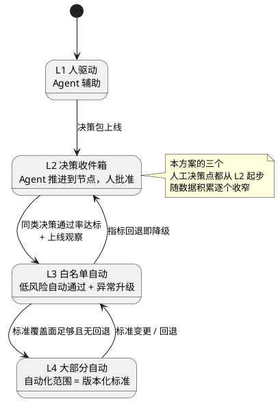
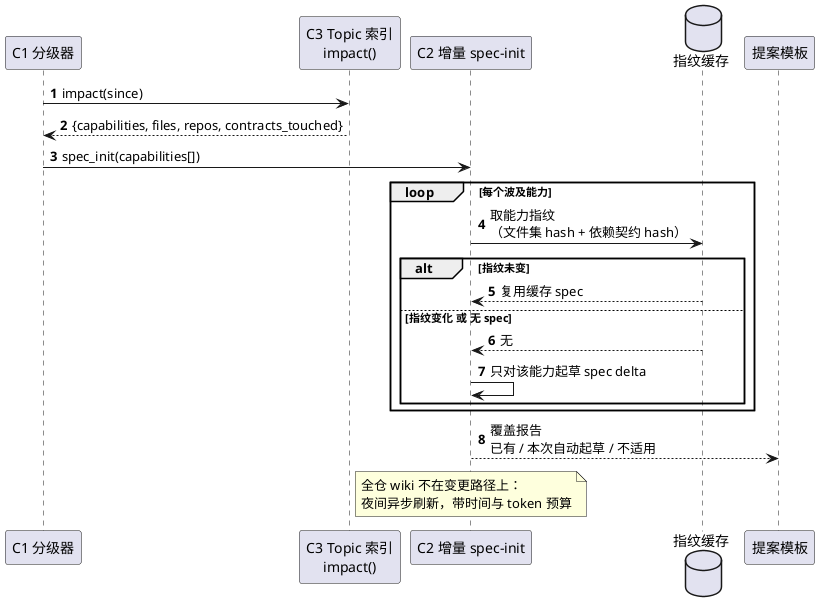
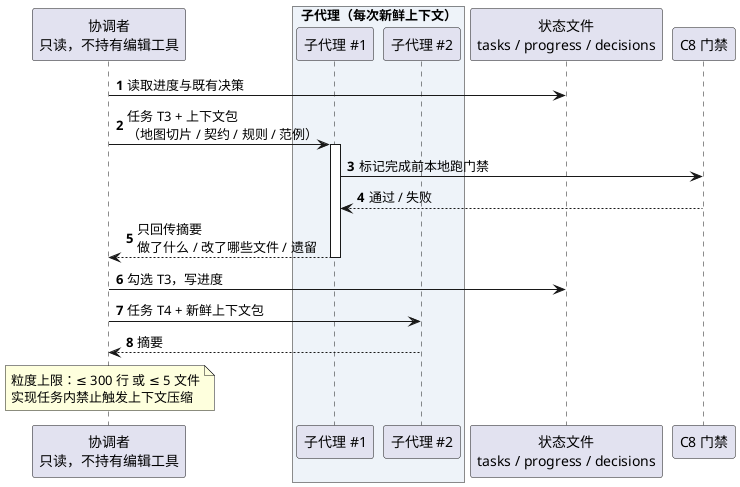
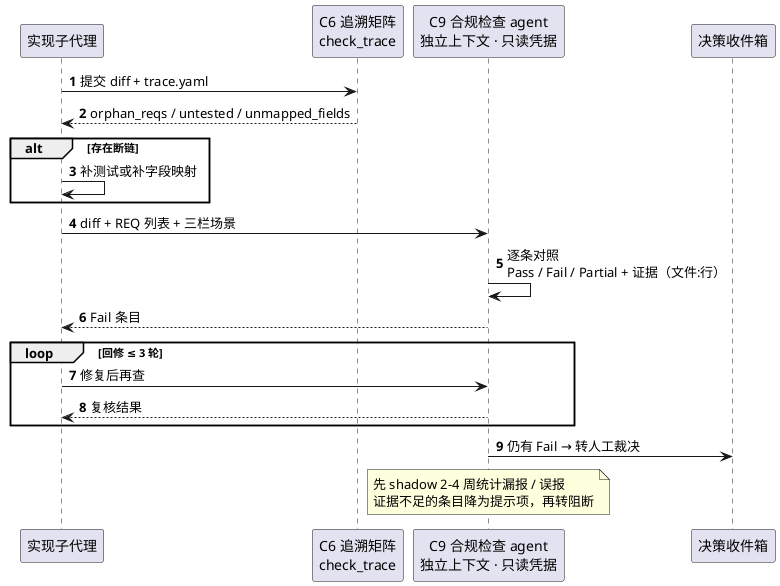
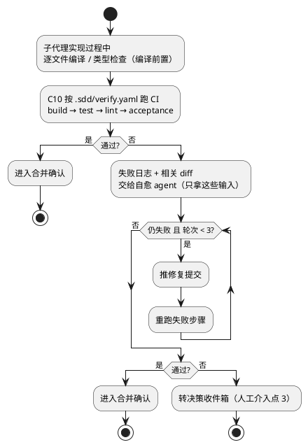
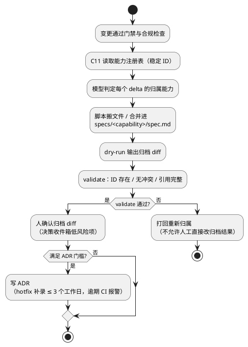

# SDD 工具链系统化方案（全套软件工程）v1.0

> 目标读者：SDD 工具链产品/研发负责人、CoreALM-Next 系统设计 owner、试点产品架构师
> 交付形式：Markdown（本文件）+ 可视化静态页 [[SDD工具链系统化方案.html]]（方案 A）；平台结合见 [[SDD工具链与CoreALM-Next结合方案.md]] 与 [[SDD工具链与CoreALM-Next结合方案.html]]（方案 B），图示 PlantUML
> 状态：草案待评审。标【待确认】的条目集中在 §13
> 同步：2026-11-24 按两个 HTML 页面同步——新增 §1.3 两张卡、§4.4 交付形态、§5.1 决策卡、7 段 PlantUML 图源、§14 带链接的参考表；章节编号沿用本文件（与 HTML 页面不同，正文已换算）

## 0. 文档定位

- **回答什么**：把前十条一线反馈和此前讨论的解法（三层分离、spec-on-touch、ADR、确定性门禁、一任务一上下文、CI 自愈）整合成一份可排期、可验收的工具链规划。
- **不回答什么**：具体语言/框架选型、CoreALM-Next 内部模块的详细设计（只给对接边界）。
- **与现有文档的关系**：本方案是 CoreALM-Next 之上的一个**工作负载方案**，以**独立工具链**形态建设（已确认，见 §8）。交付形态是**一组斜杠命令 + 一组 Skill 加一组 MCP 服务**（命令如 `/spec-init <变更描述>`，sdd-skills / sdd-mcp），由研发人员在 CodeAgent CLI 里以命令触发、在 CodeAgent 运行时加载，不提供独立的 SDD CLI；后续引导优先从 CoreALM-Next 进入，本地用 CodeAgent CLI 单独跑作为试点入口和长期兜底；平台模式下通过 M5 资产登记、M17 镜像预装、M18 基线冻结、M4 断点转决策包接入，不新增模块。系统设计方案 §6.6 目前把"OpenSpec/Spec Kit 适配"留待试点证据后决定，本方案给出该决策所需的证据框架和接入方式。
- **写作基线（假设）**：SDD 引擎流程已参考 OpenSpec（change → proposal/design/spec/tasks → implement → archive）；存量逆向使用 codewiki（DeepWiki 类）；已有 e2e 流水线 demo 但脚本写死；产品为多仓、传统技术栈；产业用户不愿投入文档治理。假设不成立处请直接改 §13。

## 1. 总览：从痛点到体验

先说结果。下表左边是一线反馈里的现状，右边是方案落地后的样子；再往下一张表，每一行把一个痛点对到具体特性和技术方案，以及用户能感觉到的变化。

| 现在 | 之后 |
|---|---|
| spec-init 跑一夜没完，全流程一整天；小改动只能 vibe coding，文档形同虚设 | 小改动 **30 分钟**走完、0–1 次确认；默认通道**半天**；spec-init 从小时级降到分钟级；所有改动都走流程 |
| 设计文档里有的字段代码里漏了；时序图只画主流程，异常场景缺失；基于 SPEC 开发还是遗漏 | 每条需求挂测试；合并前自动报"有需求没实现、有实现没需求"，**遗漏率 < 2%** |
| 生成后编译错误反复跑；圈复杂度高、风格和项目不一样 | **合并前编译错误 = 0**，修复在 CI 里自动跑最多 3 轮；复杂度超标自动打回，风格锚定同模块范例 |
| 跨仓隐性规则说不清，agent 理不透仓间关系；codewiki 颗粒度粗，Topic 识别不到 | 改动方案直接列出**波及哪些仓、哪些契约、哪些能力**；定位命中率 ≥ 85%；踩过一次的规则变成 ADR / 契约测试 |
| 0.5K 代码生成得散，一压缩上下文就丢；归档目录迁错 | **压缩触发 = 0**，一任务一上下文，进度随时可看；归档先看 diff 再确认 |
| 人写文档、人审文档、人盯编译 | 人只在**三个点**做确认（范围 / 合并 / 门禁失败）；文档由模型生成、可随手重生成 |

### 1.1 一线痛点 → 特性 → 体验

| 一线痛点 | 特性 | 技术方案（组件） | 体验变化 |
|---|---|---|---|
| spec-init 跑一夜没完；全流程一整天；小改动直接 vibe coding | 按变更大小选通道 | C1 变更分级器（确定性判据）→ 轻 / 标准 / 重；C2 增量 spec-init 只起草波及能力 + 指纹缓存 | 小改动 ≤ 30 分钟、0–1 次确认；默认通道 ≤ 半天；spec-init 分钟级；不再有"小改动绕过流程" |
| 设计文档有的字段代码里漏；时序图只覆盖主流程；基于 SPEC 开发遗漏多 | 需求挂测试，遗漏自动查出 | C5 需求 ID + 三栏场景（主 / 备选 / 异常）+ 必答清单；C6 追溯矩阵，数据结构从 schema 生成；C9 独立合规检查 agent 拿 diff 逐条对照 | 合并前自动报"有需求没实现、有实现没需求"；遗漏率 < 2%；异常场景天然变成测试 |
| 跨仓隐性规则没承载；codewiki 颗粒度粗，Topic 识别不到 | agent 能定位到符号和业务能力 | C3 符号地图（tree-sitter + PageRank + 预算）+ Topic 索引（co-change 聚类 + spec/ADR 反推）；C4 契约仓 + 协调仓 + 规则层 | 方案直接列出波及的仓、契约、能力；定位命中率 ≥ 85%；隐性规则踩一次就固化 |
| 生成后编译错误反复跑；希望流水线能自助修复 | 验证与自愈在 CI 里闭环 | C10 verify.yaml 仓库自描述验证清单 + CI 自愈 agent（轮次上限 3）+ 逐文件编译前置 | 合并前编译错误 = 0；人不再盯编译；超轮次才转人 |
| 圈复杂度高；风格与项目差异大 | 规范由确定性工具判定 | C8 linter / 复杂度 / 格式化门禁，在编码过程中而不是提交后；风格锚点 = 同模块 2–3 个范例文件 | 超标自动打回；不用人写规范、人审风格 |
| 0.5K 代码生成得散，一压缩上下文就丢 | 一任务一上下文，状态外置 | C7 协调者不碰编辑工具；子代理一任务一新鲜上下文只回传摘要；tasks 勾选与 progress 落文件 | 压缩触发 = 0；进度随时可看；失败可续作 |
| 归档目录迁错；文档治理负担重 | 归档先看 diff，文档可再生 | C11 注册表 + 模型定归属 + 脚本搬 + dry-run 确认；C12 三层分离（描述层可抛弃 / 决策层 ADR / 约束层规则与测试）+ 漂移检测 | 归档修正次数 → 0；生成物可随手重生成，人的修正只落在规则 / ADR / 测试；文档数量不作考核 |

- **怎么用**：研发人员在 CodeAgent CLI 里敲 `/spec-init <变更描述>`，后面按通道自动串起来，在三个决策点停下来等人；本地 CLI 或 CoreALM-Next 都能用。
- **怎么交付**：斜杠命令 + Skill 包（讲流程）+ MCP 服务（做判定），装进 CodeAgent 就能用；门禁在 CI 里跑，模型改不了。
- **怎么推进**：P0 两周先做不改引擎的改进 → P1 六周改引擎 → P2 八周补上下文与多仓 → P3 持续；看采用率和遗漏率，不看文档覆盖率。

### 1.2 一个真实变更走一遍

拿"订单取消时库存释放失败要自动重试"这个变更当例子。研发人员在 CodeAgent CLI 里敲一条命令，之后只做两次确认，其余是看着它在终端里跑完。先是标准通道（约 50 分钟），再是轻通道（改一个错误码，约 20 分钟）。

研发人员的终端 · 标准通道 · 约 50 分钟

```text
09:02  > /spec-init 订单取消时库存释放失败要自动重试，最多 3 次
09:03  [sdd-triage] 标准通道。判据：单仓 ✓ · 预计改 6 个文件（轻通道上限 5）· 不触及契约 ✓ · 非核心路径 ✓
09:03  [sdd-map]    波及 order-service/cancel.py、inventory_client.py、retry_policy.py；Topic「订单履约 › 取消与回滚」
09:04  [spec-init]  order-service 已有 spec ✓；inventory-client 缺 spec → 起草 delta：1 条需求 + 3 个场景（主流程 / 超时 / 重复回调）
09:04  [需要你确认] 范围确认卡 #CHG-0142，推荐「标准通道」，置信度 0.86 → 看了 1 分钟，按 a 批准
09:05  [implement]  拆成 4 个任务，每个任务一个子代理：T1 重试策略 ✓ 6m · T2 调用改造 ✓ 4m · T3 幂等键 ✓ 3m · T4 测试 ✓ 5m
09:24  [gate]       第 1 轮 ✗ OrderCancelService.retry() 圈复杂度 14 > 10 → 自动修复：抽出 _backoff()，对照范例 RefundService
09:31  [gate]       第 2 轮 ✓ lint ✓ · test 12/12 ✓ · trace 3/3 ✓ · compliance 3/3 ✓ · 编译 ✓
09:33  [需要你确认] 合并确认：归档 diff 3 个文件（见 1.3）→ 看了 40 秒，按 a 合并
09:35  [archive]    specs/order-service +2 条需求 · specs/inventory-client +1 条 · ADR-041 幂等键用订单号 · trace +3 条 · 事件 7 条已落盘
```

研发人员的终端 · 轻通道 · 约 20 分钟

```text
14:10  > /spec-init 取消接口的错误码 400 改成 409，文案同步
14:11  [sdd-triage] 轻通道。单仓 ✓ · 预计 2 个文件 ✓ · 不触及契约 ✓ · 非核心路径 ✓
14:11  [proposal]  一页提案：改动点 2 处、验收 3 条（接口返回 409 / 文案断言 / 原有 400 用例改成 409）；轻通道不要求范围确认
14:12  [implement]  1 个任务 ✓ 8m
14:21  [gate]       第 1 轮 ✓ 全部通过
14:23  [merge]      轻通道不归档，只补 1 行 trace。完。
14:24  人一共花了 2 分钟：敲命令 + 看一眼提案。
```

### 1.3 开发者会收到的两张卡

整个流程里人真正要看的，除了 5.1 的范围确认卡，就是这两样：门禁报告（看哪里没过、机器打算怎么修）和归档 diff（看这次变更往仓库里留下了什么）。

门禁报告 · CHG-0142 · 第 1 轮 · CI 按 verify.yaml 执行，模型改不了结果

```text
✗ 复杂度  OrderCancelService.retry()  圈复杂度 14（上限 10）
           对照范例 RefundService.retry()（复杂度 5）：建议把退避计算抽成 _backoff()
         → 已自动修复，进入第 2 轮（上限 3 轮，超过转人）
✓ lint      0 问题
✓ 测试      12 / 12 通过，其中 3 条直接来自场景文件
✓ 追溯      REQ 3 条 ↔ 代码 3 处，没有孤儿
✓ 合规      diff 逐条对照 spec：3 / 3
           CANCEL-04「重复回调幂等」由幂等键 = 订单号满足；「库存服务超时」落在 cancel.inventory-timeout 测试
```

合并确认 · CHG-0142 · 归档 diff（dry-run，人确认后才真的动文件）

```text
openspec/changes/CHG-0142/            → 删除（内容已合并进主 spec）
specs/order-service/spec.md         + ADDED 2 条需求（取消重试、幂等键）
specs/inventory-client/spec.md      + ADDED 1 条需求（本次起草，之前这个能力没有 spec）
docs/adr/ADR-041-幂等键用订单号.md   新增（备选：请求 ID / 时间戳；没选的原因：重试时会变）
.sdd/trace.yaml                     + 3 条
事件                                 7 条 → .sdd/events/CHG-0142.jsonl
                                     （triaged · approved · task.started ×4 · gate.failed · gate.passed · archive.validated）
           [ a 合并 ]   [ e 看完整 diff ]   [ r 驳回（需填理由） ]
```

### 1.4 同一个变更，前后各花多久

还是上面这个标准变更。右边两列是目标值，作为 P1 的验收口径，试点时逐项实测。

| 步骤 | 现在：人做什么 | 之后：谁做 | 现在 | 之后 | 靠哪个组件 |
|---|---|---|---|---|---|
| 理清范围和影响面 | 读代码、问老同事、猜波及 | 地图 + Topic 索引直接给波及文件和能力 | 60–90 分钟 | **3 分钟** | C3 · C4 |
| 写 spec / 设计文档 | 从模板开始手写 | 只对波及且缺 spec 的能力起草 delta，人改 0 字 | 2–3 小时 | **3–5 分钟** | C2 · C5 |
| 文档评审 | 约人开会，逐段过 | 看一张范围确认卡 | 约 1 小时 | **2 分钟** | C1 · 决策收件箱 |
| 实现 | 一个人顺着写，越写越散 | 拆 4 个任务，每个任务一个子代理 | 2–3 小时 | **20–30 分钟** | C7 |
| 编译错误来回修 | 跑编译、看报错、改、再跑 | CI 里自愈，最多 3 轮 | 1–2 小时 | **0**（人不在场） | C10 |
| 代码评审 | 逐行看风格和复杂度 | linter 和复杂度门禁已判过，人只看合规报告 | 约 1 小时 | **10 分钟** | C8 · C9 |
| 归档 | 手工搬目录、改链接 | 看 diff，按 a | 约 30 分钟 | **1 分钟** | C11 |
| **合计** | 一个人的一个工作日 | 人在场约 20 分钟，其余等机器 | **8–10 小时** | **50 分钟** | |

支撑这些的是三条通道、六层架构和十三个组件：通道决定一次变更走多重的流程（§5），架构和组件负责把每一步交给机器或确定性工具（§4、§6）。

### 1.5 核心结论

1. **问题的本质不是"文档多"，而是四件事没有工程化**：范围没收窄、上下文不准、规范到代码没有追溯闭环、执行与验证没有工程化。砍文档不解决问题，把这四件事交给机器和确定性工具才解决。
2. **做法**：三条通道决定一次变更走多重的流程；六层架构、十三个组件把每一步交给机器或确定性工具；一套度量和三期路线管推进。
3. **人只出现在三个决策点**：确认范围（一页提案，轻通道可省）、确认合并（看归档 diff 和门禁结果）、门禁失败时裁决。其余全部机器完成；随着自动化分级演进，这三点也逐步收窄为低风险自动通过。
4. **顺序**：两周快速改进（不改引擎架构）→ 六周引擎改造 → 八周上下文与多仓 → 持续提升自治度。度量只看**采用率**和**遗漏率**，不考核文档覆盖率。

## 2. 现状与问题诊断

### 2.1 现状基线

| 维度 | 现状 | 含义 |
|---|---|---|
| 引擎 | 参考 OpenSpec，已尽量轻量 | 流程骨架可用，问题在执行层和验证层 |
| 存量建模 | 缺乏；靠 codewiki（DeepWiki 类）逆向，颗粒度粗 | 瓶颈在上下文供给，而不在文档格式 |
| 用户 | 传统产品转型；产业用户不愿治理文档 | 凡是要求人写或人审文档的做法都很难推行下去 |
| 流水线 | 有 e2e demo，脚本写死、泛化低 | 验证能力已经有了，但脚本写死在流水线里，仓库自己不知道该怎么验证 |

### 2.2 十条反馈 → 四类根因 → 组件

**A · 范围没收窄**
1. spec-init 跑一晚没完，全流程一整天；小改动想直接 vibe coding
   - 解法方向：分级入口：判据决定通道；只对波及能力建 spec；开轻通道
   - 组件：C1 变更分级器、C2 增量 spec-init

**B · 上下文不准**
1. 跨仓隐性规则无承载，AI 理不透仓间关系
2. codewiki 颗粒度粗，Topic 识别不到
3. 时序图只覆盖主流程，异常 / 边界缺失
   - 解法方向：符号地图 + Topic 索引；契约仓 + 协调仓；场景文本化（主 / 备选 / 异常）
   - 组件：C3 符号地图 / Topic、C4 多仓工作区、C5 需求与场景模板

**C · 规范 → 代码无追溯闭环**
1. 字段漏掉：复杂 / 容器 / 深层子字段未实现
2. 基于 SPEC 开发功能遗漏多
3. 不符合编码规范：圈复杂度高、风格差异大
   - 解法方向：需求 ID + trace + 每条需求挂测试；数据结构从 schema 生成不走散文；以 linter 判定；独立合规检查
   - 组件：C6 追溯矩阵、C8 确定性门禁、C9 合规检查 agent

**D · 执行与验证未工程化**
1. 编译错误反复修；e2e 脚本写死、泛化低
2. 上下文每压缩一次能力下降，最后不知道在干什么
3. 归档目录迁移不准
   - 解法方向：一任务一上下文 + 状态外置；verify.yaml + CI 自愈 + 轮次上限；模型定归属、脚本搬文件
   - 组件：C7 执行编排、C10 验证清单与自愈、C11 归档与 ADR

C12 漂移检测和 C13 度量看板横跨四类原因。每个组件都标明了判定方式：确定性规则、确定性工具、模型生成加校验，或独立模型加证据。

### 2.3 一句话诊断

**诊断**：引擎已经把文档阶段自动化了，但**范围计算、上下文装配、追溯、验证**仍然靠模型自觉和人工兜底。模型自觉不可靠，人工兜底就变成了大量的人工干预。

## 3. 设计原则

| # | 原则 | 落地含义 | 反面案例 |
|---|---|---|---|
| P1 | 模型生成，确定性工具判定，人只在门禁失败时介入 | 由 linter、编译、测试判定；模型产物不靠人逐行审 | 人逐页审 spec markdown |
| P2 | 范围优先：一切按"波及能力"做，不全仓 | 分析、spec 生成、上下文都只覆盖波及集合 | spec-init 全仓扫描跑一夜 |
| P3 | 三层分离：描述层可抛弃、决策层 ADR、约束层契约/测试/steering | 人工修正不落在生成物上 | 手改 wiki 后被重生成覆盖 |
| P4 | 可追溯：需求 ID → 场景 → 任务 → 测试 → 代码 | 每条需求至少挂一个测试 | 设计文档有、代码没有 |
| P5 | 一任务一上下文，状态外置 | 协调者不写代码；进度写文件不靠记忆 | 长会话压缩后迷失 |
| P6 | 仓库自描述 | 验证清单、契约、规则都在仓内，agent 不靠口头交代 | 脚本写死在流水线里 |
| P7 | 度量看采用率和遗漏率，不看文档覆盖率 | 文档数量不作为考核项 | 用文档数量考核 |

**术语**：能力（capability）= 一组可独立描述的业务能力，spec 的归档单位；波及能力集合 = 一次变更可能影响的 capability 集合，所有分析和生成的范围边界；Topic = 按业务能力组织的代码区域索引，是"定位到符号"的入口；通道 = 一条端到端作业链路模板（轻 / 标准 / 重）；门禁 = 确定性工具的通过 / 不通过判定，模型不能修改门禁；决策收件箱 = 所有人工介入点的统一形态：决策包 + 证据 + 推荐 + 反方证据。

## 4. 目标架构

六层分工：入口层判断变更范围，上下文层准备给模型看的材料，规范层组织需求与场景，执行层管理实现过程，验证层负责判定，沉淀层决定哪些内容长期保留。研发人员只在两处参与——L0 看一页提案，L5 做合并确认；小改动走轻通道，可以跳过范围确认，不写文档，只做确认或否决。

### 4.1 分层图

```
┌──────────────────────────────────────────────────────────────────┐
│ L0 入口层    C1 变更分级器 ─ C2 增量 spec-init（波及能力集合）          │
├──────────────────────────────────────────────────────────────────┤
│ L1 上下文供给 C3 符号地图与 Topic 索引 ─ C4 多仓工作区（契约/协调/规则）  │
├──────────────────────────────────────────────────────────────────┤
│ L2 规范层    C5 需求与场景模板 ─ C6 追溯矩阵与 schema-first            │
├──────────────────────────────────────────────────────────────────┤
│ L3 执行层    C7 执行编排（协调者 + 子代理，一任务一上下文，状态外置）      │
├──────────────────────────────────────────────────────────────────┤
│ L4 验证层    C8 确定性质量门禁 ─ C9 合规检查 agent ─ C10 验证清单与 CI 自愈│
├──────────────────────────────────────────────────────────────────┤
│ L5 沉淀层    C11 归档与 ADR ─ C12 漂移检测与所有权 ─ C13 度量看板       │
└──────────────────────────────────────────────────────────────────┘
数据流：L0 → L1 取上下文 → L2 产工件 → L3 实现 → L4 判定（失败回 L3）→ L5 沉淀 → 反哺 L1
```

### 4.2 组件总览

| 组件 | 解决 | 判定方式 | 阶段 |
|---|---|---|---|
| C1 变更分级器 | #1 | 确定性规则 | P1 |
| C2 增量 spec-init | #1 | 模型生成 + 指纹缓存 | P1 |
| C3 符号地图与 Topic 索引 | #4 #3 #1 | 确定性解析 + 模型归类 + 人校对名 | P2 |
| C4 多仓工作区 | #3 | 契约文件 + 确定性兼容检查 | P2 |
| C5 需求与场景模板 | #6 #2 | 模型起草 + 模板校验 | P0 |
| C6 追溯矩阵与 schema-first | #2 #9 | 确定性校验 | P1 |
| C7 执行编排 | #7 | 结构约束 | P0 |
| C8 确定性质量门禁 | #10 | 确定性工具 | P0 |
| C9 合规检查 agent | #2 #9 #6 | 独立模型 + 证据 | P1（shadow）→ P2（阻断） |
| C10 验证清单与 CI 自愈 | #5 | 确定性 + 模型修复 | P0（清单）→ P1（自愈） |
| C11 归档与 ADR | #8 | 模型定归属 + 脚本执行 + 人确认 | P0（dry-run）→ P1 |
| C12 漂移检测与所有权 | 抛弃式文档矛盾 | 确定性扫描 | P2 |
| C13 度量看板 | 全部 | 采集与口径 | P0 基线 → P2 看板 |

### 4.3 生命周期视角（"全套软件工程"覆盖）

| 阶段 | 人 | 机器 | 组件 |
|---|---|---|---|
| 需求/变更入口 | 一句话描述 | 分级、影响面、波及能力、spec 覆盖检查 | C1 C2 |
| 规范 | 确认范围（一页） | 起草 spec delta、三栏场景、可执行验收 | C2 C5 |
| 设计 | 重通道评审契约 | 引用 schema/契约、文本化时序图 | C4 C5 C6 |
| 实现 | 无 | 协调者 + 子代理切片实现、逐文件编译 | C7 C3 |
| 验证 | 失败时裁决 | 门禁、合规检查、CI、自愈 | C8 C9 C10 |
| 集成/发布 | 合并确认 | 归档合并、契约兼容检查 | C11 C4 |
| 维护/演进 | 低风险确认 | spec-on-touch、漂移检测、重生成 | C2 C12 |
| 度量改进 | 看看板 | 采集、误报分析、判据调优 | C13 |

### 4.4 交付形态：斜杠命令 + Skill 包 + MCP 服务

十三个组件不是一套独立的 SDD CLI。研发人员在 CodeAgent CLI 里敲一条斜杠命令（例如 `/spec-init 订单服务增加幂等重试`）触发，命令背后是**一组 Skill 加一组 MCP 服务**，装进任何支持自定义命令、Skill 和 MCP 的 CodeAgent 就能用。后续会引导大家优先从 CoreALM-Next 进入，本地用 CodeAgent CLI 单独跑作为试点入口和长期兜底。

- **斜杠命令（入口层）**：每个 Skill 对应一条命令，放在 CodeAgent 的自定义命令目录（如 `.claude/commands/`、`.codex/prompts/`），正文指向该 Skill。`/spec-init <变更描述>` 是主入口，一条命令完成分级、提案、spec 起草并串起后续步骤；`/sdd-verify`、`/sdd-archive` 等可单独重跑某一步。
- **Skill 包（sdd-skills，prompt 层）**：每个组件对应一个 `SKILL.md` 加参考资料和可选脚本，讲流程、模板、检查清单，告诉 agent 何时调用哪个工具。Skill 里不写判定逻辑。
- **MCP 服务（sdd-mcp，确定性层）**：分级规则、指纹哈希、追溯解析、归档脚本、事件落盘都做成 MCP 工具（`sdd_triage`、`sdd_spec_init`、`sdd_context`、`sdd_check_trace`、`sdd_gate`、`sdd_archive` 等）。工具返回统一 `status`：ok / decision_required / gate_failed，decision_required 携带 §5.1 的决策包。
- **门禁在 CI 执行**：`sdd_gate` 只触发 CI 按 verify.yaml 跑 build / test / lint，`sdd_gate_result` 读回结果。判定不放在模型能改写的地方。
- **工件与事件**：spec、trace、ADR 等工件在仓库内；事件由 sdd-mcp 落盘为 JSONL，给度量（C13）和平台（方案 B）消费。

与 CoreALM-Next 的接入方式见 [[SDD工具链与CoreALM-Next结合方案.md]]：平台通过 M5 资产登记、M17 镜像预装、M18 基线冻结、M4 断点转决策包接入，不新增模块。

## 5. 工作流：三条通道

分级结果可以被人覆盖，但必须选择原因，覆盖记录用来调整判据。轻通道不是绕过 SDD：它把流程压缩到一页提案加可执行验收，目的是让小改动也愿意走 SDD，而不是直接 vibe coding。
| | 轻通道 | 标准通道 | 重通道 |
|---|---|---|---|
| 触发【阈值待确认】 | 单仓、影响文件 ≤ 5、不触及契约和核心模块路径 | 默认 | 跨仓、改契约、核心模块、新能力 |
| 工件 | 一页 proposal（含 3–5 条可执行验收） | proposal + spec delta（需求 ID + 三栏场景）+ 设计（引用 schema）+ tasks | 标准工件 + 契约变更稿 + 保真度测试计划 + ADR 草案 |
| 人工介入点 | 0–1（合并确认） | 2（范围确认、合并确认） | ≥ 3（范围评审、契约评审、合并评审） |
| 门禁 | 编译 + lint + 验收测试 | + 合规检查 + 回归 | + 跨仓兼容检查 + 保真度测试 |
| 时长目标 | ≤ 30 分钟 | ≤ 半天 | 按周计 |
| 归档 | 无（提交信息即记录） | archive 合并；视情况 ADR | archive + ADR 必写 |

```plantuml
@startuml
skinparam defaultFontName "PingFang SC"
skinparam activity {
  BackgroundColor #FFFFFF
  DiamondBackgroundColor #FBF5E9
  ArrowColor #5f767b
}
|研发人员|
start
:提交变更描述（一句话）;
|SDD 工具链|
:C1 分级（确定性规则）;
switch (通道?)
case (轻)
  :起草一页 proposal\n+ 3–5 条可执行验收; <<#teal>>
case (标准)
  :C2 增量 spec-init\nspec delta + 设计 + tasks; <<#teal>>
case (重)
  :标准工件 + 契约变更稿\n+ 保真度测试计划 + ADR 草案; <<#Wheat>>
endswitch
|决策收件箱|
if (通道 = 轻?) then (是)
else (否)
  :人工决策点 1\n范围确认（只看一页）;
endif
|SDD 工具链|
:C7 协调者派发任务\n子代理一任务一新鲜上下文;
:C8 门禁 + C9 合规检查\n+ C10 CI / 自愈;
while (全部通过?) is (否)
  :回修（上限 3 轮，超限转人工）;
  :重跑门禁;
endwhile (是)
|决策收件箱|
:人工决策点 2\n合并确认（归档 diff + 门禁结果）;
|SDD 工具链|
:C11 归档 + ADR\nC12 漂移检测\nC13 度量;
stop
@enduml
```

图 3 · 三条通道泳道。研发人员只给一句描述，工具链按分级进入轻、标准或重通道；两个人工决策点（范围确认、合并确认）都通过决策收件箱；门禁失败先自动回修，超过轮次上限才转人。

> 可视化版本见 [[SDD工具链系统化方案.html]]（12 张图：7 张 PlantUML UML 与本文件的 plantuml 块同源，分层架构 / 决策卡 / 三层分离 / 度量等用 HTML 直接呈现；§1 的终端走读、门禁报告与归档 diff 也是 HTML）。UML 图源在 `sdd-plan-html/puml/`，页面源在 `sdd-plan-html/src/`，`python3 sdd-plan-html/build.py` 可重新生成。

设计要点：
- **分级可覆盖**：人可改通道，但必须选原因；覆盖记录反哺判据调优。
- **轻通道不是绕过 SDD**：它把 SDD 压到"一页提案 + 可执行验收"，让小修改也走流程，这是把 vibe coding 拉回来的关键。
- **文档阶段只有一次人工确认**：范围确认看的是一页纸（波及能力、通道、验收标准），不是逐页审 markdown。

### 5.1 人工确认的形态：一页决策卡

范围确认时，人看到的是一张决策卡，而不是逐页的 markdown。卡片列出变更是什么、走哪条通道、判据明细、波及哪些能力、spec 覆盖情况和可执行验收标准；下面是模型推荐与置信度、**必须呈现的反方证据**，以及四个操作（批准、否决且理由必填、补充信息、亲自看）。做推荐的是模型，做决定的是人；否决和复核都留痕。

这与 CoreALM-Next 的决策收件箱是同一种形态。SDD 工具链的三个人工点都复用它，不另建审批流。

范围确认 · #CHG-0142 订单服务幂等重试（AI 推荐置信度 0.86 · 待你决定）

```text
变更        支付回调超时后重试导致重复扣款；增加幂等键与重试窗口
通道        标准通道　判据命中 3 条：单仓 · 4 个文件 · 不触及契约
波及能力    order-service × 3 文件 · pay-callback × 1 文件
spec 覆盖   order-service 已有；pay-callback 缺 → 已自动起草 delta（待你扫一眼）
验收标准    1. 同一幂等键重复回调只扣款一次
            2. 重试窗口内失败回调 5 分钟后重投
            3. 回调乱序不改变终态

AI 推荐：批准，走标准通道 —— 先补 pay-callback 的 spec delta，再进入实现。
反方证据（必须呈现）：触及支付回调核心路径，文件数接近"重通道"阈值（5 文件）；
                      若需改回调契约，应升级为重通道并写 ADR。

[ a 批准 ]  [ r 否决 · 理由必填 ]  [ i 补充信息 ]  [ v 亲自看 ]

模型推荐，人做决定 · 否决与复核留痕（M6）· 轻通道可跳过此卡
```

图 4 · 决策收件箱里的范围确认卡（示意）：人看的是一张卡，而不是逐页 markdown



图 5 · 自动化分级 L1 到 L4：随着低风险项进入白名单，需要人决定的决策点逐渐减少；指标回退时自动降级。

## 6. 组件详细设计

### C1 变更分级器（Triage）
- 解决：#1　判定：确定性规则（模型只做"描述→影响面"初筛）　阶段：P1
- 目标：用客观判据把变更分流到三条通道，替代"都用重流程"或"都 vibe coding"。
- 设计：
  - 判据版本化，放 `.sdd/triage.yaml`，可继承平台默认。初值：文件数、仓数、是否触及 `contracts/` 或核心路径标记、是否有 schema 变更、需求条数。
  - 影响面由 C3 的 impact 查询给出（topic → 能力 → 文件集），不由模型猜。
  - 输出"通道 + 判据明细 + 置信度"，进决策收件箱作为低风险确认项；人改通道必须选原因。
- 接口：`triage(change_description, impact) → {lane, reasons, overrides[]}`
- 验收：与资深工程师判断一致率 ≥ 90%；轻通道端到端 P50 ≤ 30 分钟；小修改走 SDD 的比例较基线提升。
- 参考：Kiro 区分 feature spec 与 bugfix 工作流的思路（见 §14）。

### C2 增量 spec-init（spec-on-touch 的入口）
- 解决：#1　判定：模型生成 + 确定性指纹缓存　阶段：P1
- 目标：spec-init 从"全仓跑一夜"变为"只对波及能力生成，分钟级"。
- 设计：
  - 波及能力集合 = C3 impact 结果 ∩ spec 覆盖缺口（已有且指纹未变的不重算）。
  - 能力级指纹 = 能力文件集 hash + 依赖契约 hash；指纹未变直接复用缓存。
  - 全仓 wiki 不在变更路径上：走夜间异步刷新，带时间和 token 预算，超限降级为"索引 + 按需生成"。
  - 提案模板新增必填字段"波及模块 spec 覆盖"：哪些能力有 spec、哪些本次自动起草、哪些明确不适用。
- 接口：`spec_init(capabilities[]) → {drafts[], coverage_report}`
- 验收：标准通道 spec-init P50 ≤ 10 分钟；指纹未变重跑 < 1 分钟；单次变更分析 token 有上限并被记录。
- 参考：OpenSpec 增量 delta（Thoughtworks Radar 已升至 Trial）、Tessl `tessl document`。



图 6 · 增量 spec-init：C1 分级 → C3 影响面 → C2 只对"波及且缺 spec"的能力起草，指纹命中的直接复用，产出提案覆盖报告。

### C3 符号地图与 Topic 索引
- 解决：#4 #3（并为 C1/C2 提供影响面）　判定：确定性解析 + 模型归类 + 人只校对名称　阶段：P2
- 目标：给 agent"定位到符号"的上下文，而不是整份 wiki；Topic 能识别到业务能力级。
- 设计：
  - **符号地图**：tree-sitter 解析 → 符号（函数/类/类型）与调用、引用边 → PageRank 排序 → 按 token 预算输出；按语言做适配器，先覆盖主语言；基于 git diff 增量更新。
  - **Topic 索引**：按业务能力组织。每个 Topic = 稳定 ID + 名称 + 一句话 + 入口符号列表 + 关联 spec/ADR/契约 + 关联仓。来源三路融合：codewiki 的目录级结果（粗）、co-change 聚类（git 共变历史）、从 spec/ADR/需求反推。
  - **上下文接口** `get_context(task)`：返回 地图切片 + Topic 卡 + 相关契约 + 适用规则 + 同模块 2–3 个范例文件；按 token 预算裁剪；实际装载内容记入 ContextManifest。
  - 人只校对 Topic 名和归属（决策收件箱低风险项），不写索引。
- 接口：`get_context(task) → ContextBundle`；`impact(since) → {capabilities, files, repos, contracts_touched}`
- 验收：固定问答集上 top-5 定位正确文件命中率 ≥ 85%；上下文占用不超预算；Topic 人工修改率逐月下降。
- 参考：Repository Map 模式（tree-sitter + PageRank + 预算）。
- 运行开销与多客户端（P2 实测前为估算）：重活（全量解析、co-change 聚类、Topic 的模型归类）放 CI 或夜间任务，产物是 `.sdd/map/` 下的缓存工件；本地 sdd-mcp 只读工件 + 按 git diff 增量重解析改动文件，缓存键只含文件内容哈希、不含对话内容（Aider 曾因缓存键混入提示词导致 Linux 内核级仓库每次请求全量扫描约 20 分钟，见 [aider PR #5556](https://github.com/Aider-AI/aider/pull/5556)）。首扫：千文件级仓库数十秒，万文件级数分钟，一次性；之后增量秒级。内存：构建峰值几百 MB，常驻 sdd-mcp 进程约 100–200 MB。本地强制配置只有两样：CodeAgent 本身 + 运行时（uv/Python 3.12 或 Node）；`.mcp.json` 与命令目录随仓库提交，Claude Code 首次使用项目级 MCP 需确认一次（[.mcp.json 项目作用域](https://code.claude.com/docs/ja/mcp#5)）。多客户端：v0 用 MCP stdio，每个 CodeAgent 一个 sdd-mcp 子进程（[MCP 传输](https://modelcontextprotocol.io/specification/2025-03-26/basic/transports)），进程无状态、共享缓存用文件锁 + 临时文件原子替换，事件按 change_id 分文件追加，同一仓并行变更用 git worktree 隔离工作树；v1 可选 `sdd-mcp serve` 走 Streamable HTTP，多客户端共用一个进程。业界同类：Aider repo map（符号地图层最成熟的单点，Continue 的 @Repository Map 即受其启发）；Sourcegraph Cody 的 Code Graph Context（图谱 + 向量）；Greptile（代码图谱 + 文档入库做评审）；Google Code Wiki（自动 wiki 层）；AppMap Navie（运行时轨迹 + 源码片段做 RAG）；CodeScene（churn × 复杂度热点与协作分析，对应 co-change 层）；Swark（LLM 画架构图）；codebase-cortex（TreeSitter 分块 + FAISS + MCP 工具，Skill/MCP 形态的小型实例）。没有现成项目同时覆盖符号地图 + 业务能力 Topic + 契约/ADR 挂载，Topic 层需自建。
- 与代码图谱（code graph）的区别：Sourcegraph 代码导航 / GitHub stack graphs / Meta Glean / Joern CPG 这类代码知识图谱解决的是"精确"，全仓、编译器级名称绑定、面向 IDE 跳转与静态分析；C3 解决的是"给模型挑上下文"：有损摘要、按 token 预算裁剪、按业务能力（Topic）组织、git diff 增量刷新、输出写进 ContextManifest。Topic 层（co-change 聚类 + spec/ADR/契约挂载）是代码图谱没有的。两者互补：`impact()` 与跨仓定义跳转、契约兼容检查可复用已有精确索引（SCIP / Glean 类），`get_context()` 走地图切片；P2 不自建精确索引。

### C4 多仓工作区
- 解决：#3　判定：契约文件 + 确定性兼容检查　阶段：P2
- 目标：把跨仓隐性规则变成三层显性资产。
- 设计：
  - **契约层**：共享契约仓（OpenAPI/proto/JSON Schema【待确认格式】），接口兼容性检查进 CI；契约变更强制走重通道。
  - **工作区层**：协调仓存依赖图（谁提供接口、谁消费）、owner、发布顺序、兼容窗口；workspace 组装器按波及仓拉取拼装工作区。
  - **规则层**：AGENTS.md 基线段由协调仓生成，仓级/路径级手写段覆盖，优先级明确。
  - **隐性规则沉淀铁律**：每次"AI 理不透仓间关系"的事件，当场必须落成 ADR 或契约测试，不允许只口头解释。
- 接口：`assemble_workspace(capabilities) → Workspace{repos[], contracts[], rules[]}`
- 验收：跨仓变更一次门禁通过率提升；隐性规则事件数环比下降；规则冲突数为 0。
- 参考：Maestro、NexusFlow 的协调仓思路；多仓上下文策略。

### C5 需求与场景模板
- 解决：#6 #2　判定：模型起草 + 模板校验（缺项标红）　阶段：P0
- 目标：时序图只画主流程的问题，用"必答清单"结构性消除。
- 设计：
  - 需求带 ID（`REQ-<能力>-<序号>`），EARS 句式书写。
  - 场景三栏：主流程 / 备选流程 / 异常流程。必答清单：空输入、超时、幂等、并发、权限、边界值；不适用必须写原因。
  - 时序图文本化（Mermaid），参与者只能是契约中的接口；每张主序列图至少配一张异常序列图。
  - 每条异常场景落成测试用例（由 C9 核对）。
- 接口：模板 + `validate_spec(spec) → {missing[]}`
- 验收：需求带 ID 比例 100%；三栏完整率 ≥ 95%；异常场景对应测试存在率 ≥ 90%。
- 参考：Kiro EARS 需求写法。

### C6 追溯矩阵与 schema-first
- 解决：#2 #9　判定：确定性校验　阶段：P1
- 目标："设计文档有、代码没有"结构性归零。
- 设计：
  - `trace`：requirement_id → scenario → task → test → code path；tasks 每条任务回链 REQ ID。
  - 数据结构只引用 schema，类型代码由生成器产出，不在散文里描述字段。
  - 门禁：每条 REQ 至少一个测试；每个 schema 字段在代码中有生成映射。
- 接口：`check_trace(trace) → {orphan_reqs[], untested[], unmapped_fields[]}`
- 验收：字段遗漏（#2）归零；合规检查发现的功能遗漏/需求 < 2%。
- 参考：Tessl 每条 requirement 挂 `@test`；Allegro 每任务 acceptance criteria。

### C7 执行编排
- 解决：#7　判定：结构约束　阶段：P0
- 目标：长任务不散，压缩不丢现场。
- 设计：
  - 协调者只读不写（不持有编辑工具）；子代理一任务一新鲜上下文，只回传摘要（做了什么、改了哪些文件、遗留）。
  - 状态外置：tasks 勾选、`progress.md`、`decisions.md`；每次尝试一份续作记录（与 CoreALM-Next 续作机制对齐）。
  - 任务粒度上限【初值 ≤ 300 行或 ≤ 5 文件】，超限拆分；实现任务内禁止触发上下文压缩，超限即拆。
  - 探索（读代码、找位置）交子代理，不占实现会话。
- 验收：实现任务压缩触发次数 = 0；长任务一次完成率提升；重复编辑/回退次数下降。
- 参考：实证衰减曲线（30 分钟准确 → 60 分钟漏 import → 90 分钟 tunnel vision）；子代理模式。



图 7 · 一任务一上下文：协调者只读、不持编辑工具；每个子代理拿新鲜上下文和一个切片；进度写进状态文件；C8 门禁在子代理标记完成前本地跑。

### C8 确定性质量门禁
- 解决：#10　判定：确定性工具　阶段：P0
- 目标：编码规范由工具裁判，不靠模型自觉、不靠人审。
- 设计：
  - 项目：圈/认知复杂度、函数与文件长度、格式化、lint、命名、import、安全扫描；阈值版本化（引用质量标准）。
  - 时机：**进行中**——子代理标记任务完成前必须本地跑门禁；CI 再跑一次。
  - 风格锚点：同模块 2–3 个范例文件注入上下文，让模型模仿而不是靠规则解释。
  - steering/constitution 只解释"为什么"，裁判是 linter。
- 验收：一次门禁通过率；复杂度超标数；与项目风格的 diff 量下降。
- 参考：Rigour 的"进行中检查"思路。

### C9 合规检查 agent
- 解决：#2 #9 #6　判定：独立模型 + 证据　阶段：P1 shadow → P2 阻断
- 目标：独立对照 diff 与 spec，逐条给出 Pass/Fail/Partial 和证据。
- 设计：
  - 独立上下文（不是写代码的会话）、只读凭据。输入：diff + REQ 列表 + 场景 + trace。输出：逐条结论 + 证据（文件:行）。
  - Fail 回执行层修复，循环上限 3 轮，超限转决策收件箱。
  - 先 shadow（只报告不阻断）跑 2–4 周，统计漏报/误报，再转阻断；证据不足的条目降为提示项。
- 验收：漏报率（人工复核发现 agent 未报）；误报率；每变更检查时长。
- 参考：AWS Emulator 三角色分离（写测试 / 找问题 / 修问题），见 [[../../70-Knowledge/规范驱动的自主Agent开发|规范驱动的自主Agent开发]]。



图 8 · C6 追溯校验 + C9 合规检查：确定性检查先跑，合规 agent 拿 diff 逐条对照 REQ；Fail 回修 ≤ 3 轮，超限转决策收件箱，Pass 才进入合并确认。

### C10 验证清单与 CI 自愈
- 解决：#5　判定：确定性验证 + 模型修复　阶段：P0 清单 → P1 自愈
- 目标：编译错误在合并前清零；验证能力从"写死脚本"变成"仓库自描述"。
- 设计：
  - `.sdd/verify.yaml`：build/test/lint/acceptance 命令、镜像、工具链、依赖服务、超时、目标架构；平台默认 + 产品专用覆盖（对齐系统设计 §4.5 的两条路径）。
  - 编译前置：实现过程中逐文件编译/类型检查，错误当场修。
  - CI 失败 → 自愈 agent（只拿失败日志 + 相关 diff）→ 推修复提交 → 上限轮次 → 转人工。
  - 现有 e2e demo 脚本改为读 verify.yaml，不再写死。
  - **凭据分离**：门禁脚本和测试期望放在 agent 写不到的路径；测试期望先在参考实现上验证。
- 验收：合并前编译错误 = 0；自愈成功率；人工介入次数/变更下降。
- 参考：Claude Code GitHub Actions 的 CI 内修复模式。



图 9 · 验证闭环：逐文件编译前置 → CI 按 verify.yaml 执行 → 失败交给自愈 agent（轮次 < 3）→ 通过则合并确认，超限转人工。

### C11 归档与 ADR
- 解决：#8 + 决策沉淀　判定：模型定归属 + 脚本执行 + 人确认　阶段：P0 dry-run → P1
- 目标：归档迁移零错；决策只记该记的。
- 设计：
  - 能力注册表（稳定 ID）→ 模型判定 delta 归属 → 脚本搬文件/合并 → dry-run 输出 diff → validate（ID 存在、无冲突、引用完整）→ 人确认。
  - ADR 门槛：持久约束/契约/边界 + 有实质权衡的备选 + 后续必须遵守。hotfix 补录时限【初值 3 个工作日】，逾期 CI 报警。
  - 归档 diff 作为决策收件箱低风险确认项。
- 验收：归档 validate 通过率 100%；人工修正归档次数 → 0；补录逾期数下降。
- 参考：OpenSpec archive 合并进 `specs/<capability>/spec.md`。



图 10 · 归档：模型只判定"归属哪个能力"，搬文件交给脚本；dry-run diff + validate 后才进入人工确认；达到门槛的决策必须落 ADR。

### C12 漂移检测与所有权
- 解决：产业用户"抛弃式文档"与 Doc as Code 的矛盾　判定：确定性扫描　阶段：P2
- 目标：文档可以重生成，但人的修正不丢。
- 设计：
  - 三层：描述层（生成、带所有权标记、禁止手改、可抛弃）/ 决策层（ADR）/ 约束层（归档后的 spec delta + 测试 + 契约 + steering）。
  - **铁律**：对生成物的人工修正不落在生成物，落成 steering/ADR/测试，重生成以此为输入。
  - 漂移检查：提交前扫描 staged diff 标记过时文档；三档 lite（提示）/ standard（阻断可豁免）/ strict（阻断）。
- 验收：生成物手改次数 = 0；漂移告警有效率；重生成后人工修正保留率 100%（经 steering 回灌）。
- 参考：DocDrift、constant-docs 所有权块、llm-wiki-governance 三档检查。

三层分离（图 11 · 描述层可抛弃，决策层与约束层持久；人的修正只能进入约束层）：

| 层 | 定位 | 内容 | 谁维护 |
|---|---|---|---|
| 描述层 · 可抛弃 | 机器生成，禁止手改；定期重生成即可 | codewiki / DeepWiki 页面、docs/generated、spec 草稿（归档前） | agent。过时了就重生成，不治理 |
| 决策层 · 持久 | ADR：有实质权衡的决策；门槛设高，hotfix 补录有时限 | docs/adr/NNNN-*.md、契约变更稿 | 人写（或 agent 起草、人确认） |
| 约束层 · 持久且可执行 | 归档后的 spec、测试与契约、steering 规则；是重生成的输入 | openspec/specs、契约测试 / @test、AGENTS.md / steering | 随 change 归档；CI 守护 |

↻ 人发现生成文档有误 → **不改生成物**，把修正落到约束层（steering 规则 / ADR / 测试）→ 重生成以此为输入 → **C12 漂移检测**在提交前标记过时文档，三档 lite / standard / strict。

### C13 度量看板
- 解决：全部　判定：采集与口径　阶段：P0 基线 → P2 看板
- 指标见 §9。口径版本化，统一由运营分析侧管理；P0 只做基线采集，P2 再上看板；不考核文档覆盖率。

## 7. 仓库内工件规范

### 7.1 目录布局

```
<repo>/
├── AGENTS.md                 # 规则：协调仓生成的基线段（带所有权标记）+ 仓级手写段
├── openspec/
│   ├── changes/<change-id>/  # proposal.md / design.md / specs/<capability>/spec.md（delta）/ tasks.md
│   └── specs/<capability>/   # 归档后的主 spec（约束层）
├── contracts/                # 本仓对外契约，或指向契约仓的 pin
├── docs/
│   ├── adr/NNNN-*.md         # 决策层
│   ├── scenarios/*.md        # 三栏场景 + Mermaid 序列图
│   └── generated/            # 描述层：所有权标记，禁止手改，可重生成
└── .sdd/
    ├── verify.yaml           # 验证清单
    ├── triage.yaml           # 分级判据（可继承平台默认）
    ├── standards.yaml        # 门禁阈值（引用版本化质量标准）
    ├── trace.yaml            # 追溯矩阵（随 change 维护，归档时合并）
    └── map/                  # 符号地图缓存（可重建，不审）
```

### 7.2 样例：验证清单

```yaml
# .sdd/verify.yaml —— 按产品填写；平台提供默认，产品专用配置需审核
version: 1
image: <构建镜像引用>            # 锁定路径、镜像、工具链、目标架构
toolchain: { compiler: <编译器及版本>, target: <目标架构> }
commands:
  compile-file: "<逐文件编译/类型检查命令 {file}>"   # 编译前置
  build: "<全量构建>"
  test: "<单元/集成测试>"
  lint: "<静态检查，含复杂度阈值来自 standards.yaml>"
  acceptance: "<按场景跑可执行验收 {scenario}>"
services: []                   # 依赖服务及桩
timeouts: { build: 20m, test: 15m }
retry: { self_heal_max: 3 }    # 自愈上限，超过转人工
```

### 7.3 样例：需求与三栏场景

```markdown
## REQ-OrderSvc-012 取消订单释放库存
WHEN 订单处于"已支付未发货"状态，系统 SHALL 在 3 秒内释放占用库存并返回取消结果。

| 主流程 | 备选流程 | 异常流程 |
|---|---|---|
| 已支付 → 调用库存服务释放 → 标记已取消 → 返回成功 | 已发货订单 → 拒绝取消 → 返回冲突 | 库存服务超时(>2s) → 进入待补偿队列 → 返回"处理中"，重试幂等键 = 订单号 |

- 必答清单：空输入（订单号为空 → 拒绝）/ 超时（见异常栏）/ 幂等（重复取消返回同一结果）/ 并发（取消与发货竞争，以状态机原子更新决胜）/ 权限（仅订单所有者或客服角色）
- 测试：<测试文件路径>　　任务：T3、T4
```

### 7.4 样例：追溯矩阵

```yaml
# .sdd/trace.yaml
- req: REQ-OrderSvc-012
  scenarios: [cancel.paid, cancel.shipped, cancel.inventory-timeout]
  tasks: [T3, T4]
  tests: [<测试文件路径>]
  code: [<实现文件>, <补偿队列文件>]
```

C6 门禁：`check_trace` 对每条 REQ 检查"有场景、有任务、有测试、有代码映射"，任一缺失即阻断；schema 字段未映射到生成代码同样阻断。

## 8. 与 CoreALM-Next 的结合（已确认：独立工具链，以斜杠命令 + Skill / MCP 形态发布）

> 2026-11-23 确认：SDD 工具链是**独立工具链**——独立建设、独立运行、独立演进。交付形态是**一组斜杠命令 + 一组 Skill 加一组 MCP 服务**：研发人员在 CodeAgent CLI 里敲 `/spec-init <变更描述>` 这类命令触发（命令放在 CodeAgent 的自定义命令目录，正文指向对应 Skill），Skill 讲流程，`sdd-mcp` 做判定，**不提供独立的 SDD CLI**。后续引导大家优先从 CoreALM-Next 进入；本地用 CodeAgent CLI 单独跑 SDD 作为试点入口和长期兜底，两种模式用同一条命令、同一套 Skill 与 MCP。CoreALM-Next 在平台模式下负责准备运行环境、固定版本、发起执行、承接人工决策和记录事实，**不新增第 19 模块**。详细版见 [[SDD工具链与CoreALM-Next结合方案.html]]。

原则：
- 工具链负责"把一个变更从描述做到合并"（斜杠命令 + Skill 包 + MCP 服务 + 仓库内工件 + CI），对平台零依赖；入口是斜杠命令，`/spec-init` 为主入口，`/sdd-triage`、`/sdd-scenarios`、`/sdd-implement`、`/sdd-verify`、`/sdd-compliance`、`/sdd-archive`、`/sdd-drift` 可单独重跑某一步；平台负责"谁发起、在什么环境跑、以谁的身份跑、留下什么记录、谁来决策"。
- **Skill 讲流程，MCP 做判定**：Skill 是 prompt 层（`SKILL.md` + 参考资料 + 可选脚本，按 Agent Skills 开放标准），讲流程、模板、检查清单，不写判定逻辑；MCP 是确定性层（分级规则、哈希、解析、追溯、归档脚本、事件落盘）。"过不过"只来自 MCP 工具或 CI 的返回值。
- 同一事实单一写入方：平台模式下执行状态归 M4、已发生事实归 M11、执行条件归 M18、质量判定归 M6、决策待办归 M2；sdd-mcp 只上报事件，不另存权威状态，以 `change_id` 关联。
- 接入面只有三样，全部带版本号：**MCP 工具面**（协议 v1：`sdd_info`、`sdd_triage`、`sdd_spec_init`、`sdd_impact`、`sdd_context`、`sdd_plan`、`sdd_check_trace`、`sdd_gate`、`sdd_gate_result`、`sdd_compliance`、`sdd_archive`、`sdd_archive_apply`、`sdd_events`；只读资源 `sdd://specs/{capability}`、`sdd://map/{topic}`、`sdd://standards`）、**事件面**（JSONL，由 sdd-mcp 落盘：`change.triaged/approved`、`task.started`、`gate.passed/failed`、`compliance.reported`、`archive.validated`、`heal.exhausted`）、**决策包 schema**（对齐决策收件箱）。工具统一返回 `status: ok | decision_required | gate_failed`。
- 门禁在 CI 执行：`sdd_gate` 只触发 CI 按 `verify.yaml` 跑 build / test / lint，`sdd_gate_result` 读回结果；CI 侧 `sdd-core` 与 MCP 共用同一套检查实现。
- 人工介入点统一走决策收件箱：三个决策点（范围 / 合并 / 门禁失败）由 MCP 以 `decision_required` 返回，平台模式下 M4 转成 AI 断点 → M2 决策包；独立模式下 agent 在对话里用同一 schema 呈现决策卡。低风险项（归档 diff、Topic 名校对）进入 L3 白名单自动通过。

Skill 清单（九个）：`sdd-triage`(C1)、`sdd-proposal`(C1 C5)、`sdd-spec-init`(C2)、`sdd-scenarios`(C5)、`sdd-implement`(C7)、`sdd-verify`(C10)、`sdd-compliance`(C9，隔离子代理运行)、`sdd-archive`(C11)、`sdd-drift`(C12)。

| 方案组件 | Skill / MCP 内实现 | 平台承载（平台模式） | 关系 |
|---|---|---|---|
| C1 变更分级 | `sdd_triage` + `.sdd/triage.yaml` + Skill `sdd-triage` | M2 任务协同 + 决策收件箱自动化分级 | 三条通道 = 三条作业链路模板；判据版本化 |
| C2 增量 spec-init | `sdd_spec_init` + 指纹缓存 + Skill `sdd-spec-init` | M5 登记生成物；M11 记录 token | 生成物归描述层，可重生成 |
| C3 符号地图 / Topic | `sdd_impact` + 资源 `sdd://map/*`（tree-sitter + PageRank） | M5 资产目录；M18 ContextManifest | 装配策略选上下文，M18 冻结实际装载 |
| C4 多仓工作区 | `sdd_context` 多仓装配 + 契约仓 + 协调仓 | M7 研发系统接入（多仓连接器） | 契约兼容检查进 CI |
| C5 需求与场景模板 | Skill `sdd-proposal` / `sdd-scenarios` + `sdd_check_trace` 模板校验 | M5（spec / 场景 / trace 是资产类型） | 版本化 |
| C6 追溯与 schema-first | `sdd_check_trace` + 生成器 | M6 检查项 | 结果登记为检查结果 |
| C7 执行编排 | Skill `sdd-implement`；运行时子代理，状态外置 | M4 作业执行（Agent Teams；断点与续作沿用） | M4 是执行状态唯一权威 |
| C8 确定性门禁 | CI 内 `sdd-core` 跑 linter / 复杂度 / 格式化；`sdd_gate_result` 读回 | M6 版本化阈值 + M17 构建镜像 | 阈值引用版本化质量标准 |
| C9 合规检查 agent | Skill `sdd-compliance` 隔离子代理；`sdd_compliance` 登记 | M6 自动检查适配（模型辅助 + 人审） | shadow → 阻断 |
| C10 验证清单 / CI 自愈 | `verify.yaml` + `sdd_gate` + Skill `sdd-verify` | 系统设计 §4.5 + M17 + M7 | 两条验证路径读同一份清单；轮次上限 = 有限重试 |
| C11 归档与 ADR | `sdd_archive` / `sdd_archive_apply` + Skill `sdd-archive` | M5 资产发布 + M7 回执 | 人确认归档 diff；ADR 为正式资产 |
| C12 漂移检测 | Skill `sdd-drift` + 提交前扫描，三档 | M6 质量项 + M5 所有权 | drift 检查进质量标准 |
| C13 度量 | `sdd_events` 落盘与导出 | M8 运营分析（口径）+ M11（事实）+ M14（用量） | 口径归 M8，不双算 |

平台侧的接入分工（不新增模块）：
- M5：把命令包、`sdd-skills` / `sdd-mcp` 登记为正式资产（契合系统设计 §4.7 "可复用 Skill / SOP 按正式资产发布"：试用证据 + 审核者批准 → 不可变版本）。
- M17：Agent 运行时镜像预装 `sdd-mcp`。
- M18：执行基线记录 `sdd-skills` 版本、`sdd-mcp` 版本、MCP 工具清单 hash。
- M4：启动 Agent 运行时并装载，以同一条 `/spec-init` 命令开始，把 `decision_required` 转成 AI 断点 → M2 决策包。
- M7：只需通用代码仓连接器（checkout / 分支 / PR / CI 触发与读结果），不再需要 SDD 专用连接器。
- M11：订阅 sdd-mcp 的 JSONL 事件流；与运行时工具调用日志按 `event_id` 去重。

对系统设计方案的建议：
- §6.6 把"是否做 OpenSpec 适配"改为"以本方案 P0/P1 试点的**采用率、遗漏率、一次通过率**三项作为决策依据"。
- §8.2 **不新增 SDD 专用连接器**；在"镜像仓（M17/M7）"支撑接入下增加一项"Agent 运行时镜像预装 sdd-mcp"；平台模式与独立模式产出的事件完全一致。
- 关键交界 M5 / M17 / M18 的执行基线新增三项：sdd-skills 版本、sdd-mcp 版本、工具清单 hash。
- 两种运行模式长期并存：独立模式是试点、新产品与平台故障兜底的入口；平台模式提供身份、审计、环境、模型路由、质量标准与决策留痕。

## 9. 度量体系

| 类别 | 指标 | 定义 | 目标方向 |
|---|---|---|---|
| 北极星 | SDD 通道采用率 | 走 SDD 通道的变更 / 全部变更 | ↑（直接反映"太重"是否缓解） |
| 效率 | 通道端到端时长 | 各通道 P50 / P90 | 轻 ≤ 30 分钟，标准 ≤ 半天 |
| 效率 | spec-init 时长 | P50 | ≤ 10 分钟 |
| 效率 | 人工介入次数 / 变更 | 决策收件箱中该变更的决策包数 | 轻 ≤ 1，标准 ≤ 2 |
| 效率 | 人工撰写字数 / 变更 | 人写的文档字符数 | ↓，趋近 0（只确认不撰写） |
| 质量 | 一次通过率 | 首次门禁 + 合规检查通过的变更占比 | ↑ |
| 质量 | 遗漏率 | 合规检查 Fail 条目 / 需求条目 | < 2% |
| 质量 | 编译修复循环次数 | 每变更编译失败→修复轮次 | ↓ |
| 质量 | 复杂度超标数 | 门禁报告的超阈值函数数 | ↓ |
| 质量 | 归档修正次数 | 人工修正归档结果的次数 | → 0 |
| 上下文 | 实现任务压缩触发次数 | 实现类子代理触发压缩的次数 | = 0 |
| 上下文 | 地图命中率 | 固定问答集 top-5 定位正确率 | ≥ 85% |
| 上下文 | 上下文 token 占用 | 实际装载 / 预算 | 不超预算 |
| 自治 | 自愈成功率 | CI 失败由自愈 agent 修复的占比 | ↑ |
| 自治 | 合规检查漏报率 / 误报率 | 人工复核对照 | 漏报 ↓，误报可接受 |
| 文档 | 生成物手改次数 | 描述层文件的人工提交数 | = 0 |
| 文档 | spec 自动生成占比 | agent 起草的 spec / 全部 spec | ↑（不看覆盖率） |

## 10. 路线图

前两周先做不改引擎架构的改进，然后改引擎，再补上下文与多仓能力，之后持续扩大自动化范围。每期结束根据数据调整分级阈值、任务粒度上限、修复轮次和门禁阈值。

| 组件 | P0 快速改进（第 1–2 周） | P1 引擎改造（第 3–8 周） | P2 上下文与多仓（第 9–16 周） | P3 持续（第 17 周起） |
|---|---|---|---|---|
| C5 需求与场景模板 | ● | | | |
| C7 执行编排 | ● | | | |
| C8 确定性质量门禁 | ● | | | |
| C10 验证清单 → CI 自愈 | ●—● | | | |
| C11 归档 dry-run → ADR | ●—● | | | |
| C1 变更分级器 | | ● | | |
| C2 增量 spec-init | | ● | | |
| C6 追溯矩阵 + schema-first | | ● | | |
| C9 合规检查（shadow → 阻断） | | ●———● | | |
| C3 符号地图与 Topic 索引 | | | ● | |
| C4 多仓工作区 | | | ● | |
| C12 漂移检测与所有权 | | | ● | |
| C13 度量（基线 → 看板） | ●———● | | | |
| 保真度测试 · 自动化分级扩大 · 更多语言 | | | | ● |

### Phase 0 速赢（第 1–2 周）——不改引擎架构
- 范围：verify.yaml 规范 + 编译前置 + 修复轮次上限（#5）；一任务一上下文 + 状态外置（#7）；linter/复杂度门禁进"完成前检查" + 范例文件锚点（#10）；需求模板三栏 + 必答清单（#6）；归档 dry-run + validate（#8）；指标基线采集。
- 验收：选 1 个试点产品跑 ≥ 10 个变更；合并前编译错误 = 0；实现任务压缩触发 = 0；建立一次通过率、时长、人工介入次数基线。

### Phase 1 引擎改造（第 3–8 周）
- 范围：分级器 + 轻/标准通道（#1）；增量 spec-init + 指纹缓存（#1）；需求 ID + trace + schema-first 生成（#2 #9）；合规检查 agent shadow 模式（#2 #9）；CI 自愈 agent（#5）；ADR 门槛 + 补录时限。
- 验收：轻通道 P50 ≤ 30 分钟；采用率 ≥ 60%；遗漏率 < 5%；合规检查漏报/误报基线完成。

### Phase 2 上下文与多仓（第 9–16 周）
- 范围：符号地图（主语言适配器）+ Topic 索引（#4）；契约仓 + 协调仓 + workspace 组装器（#3）；漂移检测 + 所有权标记 + steering 回灌；度量看板；合规检查转阻断。
- 验收：地图命中率 ≥ 85%；跨仓变更一次通过率提升；生成物手改 = 0；遗漏率 < 2%。

### Phase 3 持续（16 周后）
- 保真度测试（参考实现 = 现有生产系统）用于核心服务；自动化分级扩大低风险自动通过；更多语言适配器；隐性规则事件持续转 ADR/契约测试；evals 数据集随变更积累。

每期结束做一次**判据与阈值复盘**：分级阈值、粒度上限、修复轮次、门禁阈值都按数据调。

## 11. 风险与对策

| 风险 | 对策 |
|---|---|
| 产业用户抵触"又是文档" | 轻通道 + 只确认不撰写；不考核文档覆盖率；提案压到一页；人工介入点固定为三个 |
| 门禁慢拖垮吞吐 | 增量编译、并行、缓存；门禁时长纳入指标；门禁速度优先于门禁数量 |
| 合规检查误报导致不信任 | shadow 先行；每条 Fail 带证据；证据不足降为提示项 |
| 契约仓变成新治理负担 | 只对波及接口强制；schema-first 从代码生成契约优先 |
| agent 改测试/门禁作弊 | 凭据分离；测试期望在参考实现上验证；门禁在 agent 写不到的路径（见 §14 METR / ImpossibleBench 证据） |
| 符号地图语言覆盖不足 | 先主语言；未覆盖语言降级为 codewiki + 文本检索 |
| 与 CoreALM-Next 边界争议 | **已确认：SDD 工具链独立建设、独立运行**，以斜杠命令 + Skill / MCP 形态发布；平台经 M5 资产登记、M17 镜像预装、M18 基线、M4 断点接入，不新增 SDD 专用连接器、不新增模块；执行状态只在 M4；用试点数据再定内化（见 [[SDD工具链与CoreALM-Next结合方案.md]]） |
| 长任务仍然散 | 粒度上限 + 禁止压缩 + 强制拆分 + 状态外置 |
| 模型差异导致效果波动 | evals 数据集随变更积累；模型路由与版本记入执行基线 |

## 12. 问题 → 组件 → 指标 → 阶段

| 问题 | 组件 | 指标 | 阶段 |
|---|---|---|---|
| 1 spec-init 慢 / 流程重 | C1 C2 | 采用率、spec-init 时长、通道时长 | P1 |
| 2 字段遗漏 | C5 C6 C9 | 字段遗漏数、遗漏率 | P0/P1 |
| 3 跨仓隐性规则 | C3 C4 | 跨仓一次通过率、隐性规则事件数 | P2 |
| 4 codewiki 颗粒度粗 | C3 | 地图命中率、Topic 修改率 | P2 |
| 5 编译错误反复 | C10 | 编译修复循环、自愈成功率 | P0/P1 |
| 6 时序图缺异常 | C5 C9 | 三栏完整率、异常测试存在率 | P0 |
| 7 压缩后能力衰减 | C7 | 压缩触发次数、长任务完成率 | P0 |
| 8 归档不准 | C11 | 归档修正次数 | P0/P1 |
| 9 功能遗漏 | C6 C9 | 遗漏率、漏报率 | P1 |
| 10 规范不达标 | C8 | 一次门禁通过率、复杂度超标数 | P0 |
| 抛弃式文档矛盾 | C12 | 生成物手改次数、修正保留率 | P2 |

## 13. 待确认事项

1. ~~SDD 工具链作为 CoreALM-Next builtin 作业系统接入，还是独立工具链（§8）。~~ **已确认（2026-11-23）：独立工具链，以斜杠命令 + Skill 包 + MCP 服务发布，由 CodeAgent CLI 命令触发（如 `/spec-init …`），无独立 SDD CLI；引导优先走 CoreALM-Next，本地单独跑保留**；平台经 M5 登记、M17 预装、M18 基线、M4 断点接入，见 §8 与 [[SDD工具链与CoreALM-Next结合方案.html]]。
2. 主语言与技术栈清单 → 符号地图适配器优先级。
3. 试点产品与试点团队。
4. 契约格式（OpenAPI / proto / JSON Schema / 混合）。
5. 分级判据阈值初值、任务粒度上限、自愈与合规检查轮次上限。
6. 合规检查 agent 的模型选择与凭据边界。
7. 门禁运行位置与 CI 凭据分离方案。
8. sdd-skills / sdd-mcp 的资产登记归属（M5）与 Agent 镜像预装排期（M17），以及是否在系统设计 §8.2 支撑接入下正式登记。
9. MCP 工具面与事件 schema 的版本策略（谁批、兼容窗口多长）；sdd-mcp 的技术栈与分发方式（Python + uvx 还是 Node + npm）。
10. 首批支持哪些 CodeAgent（Claude Code / Codex / Cursor / DSH 等）；斜杠命令命名（是否沿用 `/spec-init` 这类不带前缀的名字）与各运行时的命令目录差异如何处理；Skill 与 MCP 的分工边界是否需要更细的规则（哪些判定必须进 MCP 或 CI，不能留在 Skill）。

## 14. 参考资料

每一行对应本方案的某个组件或原则。"要义"一栏写的是可以借用的部分，不代表全盘采用。

### 流派与争论：SDD 为什么会变重

| 名称 | 类型 | 对应 | 要义 |
|---|---|---|---|
| [Scott Logic · Spec Kit 实测](https://blog.scottlogic.com/2025/11/26/putting-spec-kit-through-its-paces-radical-idea-or-reinvented-waterfall.html) | 评测 | C1 三通道 | 普通做法 15 分钟评审 + 9 分钟测试即完成；spec 流程的时间主要耗在评审 markdown，说明应该压缩文档评审而不是增加 |
| [Marmelab · Waterfall Strikes Back](https://marmelab.com/blog/2025/11/12/spec-driven-development-waterfall-strikes-back.html) | 评论 | P1 | 把 SDD 做成前置瀑布是风险；前置文档消不掉"什么才有用"的不确定性 |
| [Scrum.org](https://www.scrum.org/resources/blog/spec-driven-development-isnt-waterfall-unless-youre-using-it-way-0) | 评论 | P7 | SDD 不是瀑布，除非你用它消除所有不确定性；度量应看结果而非文档 |
| [Thoughtworks Radar · OpenSpec](https://www.thoughtworks.com/en-cn/radar/tools/openspec) | 行业评估 | C2 | Assess → Trial：增量 delta 对应持久的 spec，是目前较合理的轻量化形态 |
| [腾讯云 · 分级混合](https://cloud.tencent.com.cn/developer/article/2631688) | 实践 | C1 | 按变更风险分级采用不同重量的 SDD 流程 |

### 规范与验收：让文档可执行

| 名称 | 类型 | 对应 | 要义 |
|---|---|---|---|
| [OpenSpec](https://github.com/Fission-AI/OpenSpec) | 工具 | C2 C11 | specs 纯 Markdown；change 内写 ADDED Requirements + Scenario WHEN/THEN；archive 合并回主 spec |
| [GitHub Spec Kit](https://github.com/github/spec-kit) | 工具 | C5 | specify → plan → tasks → implement 的四段式；对照参考其"阶段数"与本文三通道的差异 |
| [Kiro · EARS 需求](https://kiro.dev/docs/specs/feature-specs/requirements-first/) | 工具 | C5 C8 | 需求用 EARS 句式 + 逐条验收准则；steering 只解释"为什么"，hooks 执行确定性检查 |
| [Kiro · feature vs bugfix](https://www.computerweekly.com/blog/CW-Developer-Network/AWS-launches-Kiro-IDE-for-real-agentic-development-at-scale) | 文章 | C1 | 区分 feature spec 与 bugfix 工作流，是分级入口的直接依据 |
| [Tessl](https://sddobservatory.com/frameworks/tessl/) | 工具 | C6 | .spec.md + YAML frontmatter，每条 requirement 用 `@test` 挂测试；`tessl document` 从代码反向生成（[对比文](https://securityboulevard.com/2026/06/7-spec-driven-development-tools-spec-kit-kiro-openspec-tessl-more/)） |
| [Allegro · SDD 最佳实践](https://blog.allegro.tech/2026/06/spec-driven-development-best-practices) | 实践 | C5 C6 | 每任务 acceptance criteria；文档服务于执行而非审批 |
| [AWS Emulator](https://www.aboutamazon.com/news/aws/how-autonomous-ai-agents-built-aws-emulator) | 案例 | C9 C10 | Spec + Reference + Fidelity Tests；写测试 / 找问题 / 修问题三角色分离；合并门禁速度决定吞吐（[github](https://github.com/aws/aws-emulator)） |

### 存量与上下文：能定位到符号的上下文

| 名称 | 类型 | 对应 | 要义 |
|---|---|---|---|
| [DeepWiki](https://docs.devin.ai/work-with-devin/deepwiki) | 工具 | C3 | 仓库自动生成 wiki；适合作为"描述层"，颗粒度粗，需要符号地图与 Topic 索引补齐 |
| [SpecFact](https://pypi.org/project/specfact-cli/0.14.0/) | 工具 | C2 C6 | Python 存量 → spec → contract 的逆向生成 |
| [BMAD brownfield 指南](https://github.com/istarwyh/mcpadvisor/blob/34c71f8eab2029f617b845b47cc5fe63a4efacab/.bmad-core/working-in-the-brownfield.md) | 方法 | C2 | 存量项目先建最小结构模型再动手；机器生成底座、人只确认 |
| [Repository Map 模式](https://github.com/agentpatterns-ai/website/blob/main/context-engineering/repository-map-pattern.md) | 模式 | C3 | tree-sitter AST + PageRank + token 预算的仓库地图 |
| [Maestro / NexusFlow](https://github.com/Th3Mouk/Maestro/blob/main/README.md) | 工具 | C4 | 协调仓 + 依赖图的多仓编排思路（[nexusflow](https://www.npmjs.com/package/@mrpatronz/nexusflow/v/1.3.0) · [多仓策略](https://raw.githubusercontent.com/vasilyu1983/AI-Agents-public/refs/heads/main/frameworks/shared-skills/skills/dev-context-engineering/references/multi-repo-strategy.md)） |
| [AGENTS.md](https://agents.md) | 标准 | C4 规则层 | 仓内规则文件的事实标准；基线段生成 + 路径级覆盖（[说明](https://github.com/agentpatterns-ai/website/blob/main/standards/agents-md.md)） |

### 执行与验证

| 名称 | 类型 | 对应 | 要义 |
|---|---|---|---|
| [Claude Code GitHub Actions](https://code.claude.com/docs/en/github-actions) | 工具 | C10 | CI 失败后由 agent 在流水线内自动修复的模式 |
| [子代理模式](https://github.com/higress-group/himarket/blob/3a63fc58cb308afcaa8e193b37ee1d5c9f36991a/.qoder/skills/harness-executor/references/subagent-patterns.md) | 模式 | C7 | 协调者不碰编辑工具；子代理一任务一新鲜上下文，只回传摘要 |
| [长会话衰减实证](https://current.tinyfish.ai/issue/31/foundations/article/18061/where-agent-behavior-actually-gets-decided) | 研究 | C7 | 30 分钟内准确，60 分钟开始漏 import，90 分钟出现 tunnel vision；这是任务粒度上限和禁止压缩的依据（[压缩丢状态](https://github.com/tomcounsell/ai/issues/1107)） |
| [Rigour](https://www.npmjs.com/package/@rigour-labs/mcp/v/4.0.5) | 工具 | C8 | 23 项检查含复杂度，"进行中"而非提交后；[白皮书](https://zenodo.org/records/18673564/files/rigour-whitepaper-zenodo.pdf)给出量化口径 |
| [Meta TestGen-LLM](https://arxiv.org/abs/2402.09171) | 论文 | C6 C9 | 75% 测试能构建、57% 稳定通过、25% 提升覆盖；幸存者接受率约 73%，可作为自动生成验收测试的预期参考 |
| [Meta ACH](https://dl.acm.org/doi/pdf/10.1145/3696630.3728544) | 论文 | C9 | 7 平台、10,795 类 → 571 测试，73% 接受；独立"找问题"角色有效的证据 |
| [Anthropic · C 编译器实验](https://www.anthropic.com/engineering/building-c-compiler) | 案例 | C7 | 16 并行 agent、约 2,000 会话、10 万行 Rust；作者不建议使用，说明并行子代理能上量但不能替代门禁 |
| [METR · o3 评测](https://metr.org/evaluations/openai-o3-report/) | 研究 | C10 凭据分离 | o3 在 30.4% 的 RE-Bench 运行中出现 reward hacking，门禁必须放在 agent 写不到的路径 |
| [ImpossibleBench](https://arxiv.org/abs/2510.20270) | 论文 | C10 凭据分离 | 模型能让"不可能通过"的测试通过，所以测试期望要先在参考实现上验证 |

### 文档治理：生成物可重生成，人工修正不丢

| 名称 | 类型 | 对应 | 要义 |
|---|---|---|---|
| [DocDrift](https://pypi.org/project/docdrift/) | 工具 | C12 | 提交前扫 staged diff 标记过时文档 |
| [constant-docs](https://pypi.org/project/constant-docs/0.7.0/) | 工具 | C12 | 所有权块；apply 拒绝覆盖未标记内容；adopt 纳管 |
| [llm-wiki-governance](https://packages.ecosyste.ms/registries/npmjs.org/packages/llm-wiki-governance) | 工具 | C12 C3 | impact / drift 检查，lite / standard / strict 三档 |
| [腾讯云 · spec-on-touch 流程](https://cloud.tencent.com.cn/developer/article/2656315) | 实践 | C2 C12 | 热点 → 影响面 → change 内补 delta → archive 门禁 → CI 守护 → 可执行验收 |
| [ADR 门槛与补录](https://github.com/kdlbs/kandev/blob/9c169e5d22a09772c2890f2eec0c9d445113620c/.agents/skills/record/SKILL.md) | 实践 | C11 | ADR 只记持久约束 / 契约 / 边界；hotfix 补录有时限，逾期报警（[补录](https://cloud.tencent.com.cn/developer/ask/2213818/answer/2954916)） |
| [Docs as Code](https://raw.githubusercontent.com/akillness/jeo-skills/HEAD/.agent-skills/technical-writing/references/docs-as-code-and-maintenance.md) | 方法 | P3 | 文档与代码同仓同评审；生成物与手写物分离 |

**证据边界**：带完整闭环数字的公开证据仍然不多。Meta 两篇论文给出的是自动生成测试的预期效果，Anthropic 实验说明并行子代理能上量但不能替代门禁，METR 和 ImpossibleBench 说明门禁必须放在 agent 写不到的位置。本方案每期的验收指标，就是为了在自有试点里把这些数字测出来。

### 交付形态与内部文档
- 交付形态：[Model Context Protocol 规范](https://modelcontextprotocol.io/specification/2025-11-25)；[Agent Skills 开放标准](https://agentskills.io)（2026-10 已捐给 Agentic AI Foundation）；[Claude Code 扩展文档](https://code.claude.com/docs/en/features-overview)（"MCP 给工具，Skill 给怎么用工具"）。
- 平台结合：[[SDD工具链与CoreALM-Next结合方案.md]]（方案 B 的 Markdown 版）与 [[SDD工具链与CoreALM-Next结合方案.html]]。
- 相关概念卡：[[../../70-Knowledge/决策收件箱|决策收件箱]]、[[../../70-Knowledge/任务续作与现场隔离|任务续作与现场隔离]]、[[../../70-Knowledge/薄入口厚语料|薄入口厚语料]]。
- 内部文档：[[CoreALM-Next系统设计方案]]（§4.4、§4.5、§6.6）、[[CoreALM-Next功能模块划分]]。
- 外部参考（Skill 与 MCP 形态的工具如何被平台使用）见方案 B §9。

## 待办
- [x] 确认 §13.1：独立工具链（2026-11-23）
- [ ] 评审本方案，确认 §13 其余六项（主语言与技术栈、试点产品、契约格式、阈值初值、合规检查模型与凭据、门禁运行位置）
- [ ] 选定试点产品，启动 Phase 0
- [ ] 在系统设计方案中登记：§8.2 支撑接入下"Agent 运行时镜像预装 sdd-mcp"、M5 的 sdd-skills / sdd-mcp 资产登记，以及 §6.6 决策依据
- [ ] 工具链 MCP 工具面 / 事件面协议初稿（`sdd-mcp` 工具清单、统一 `status`、JSONL 事件）、斜杠命令清单与 Skill 包目录结构初稿
