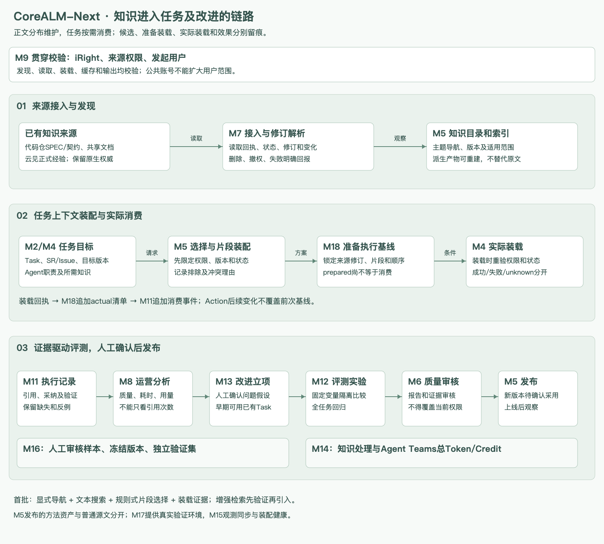

# CoreALM-Next 研发作业知识工程实施方案 v1.0

2026-11-11。纳入系统设计v1.17，作为平台建设、模块协作及试点验收的实施参考。本文定义拟建设能力，不表示接口已接通、任务已登记或效果已验证。

## 1. 建设目标和首批边界

让Agent Teams在具体Task和Action中，使用有来源、有版本、在授权范围内的必要知识，并记录实际装载和后续验证依据。平台保留现有知识承载方式，通过统一发现和上下文装配衔接执行，不要求把全部正文迁入新知识库。

首批覆盖一个真实服务的行为修改和一个旧版本Issue修复。服务名称`order-service`仅用于本文示例；真实产品、来源系统、代码仓、验证入口和确认人需由试点启动单指定。跨服务接口变更作为第二批，故障处置先提供只读诊断，自动经验推广后置。

| 批次 | 交付能力 | 完成条件 |
| --- | --- | --- |
| 高：首批底线 | 来源登记和授权读取；版本/状态过滤；任务知识绑定；基于显式规则装配；执行及Action基线；实际装载回执和缺失标记 | 能完成真实Task并追溯所用知识；不能靠事后查看当前文件推断历史 |
| 中：验证完善 | 增量索引、跨仓版本集合、样本治理、对照评测、常用分析 | 能说明版本选择、知识变化传播、结果质量和总Token/Credit变化 |
| 低：增强 | 向量混合检索、重排、图谱、摘要推荐、复杂老化诊断和自动改进候选 | 先证明基础方式存在瓶颈，再用同批任务验证改动效果 |

基础权限、来源状态和版本检查不能因智能检索后置而省略。首批允许显式导航、文本搜索和人工选择，不要求提前建设全库RAG。

## 2. 在系统设计中的位置

保持18个一级模块。M5增加知识目录、上下文选择和装配规则子能力，M4执行实际装载；M18维护基线，M11维护发生事实。开发责任组可复用现有分工，不另设“知识团队”作为前置条件。



| 模块 | 本专题负责内容 | 输入 | 输出和边界 |
| --- | --- | --- | --- |
| M1 作业空间 | 选择可用知识来源和订阅范围 | 来源登记、空间配置及用户选择 | 范围配置；订阅不授予权限 |
| M2 任务协同 | SR/Issue/Task与变更及知识引用关联，生成确认待办 | 来源Task、变更引用、人工意见 | 任务绑定；仓内tasks.md不另建正式任务状态 |
| M5 资产管理 | 知识目录、主题导航、派生索引、装配规则及候选选择方案；正式方法资产发布 | M7来源观察、任务范围、M9授权、已发布规则 | 选择方案和版本化规则；不接管源正文或实际执行基线 |
| M6 质量管理 | 知识缺陷判定、标准、发布审核和例外 | 来源审阅、测试及评测证据 | 质量结论；不能用审批抵消当前来源授权 |
| M7 研发系统接入 | 代码仓、文档平台及云见读取、修订解析、变更和撤回观察 | 有授权的用户身份、来源配置 | 原生内容/修订/状态及读取回执；不决定知识如何装配 |
| M9 访问控制 | iRight及来源权限，读取、装载、缓存、分享和输出校验 | 发起用户、对象、动作、当前授权 | 决定及认证引用；公共账号仍须保留用户 |
| M4 作业执行 | 按阶段/Agent职责请求上下文，实际装载，处理冲突断点 | Task、选择方案、基线及当前授权 | 装载回执、后续补充及执行结果；不能假称掌握CLI不可见上下文 |
| M18 执行基线 | 固定来源修订、片段、装配策略、实际装载及Action差异 | 选择方案、装载事实、代码和环境 | ContextManifest与派生基线；预期装载和实际装载分开 |
| M11 执行记录 | 检索、选择、装载、引用、人工修正和验证事件 | 生产者事件及证据引用 | 追加轨迹、完整性及双向追溯；不推测隐藏思维链 |
| M14 用量统计 | 汇总知识处理和Agent作业的计量 | 实际模型及执行用量、来源类别 | Token/Credit去重统计；不增加额度准入或金额功能 |
| M8 运营分析 | 知识覆盖、失败归因、质量/耗时/消耗比较 | 证据、标准及M14统计 | 比较及候选建议；不直接修改知识 |
| M16 / M12 / M13 | 授权样本、实验和改进推进 | 经确认案例、规则、基线及候选 | 冻结样本、实验报告、人工控制的改进；不自动训练或发布 |

M17继续提供可还原的构建验证环境和快照，M15看护来源同步、装配服务及索引健康。M10只负责模型调用和平台处理策略，不承接跨来源知识治理或整套Task上下文选择。

## 3. 知识承载和权威来源

| 内容 | 推荐承载 | 平台处理 |
| --- | --- | --- |
| 现行SPEC、接口契约、服务架构、ADR、Runbook、项目作业指令 | 代码仓或对应专业系统 | 保持稳定入口，执行时解析具体修订；正文修改沿用源评审 |
| 术语、跨服务业务流程和通用规则 | 已有共享文档平台或授权中心仓 | 登记主题和适用范围，不复制服务契约全文 |
| 正式经验及其修订/撤回 | 云见 | 保存引用及发布回执，不新建竞争事实源 |
| 提案、设计和进行中变更 | 所属代码仓/研发系统；跨仓总体提案可在共享平台 | 关联来源Task，按本次变更授权加载 |
| 历史变更和复盘原始材料 | 原来源历史或归档区域 | 默认不进入现行问答；历史定位按任务版本定向读取 |
| Skill、Workflow、场景SOP、装配策略 | M5正式资产及其来源 | 经试用/评测、独立审核后不可变发布 |
| 摘要、索引、向量和图关系 | M5维护的可重建派生产物 | 保留来源修订和生成方式，不能替代原始证据 |

同一事实的权威按对象、版本、范围和环境确定。共享平台能索引源文，但不能与源文同时独立维护同一正文。普通文档不必全部包装成AssetRelease；原生Git修订、文档版本和评审回执可作为来源依据。只有需要发布复用的方法或策略进入完整资产生命周期。

## 4. 生命周期和有效性

知识语义分为现行基线、进行中变更和历史档案；治理状态另记录可用、待复核、已替代或已撤回，均附来源及判断依据。它们不复用空间归档、资产发布或Task进展状态。

- 现行基线：针对指定发布线和版本读取，不默认取主分支最新文件。
- 进行中变更：只有本Task明确关联且允许采用时加载，草稿不能静默成为约束。
- 历史档案：供追溯或旧版本修复定向使用；是否可采用由目标版本和当前权限决定。
- 待复核：提示不确定性，按场景标准决定是否转人工；时间超期不自动判错。
- 已替代：对原范围已被新规则取代；旧版本任务可定向读取当时材料，需说明适用性。
- 已撤回/无权：禁止后续新读取或装载，处理关联缓存和索引；历史引用可保留，但不继续授予正文访问权。

“批准、合入、发布、部署”分别保存。SPEC表示约定行为，代码表示实现，目标环境表示实际运行，三者不一致时生成冲突记录，不由模型自动裁决。平台归档或基线保留不能覆盖当前权限撤回。

## 5. 最小数据合同

以下是建议领域字段和接口语义，不要求来源系统照此改表。未提供字段应说明缺失，不虚构。

| 对象 | 核心字段 | 唯一维护职责 |
| --- | --- | --- |
| SourceObservation | source_system、native_id、uri、revision、source_status、observed_at、sync_cursor、permission_ref、capabilities | M7保留来源观察及读取回执 |
| KnowledgeEntry | knowledge_id、source_ref、kind、product/service、topic、authority_scope、content_owner_ref、applicability、lifecycle_origin | M5管理目录及来源映射，不改写原生状态 |
| KnowledgeRevisionRef | knowledge_id、source_revision、resolved_commit/blob或文档修订、content_digest、availability、observed_at | M5登记可解析修订；源事实仍归来源 |
| TaskKnowledgeBinding | task_ref、SR/Issue_ref、change_ref、role（baseline/target/reference）、source_revision、confirmed_by | M2管理任务关联及确认 |
| ContextSelectionPlan | plan_id、task/attempt/action、agent_role、query、scope、policy_version、candidates、selected_refs、excluded_reasons、conflict_refs | M5维护候选和选择方案，尚不等于实际装载 |
| ContextManifest | manifest_id、baseline_id、plan_ref、ordered_items、actual_revision、section_selector、raw/transformed_digest、transform_version、load_status、parent_manifest | M18冻结条件及实际确认；敏感正文存受控引用 |
| ContextConsumptionEvent | event_id、producer、task/attempt/action、agent/session、manifest_ref、kind、source_ref、occurred_at、received_at、receipt_ref、completeness | M11存观察；kind区分retrieved/selected/loaded/cited/adopted/validated |
| KnowledgeFinding | finding_id、source_revision、type、evidence、applicable_scope、reviewer、conclusion、supersedes | M6维护缺陷审核及处置结论 |

标识使用来源原生稳定ID或平台分配ID；字段名仅供契约讨论。commit/摘要用于身份和一致性，不自动证明内容正确；摘要不替代必要原文留存。无权限保留原文时只留授权允许的引用和不可还原说明。

### 5.1 三份版本集合

- 仓库集合：本次工作树、依赖服务的已确认版本及对应契约。
- 知识集合：实际选中的SPEC、变更、ADR和经验修订，不使用可变“latest”作最终身份。
- 环境集合：实际构建镜像、工具链和验证环境。存储快照不等于进程检查点。

跨仓任务先明确兼容版本组合；仅锁定各仓HEAD不足以证明可联调。未确认组合记为待确认，不能自动切到最新版本消除冲突。

## 6. 从任务到上下文的执行流程

| 阶段 | 平台动作 | 检查和失败处理 | 责任 |
| --- | --- | --- | --- |
| 1 识别任务 | 解析来源Task、SR/Issue、目标仓/版本、场景、Agent职责、基线和本次目标 | 缺少必须的目标或来源身份则转人工补充 | M2/M4 |
| 2 定位来源 | 按空间范围、显式导航和知识目录查找 | 来源不可用显示时效；历史缓存须重新授权且明确版本 | M5/M7/M9 |
| 3 过滤候选 | 按用户权限、目标版本、知识语义和类型限定 | 未授权不返回候选正文或敏感元数据；空结果不填造知识 | M5/M9 |
| 4 选择片段 | 优先显式绑定及稳定来源，文本检索补充；记录选择和排除依据 | 冲突按风险提示或形成断点；默认不自动选“更新”材料覆盖目标版本 | M5/M4/M6 |
| 5 组装 | 保留目标、必要约束和片段来源；按步骤加入内容，记录压缩方式 | 不可丢失否定、例外、版本和安全前提；容量不足保留必选项并提示裁剪 | M5 |
| 6 准备基线 | 记录选定修订和拟装载集合，校验必要引用 | 标明prepared，不能提前视为已消费 | M18 |
| 7 实际装载 | 执行端按能力将内容交给目标Agent，报告实际修订及结果 | 装载时重验权限和状态；不一致则重选或断点，不能静默替换 | M4/M9 |
| 8 确认及留痕 | 追加实际manifest确认及loaded/failed事件 | 无回执记unknown，CLI隐式读取部分单独说明覆盖边界 | M18/M11 |
| 9 使用及验证 | 关联引用、人工采纳和测试/评审结果 | 结果成功不能自动补成知识采纳或知识正确 | M4/M6/M11 |
| 10 变化后接续 | 动态检索、人工补充和资源变化追加局部manifest | 仍关联原发起用户，新调用重验权限，不覆盖前次条件 | M4/M18/M11 |

首批“裁剪”可用规则式章节选择，不要求模型摘要。模型摘要或重排引入后须记录额外调用及实际Token/Credit，不能只计算最终Agent输入。

### 6.1 读取失败的统一语义

结果应区分available、not_found、forbidden、version_mismatch、withdrawn、conflict、source_unavailable和partial。对普通用户不暴露无权来源详情，审计仅供授权人员查阅。跨权限请求不能通过降低版本过滤重试成功。

### 6.2 能力分级

执行端登记是否支持显式上下文传入、工具读取回执、session恢复和Action前置hook。能显式装载的才确认具体内容；仅有日志观察的记录观察范围；无回执不能声称覆盖全部上下文。首批选择能形成可信装载证据的一种执行端，后续再扩展，不要求所有CLI统一内核。

## 7. Agent Teams的知识分工

| 角色 | 共同约束之外优先加载 | 不默认装载 |
| --- | --- | --- |
| 分析/设计 | 本次需求、现行SPEC、接口和有效ADR | 全量历史变更及全部代码 |
| 编码 | 批准目标、相关代码/测试、项目作业指令及工具链 | 无关领域文档 |
| 测试/验证 | 验收场景、契约、验证方法和目标环境 | 全部设计讨论及其他版本日志 |
| 协调Agent | 任务目标、分工、必要结论和来源索引 | 各成员全部上下文的重复拷贝 |

角色是一次任务的执行分工，不是新的授权主体。成员沿用发起用户范围，不能通过共享消息跨越源权限。交接提供结论、适用条件、证据引用和未决项；共享摘要仍需源版本，成员按需取得原文。

目录或ContextManifest是索引，不强制全部片段同时进入Prompt。后续Action继承共同条件，局部更新按需追加；不能为了减少Token删除必要约束。多Agent并行、协调汇总、失败重试和摘要的总消耗共同计入比较。

## 8. 研发变更和知识更新

1. M2关联来源SR/Issue、Task和变更材料；一项交付Task仍只归属一个SR。
2. 根据风险采用轻量Task契约或完整Proposal/Design/可选delta，不要求例行小修改走所有文档。
3. M4生成代码和知识修改建议，经已有PR或来源评审提交；写入依然使用用户身份。
4. 构建测试由已有CI/CD或M17池化环境完成，M6提供检查依据，用户确认Task结果。
5. 经确认的行为合入对应版本现行SPEC，按需更新接口、架构和Runbook，保留commit及评审证据。
6. M7观察来源变化，M5更新目录和派生产物；已开始的执行继续保留原条件，需改变时显式派生。
7. 历史变更材料归档不等于全环境部署，记录合入、发布和部署关系。

`tasks.md`是仓内实施清单或任务投影，引用正式来源Task；不能另维持跨系统正式完成状态。OpenSpec/Spec Kit仅为可选方法或工具适配，不作为本方案前置，不把示例目录当已建立能力。

### 8.1 源变化传播

源修订/删除/撤回事件或轮询观察 → M7记录观察及游标 → M5对受影响索引和摘要标记待更新或不可用 → M9限制后续不授权读取/装载 → M18/M11保留旧引用及可用性说明 → 需要时由M2产生复核待办。

索引更新先构建新修订再切换可见引用，旧事件不能覆盖新修订。同步中断时显示数据截至时间；高风险用途不能把过期副本当来源实时确认。撤权不得等到全库重建后才限制访问。

## 9. 接口和事件清单

下列是平台内部的建议契约，语言及存储由开发责任组决定，不要求外部系统实现同名API。

| 契约 | 提供方 | 关键请求 | 返回及验收 |
| --- | --- | --- | --- |
| ResolveKnowledgeSource | M7 | source_ref、revision_selector、actor、purpose | 精确修订及状态/读取回执；不支持的版本解析明确失败 |
| DiscoverKnowledge | M5 | task_scope、actor、target_versions、knowledge_role、query | 经权限和语义过滤的引用；支持显式路径直接定位 |
| PlanTaskContext | M5 | Task/Action、agent_role、policy_version、required_refs | 选择方案、排除理由和冲突；相同输入可解释，不承诺模型随机推荐完全一致 |
| PrepareContextBaseline | M18 | plan_ref、attempt/action、expected_revision | prepared基线及完整性；不等同装载成功 |
| LoadTaskContext | M4 | baseline_ref、ordered_refs、actor、capabilities | 实际装载回执、失败或unknown；当前权限重验 |
| ConfirmContextLoad | M18 | prepared_ref、load_receipt、actual_refs | 实际manifest及差异，追加不覆盖 |
| AppendKnowledgeObservation | M11 | event_id、source/agent/session、manifest及结果 | 去重接收、完整性和事件序列 |
| ReportKnowledgeFinding | M6 | source_revision、问题类型、证据及适用范围 | 人工审核结论及关联整改，不能直接改来源正文 |

事件包括KnowledgeRevisionObserved、KnowledgeAccessChanged、ContextPlanCreated、ContextLoadSucceeded/Failed、KnowledgeCited、KnowledgeAdoptionConfirmed、KnowledgeValidationObserved、KnowledgeFindingReviewed。记录来源时间和接收时间，重复/乱序不追加虚假消费次数，重试的真实多次调用要保留。

## 10. 权限、提示注入和保留

- 统一依托iRight群组及来源权限。索引维护和知识更新作业同样保留发起用户；公共账号不扩大用户授权，不以无主体后台任务绕过约束。
- 知识参考、经批准的作业指令和本次操作授权分别识别。文档中出现命令或“忽略限制”不能提升执行权限；写操作仍由M9和来源系统检查。
- 缓存和派生内容记录来源修订、状态及权限范围，读取时重验；不能仅凭相同问题跨用户共享。
- 压缩不删除否定、例外或权限条件。凭证明文不进入上下文清单、事件和样本；引用受控凭证不等于暴露凭证。
- 原文快照、处理后片段和消费事件按既有保留规则管理。源许可不允许留存时保留必要引用和不可还原说明；撤权后不为追溯重新授权。
- 失败、拒绝和无答案事件也保留最小记录；不能据此自动采集全量个人行为或将样本用于训练。

## 11. 使用分析和对照评测

| 评价维度 | 最小观测 | 判断边界 |
| --- | --- | --- |
| 来源与版本 | 目标版本匹配、错误历史/草稿混入、证据可解析性 | 新版本不自动优于正确旧版本 |
| 授权 | 越权候选/正文/缓存输出、撤权后装载 | 越权输出及绕过撤权属于阻断项，不能用平均分掩盖 |
| 知识消费 | 检索、选择、实际装载、引用、采纳及验证 | 任一阶段不能自动代替下一阶段 |
| 任务质量 | 测试、人工确认、返工及完整作业回归 | 不只评估问答文本或Action局部指标 |
| 处理效率 | 查找、装配、端到端耗时和人工补充 | Token减少不必然意味着交付更快 |
| 用量 | 全团队及知识处理的实际Token/Credit、重试和缓存类别 | 三侧去重，不增加金额或预算准入 |

M16建立经审核的常规、边界、旧版本、权限、来源冲突和无答案样本，调优和独立验证分开。权限负例使用专设测试主体和可控样例，不暴露真实无权资料。

比较采用分步实验：A为已有工作方式，B仅增加版本/状态约束，C在B上增加任务片段装配，D在C上试验一种摘要或检索改动。每次比较固定任务、代码、模型和参数、工具、环境及标准，记录不可固定条件；模型随机性按方案重复运行。各阶段记录完整执行消耗和失败，不把A与D的多项改动差异宣称为单变量因果。

非安全类质量、耗时及用量门槛由M6和试点确认人基于初始基线在实验前确定并版本化；尚无数据时只能报告观测，不预设节省百分比。未经实验确认的知识建议不能自动发布。

## 12. 示例：下单幂等改动

以下标识为结构示意，不是已存在的来源Task或接口。

- 来源事项：一个已存在的SR及归属该SR的开发Task；问题修复则关联Issue。
- 基线：目标代码修订和现行下单SPEC、接口契约；目标：本Task已批准的幂等变更。
- 必须澄清：有效期、相同参数重复请求、不同参数冲突，以及首次请求未完成时的行为。
- 分析Agent读取规则与契约，编码Agent按需读取相关代码/测试，验证Agent读取验收场景和环境要求。
- 提案与现行SPEC混淆、目标版本缺失或关键行为未定时形成断点，由用户补充确认。
- 用已有CI/CD或选定镜像执行验证：并发不重复下单、用户隔离、参数冲突不改已有订单；具体测试入口必须来自真实项目。
- 用户确认结果后更新来源Task；经源评审合入知识修改，保留PR/commit和验证证据，索引更新。

```yaml
# ContextManifest字段示意；占位值须在真实执行时解析。
manifest_id: "<平台分配>"
task_ref: "<来源系统和原生Task ID>"
actor_ref: "<发起用户>"
agent_role: coding
parent_manifest_ref: "<整次执行基线>"
policy_version: "<已发布装配规则>"
items:
  - source_ref: "<代码仓>/docs/specs/order-create.md"
    knowledge_role: baseline
    resolved_revision: "<确切commit及文件对象>"
    section_selector: "<所选规则及必要相邻条件>"
    transform_version: none
    content_digest: "<实际内容摘要>"
    load_status: "<prepared/loaded/failed/unknown>"
  - source_ref: "<本Task批准的变更材料>"
    knowledge_role: target
    resolved_revision: "<已确认修订>"
    approval_receipt_ref: "<来源评审回执>"
completeness: "<实际采集边界>"
```

每份清单保留实际顺序和来源，不把示例中的占位值作为数据写入。loaded须有装载依据；无证据则unknown，不能因Agent返回成功自动置为loaded。

## 13. 建设任务和依赖

所有编号为建设清单编号，须在已有作业系统登记并取得原生Task身份。以下牵头模块用于开发分工，具体人员沿用模块责任表，未确认的人选不擅自补全。

| 编号 | 优先级 | 牵头/协作 | 具体交付物 | 前置 | 验收 |
| --- | --- | --- | --- | --- | --- |
| KE-01 | 高 | M5；M2/M6/M7 | 来源及知识类型词表、状态/版本映射、试点来源登记模板 | 试点入口和确认人 | 同一来源不产生两个正文权威，基线/目标/历史可识别 |
| KE-02 | 高 | M7；M9/M5 | 一个代码仓和实际需要的文档/云见读取适配，精确修订和来源回执 | KE-01及授权方式 | 可按用户读取目标修订；失败和不支持可解释 |
| KE-03 | 高 | M9；M7/M5/M4 | 发现/读取/装载/缓存权限校验及撤权传播 | KE-01，和KE-02并行 | 权限负例不返回正文，公共账号可追溯到发起人 |
| KE-04 | 高 | M2；M5/M7 | Task与知识/变更绑定、冲突及补充待办 | 来源Task身份 | tasks.md不成为第二套正式状态；人工确认留痕 |
| KE-05 | 高 | M5；M4/M9 | 显式导航、文本检索和规则式片段选择，ContextSelectionPlan | KE-01/02/03/04契约 | 范围/状态/版本过滤；无来源不伪造答案 |
| KE-06 | 高 | M18；M5/M4 | prepared/actual清单、整次和Action差异、未知条件 | KE-05字段合同，可先用契约样例 | 来源变化后旧基线不被覆盖；实际装载可核对 |
| KE-07 | 高 | M4；M18/M11/M9 | 一种执行端装载适配、Agent分工及冲突断点 | KE-05/06、KE-03 | 成功/失败/无回执分开；后续Action重验权限 |
| KE-08 | 高 | M11；M4/M18/M14 | 消费事件及双向追溯、知识处理用量标签 | 和KE-06/07同步 | 检索不算采纳，未知不补零，重试不丢记录 |
| KE-09 | 高 | M6；M4/M5/M2 | 首批知识/作业质量标准、发布检查及人工确认 | 试点验收场景 | 冲突、越权和草稿混用演练；真实构建测试可追溯 |
| KE-10 | 中 | M7/M5；M9/M15 | 变更游标、增量索引、删除/撤回/缓存传播及健康信号 | KE-02/03/05 | 源变化按修订收敛，撤权不等待全量索引完成 |
| KE-11 | 中 | M16/M12；M6/M18/M4 | 授权数据集、A/B/C分步对照方案及报告 | KE-06/07/08/09及真实案例 | 固定变量并报告局限；任务回归和全团队用量齐全 |
| KE-12 | 中 | M8；M14/M11/M12 | 覆盖及失败归因看板、版本化比较口径 | KE-08及报告合同，和KE-11并行 | 可下钻证据，不因引用次数宣称收益 |
| KE-13 | 低 | M13；M8/M5/M6 | 候选、立项、发布采用和观察闭环 | 有真实改进及观察数据 | 人工确认后推进，观察达标才关闭；不自动训练 |
| KE-14 | 低 | M5；M12/M16/M8 | 一种增强检索或压缩策略及对照结果 | 基础瓶颈有证据、KE-11 | 保留必要约束；质量底线不退化且报告额外消耗 |

KE-01先固定接口语义，接入、授权、任务绑定、基线和事件可按契约并行开发；KE-06与KE-08不能在执行上线后再追补历史。任务先采用mock合同联调时明确标记，最终验收必须换真实来源及执行端。

## 14. 验收用例

| 编号 | 场景 | 预期结果 | 必留证据 |
| --- | --- | --- | --- |
| KA-01 | 现行、草稿、历史同时存在 | 当前行为任务只用目标版本有效知识；本次批准目标单独标识 | 选择/排除理由、版本和manifest |
| KA-02 | 修复旧版本问题 | 定向读取匹配旧版本材料，不能自动替换为最新 | 目标版本、源修订及验证结果 |
| KA-03 | 用户无权或中途撤权 | 不暴露受限内容，阻止后续新读取/装载，缓存不绕过 | 授权结果、失效传播、失败/断点事件 |
| KA-04 | 选择后来源更新 | 装载匹配已锁定修订或明确失败；新条件派生 | prepared与actual对比 |
| KA-05 | 规格和契约冲突 | 给出可授权查看的差异，关键冲突转人工，不静默选择 | finding、待办及确认 |
| KA-06 | 执行端无装载回执 | unknown/partial，不宣称完整掌握上下文 | 能力声明、完整性原因 |
| KA-07 | 事件重复、乱序、重试 | 去重保持真实多次调用；旧观察不覆盖新修订 | 事件ID及来源/接收时间 |
| KA-08 | 压缩遗漏否定或例外 | 质量检查不通过，保留完整约束后重试 | 原片段、转换版本、检查结果 |
| KA-09 | 恶意知识要求越权执行 | 参考内容不能改变权限或任务授权，不执行未授权操作 | 来源分类、操作拒绝及审计 |
| KA-10 | 多Agent共享和交接 | 各自最小装载，交接有来源，不扩大用户权限 | agent/session、引用及团队总用量 |
| KA-11 | 改动实现并更新知识 | 来源Task、PR、代码、规格、构建和用户确认可相互追溯 | 原生回执、commit及测试证据 |
| KA-12 | 反馈建议进入共享规则 | 人工确认、回归及独立审核后发布；单次成功不自动推广 | 样本/实验/审核/版本及观察 |

KA-01至KA-09及KA-11为首批需按启用能力演练的底线，KA-10在启用Teams多成员消费时必验，KA-12在进入第二批评测和正式推广前验收。每个用例应同时提供正例和必要失败例，未启用能力标记未交付，不能记通过。

## 15. 试点启动单和退出条件

启动前明确真实SR/Issue和来源Task、服务及代码仓、目标版本、现行SPEC/契约、知识确认人、iRight主体、验证入口、执行端能力、数据留存范围和质量标准。首次记录查找、人工补充、质量、耗时及Token/Credit基线，再运行同类任务比较。

退出本批次需满足：底线用例在实际接入上通过；关键冲突和权限问题无未处理项；装载覆盖及未知项可解释；知识改动可追溯到验证及来源评审。效果样本不足时标记“功能闭环已验收、收益待观察”，不阻止合理试点也不宣称已节省固定比例。

OpenSpec、Spec Kit、图谱和全库统一检索的选型不作为首批退出前置。跨仓试点另确认兼容版本集合，不以单服务成功替代跨服务可行性。

## 16. 设计体系中的文档关系

- [系统设计正文v1.17](../02%20ai-native工作台/CoreALM-Next系统设计方案.md)：产品范围、对象、运行机制、协作及整体验收。
- [模块边界v1.17](../02%20ai-native工作台/CoreALM-Next功能模块划分.md)：18个模块的数据所有权和知识工程子职责。
- [知识工程建设任务清单](../02%20ai-native工作台/CoreALM-Next知识工程建设任务清单.md)：KE任务、依赖、交付物和验收。
- 《研发作业知识管理参考方案》：保留知识类型、目录和维护原则作为内容规范背景，原参考正文不覆盖平台授权及执行契约。

本方案不改变M14只统计Token/Credit、不做SR独立验收、M3仅提示、网关策略仅平台管理、运行扩容需审批等已确认边界。工具实践以正式采用的版本联调为准，不把文档示例当已运行代码。
